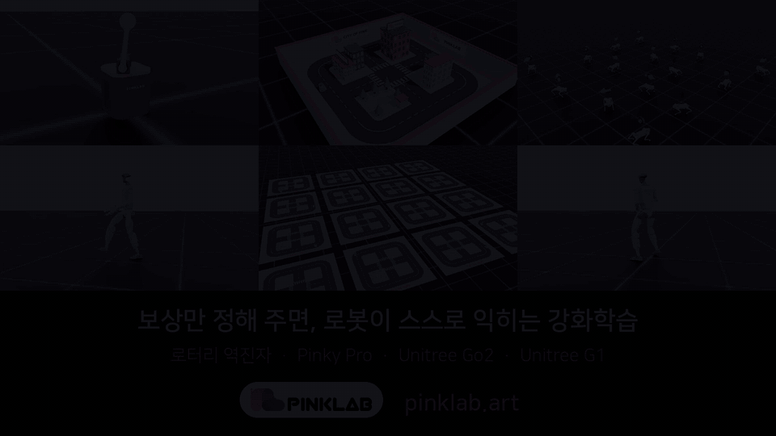
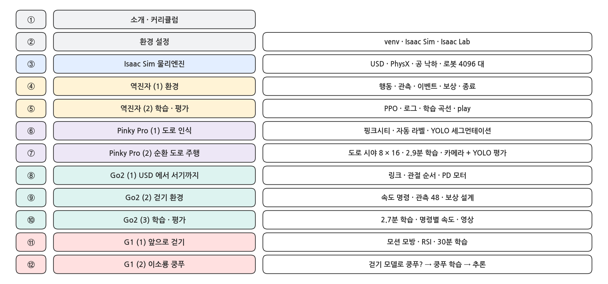
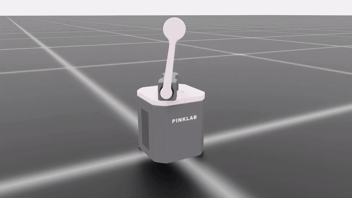
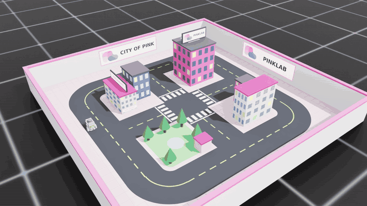
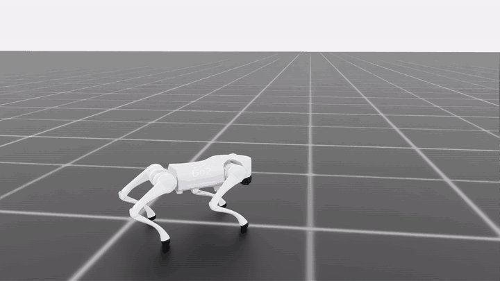
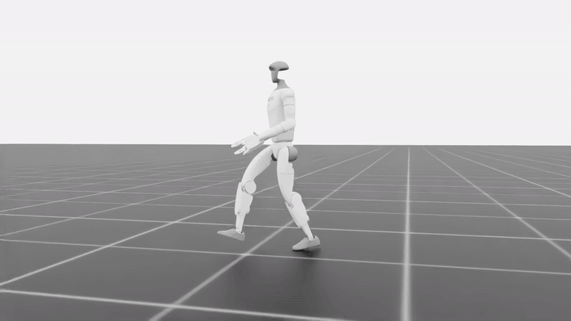
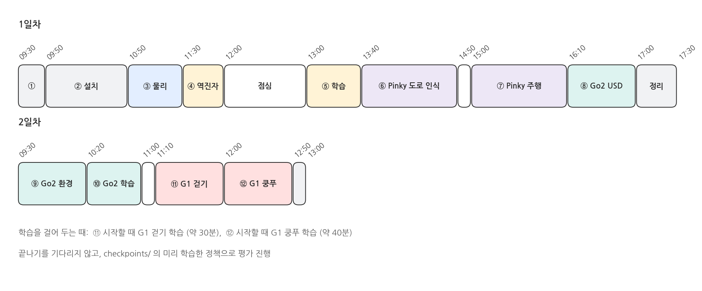

{width=1000}

- NVIDIA Isaac Sim · Isaac Lab 으로 2일 동안 해 보는 강화학습 과정임 · 설치부터 휴머노이드의 쿵푸까지 12 페이지
- 핑크랩(PinkLAB)의 로터리 역진자 키트 · 교육용 로봇 Pinky Pro 와 작은 도시 핑크시티 · Unitree Go2 · Unitree G1 으로 진행함
- 코드와 미리 학습한 정책을 GitHub 에 공개했음: [github.com/PinkWink/rl_shortcut](https://github.com/PinkWink/rl_shortcut)

## 1. 이 과정은

:::cards(3)
::card 12 페이지 · 2일
- 설치와 물리엔진에서 시작함
- 역진자 → 주행 로봇 → 4족 → 휴머노이드
- 1일차 + 2일차
::card 같은 틀을 네 가지 로봇에
- 환경의 다섯 부분 = 행동 · 관측 · 이벤트 · 보상 · 종료
- 학습은 모두 PPO · `train.py` 하나
- 로봇이 바뀌어도 틀은 그대로임
::card 따라 할 수 있게
- 페이지마다 터미널 명령과 실제 실행 결과가 있음
- 학습 시간은 20초 ~ 40분 (RTX 5060 Ti 실측)
- 기다리지 않도록 학습된 정책을 함께 줌
:::

### 과정의 방식

- 보상만 정해 주면 로봇이 시행착오로 스스로 동작을 익힘 · 로봇 수천 대가 GPU 에서 동시에 연습함
- 환경 코드를 발췌해 한 부분씩 읽고, 값 하나를 바꿔 다시 학습해 봄
- 결과는 숫자로 잼 · 넘어진 횟수 · 속도 오차 · 관절 오차를 적음

### 기준 환경

| 항목 | 내용 |
|---|---|
| 운영체제 | Ubuntu 24.04 |
| 시뮬레이터 | NVIDIA Isaac Sim · Isaac Lab |
| 학습 | RSL-RL (PPO) · PyTorch |
| 도로 인식 | Ultralytics YOLO 세그먼테이션 |
| GPU | RTX 계열, VRAM 8 GB 이상 권장 (검증: RTX 5060 Ti 16 GB) |

## 2. 주제별로 보기

### 1. 환경 설정과 물리엔진 (1 ~ 3)

{width=1000}

- 모든 것을 `~/rl_shortcut` 폴더 하나에 설치함 · 다른 버전의 Isaac Sim 이 있어도 영향 없음
- 로봇 파일(USD)과 물리엔진(PhysX)을 실험으로 익힘
- 같은 로봇 4096 대를 GPU 에서 동시에 돌려 봄

| 페이지 | 내용 |
|---|---|
| [1. 소개와 커리큘럼](https://pinkwink.atlassian.net/wiki/spaces/EDU/pages/3729620994) | 과정의 흐름 · 2일 일정 · 검증한 환경 |
| [2. 환경 설정](https://pinkwink.atlassian.net/wiki/spaces/EDU/pages/3727884331) | 폴더 하나에 venv · Isaac Sim · Isaac Lab 설치 |
| [3. Isaac Sim 물리엔진](https://pinkwink.atlassian.net/wiki/spaces/EDU/pages/3729358868) | USD · PhysX · 공 낙하 실험 · 로봇 4096 대 병렬 |

### 2. 역진자: 첫 강화학습 (4 · 5)

{width=1000}

- 핑크랩의 로터리 역진자 키트로 강화학습 환경의 다섯 부분을 만듦
- PPO 로 약 20초 학습하면 진자를 세움
- 보상 · 행동 · 관측을 하나씩 바꿔 무엇이 달라지는지 봄

| 페이지 | 내용 |
|---|---|
| [4. 역진자 (1): 환경 만들기](https://pinkwink.atlassian.net/wiki/spaces/EDU/pages/3727884354) | PinkLAB 키트 · 행동 · 관측 · 이벤트 · 보상 · 종료 |
| [5. 역진자 (2): PPO 학습과 평가](https://pinkwink.atlassian.net/wiki/spaces/EDU/pages/3728932868) | 약 20초 학습 · 로그 읽기 · 보상과 관측을 바꾸는 실험 |

### 3. Pinky Pro: 카메라로 도로를 보고 달리기 (6 · 7)

{width=1000}

- 핑크시티에서 카메라 영상과 정답을 자동으로 모아 YOLO 세그먼테이션을 학습함
- 정책은 YOLO 가 찾은 도로의 모양(도로 시야 8 × 16)만 보고 바퀴 속도를 정함
- 카메라 없이 2.9분 학습한 정책이 카메라 + YOLO 로도 순환 도로를 돎

| 페이지 | 내용 |
|---|---|
| [6. Pinky Pro (1): 핑크시티와 YOLO 도로 인식](https://pinkwink.atlassian.net/wiki/spaces/EDU/pages/3800072297) | 영상과 정답 자동 수집 · YOLO 세그먼테이션 · 도로 시야 8 × 16 |
| [7. Pinky Pro (2): 순환 도로 돌기](https://pinkwink.atlassian.net/wiki/spaces/EDU/pages/3799941285) | 카메라 없이 2.9분 학습 · 카메라 + YOLO 로 평가 |

### 4. Unitree Go2: 4족 보행 (8 ~ 10)

{width=1000}

- 로봇 USD 를 열어 보는 데서 시작해 PD 모터로 세움
- 속도 명령을 따라 걷는 환경과 보상을 설계함
- 4096 대로 2.7분 학습 · 명령한 속도와 실제 속도를 견줌

| 페이지 | 내용 |
|---|---|
| [8. Unitree Go2 (1): USD 에서 서 있는 로봇까지](https://pinkwink.atlassian.net/wiki/spaces/EDU/pages/3729686529) | 링크 · 관절 순서 · PD 모터 |
| [9. Unitree Go2 (2): 걷기 환경](https://pinkwink.atlassian.net/wiki/spaces/EDU/pages/3727917081) | 속도 명령 · 관측 48개 · 보상 설계 |
| [10. Unitree Go2 (3): 학습과 평가](https://pinkwink.atlassian.net/wiki/spaces/EDU/pages/3729555473) | 2.7분 학습 · 명령별 실제 속도 · 영상 저장 |

### 5. Unitree G1: 모션 모방 (11 · 12)

{width=1000}

- 사람의 동작(모션 캡처)을 본보기로 주고, 그 동작을 해내는 모터 명령은 강화학습으로 찾음
- 앞으로 걷기를 학습한 정책에게 쿵푸 동작을 보여 주면 어떻게 되는지 봄
- 이소룡의 쿵푸 동작을 학습하고 추론함

| 페이지 | 내용 |
|---|---|
| [11. Unitree G1 (1): 모션 모방으로 앞으로 걷기](https://pinkwink.atlassian.net/wiki/spaces/EDU/pages/3728375881) | 레퍼런스 동작 · RSI · 약 30분 학습 |
| [12. Unitree G1 (2): 이소룡 쿵푸](https://pinkwink.atlassian.net/wiki/spaces/EDU/pages/3728736307) | 걷기 정책에게 쿵푸를? · 쿵푸 학습과 추론 |

## 3. 일정

{width=1000}

- 오래 걸리는 학습(G1 걷기 약 30분 · 쿵푸 약 40분)은 수업 중에 걸어 둠
- 끝나기를 기다리지 않고 저장소의 `checkpoints/` 로 바로 평가함

## 4. 시작하려면

- RTX 그래픽 카드가 달린 Ubuntu 24.04 PC 가 필요함 · 설치는 2 페이지에서 함 (내려받기 약 9 GB · 디스크 약 30 GB)
- Python 과 리눅스 터미널을 조금 다뤄 봤다면 따라올 수 있음
- 코드 받기: [github.com/PinkWink/rl_shortcut](https://github.com/PinkWink/rl_shortcut)
