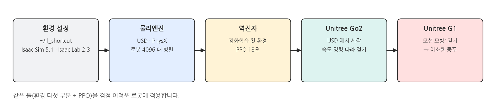
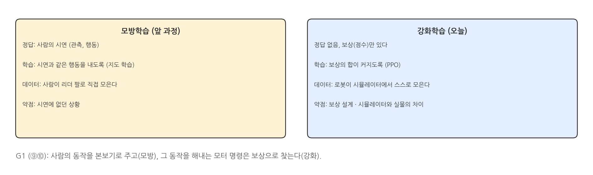
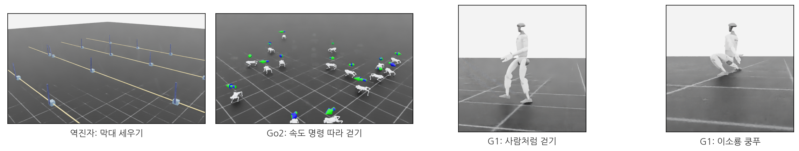
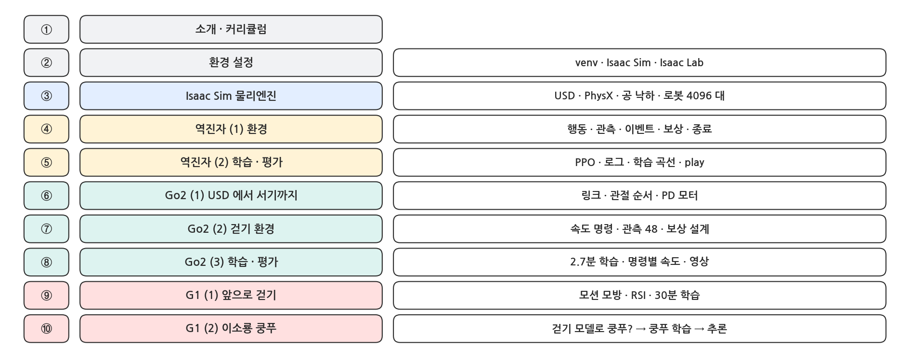
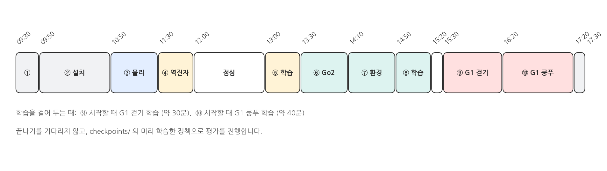

## 1. 이 과정은 무엇인가

### 한 줄 소개

{width=1000}

- NVIDIA **Isaac Sim** 과 **Isaac Lab** 으로, 보상만 정해 주면 로봇이 시행착오로 스스로 동작을 익히는 **강화학습(Reinforcement Learning)** 을 하루 동안 처음부터 끝까지 해 봅니다.
- 역진자 → 4족 보행 로봇 Unitree **Go2** → 휴머노이드 Unitree **G1** 순서로, 같은 틀(환경 = 행동 · 관측 · 이벤트 · 보상 · 종료, 학습 = PPO)을 점점 어려운 로봇에 적용합니다.

### 앞 과정과의 관계

{width=1000}

- 앞 과정(모방학습 - MuJoCo 와 실물 Lead Device)에서는 사람이 리더 팔로 시연을 보여 주고, 정책이 그 시연을 따라 했습니다.
- 오늘은 시연이 없습니다. 무엇이 좋은지(보상)만 적어 주면, 시뮬레이터 안의 로봇 수천 대가 동시에 연습하며 방법을 찾습니다.
- 마지막 G1 에서는 두 방법이 만납니다. 사람의 동작(모션 캡처)을 본보기로 주되, 그 동작을 해내는 모터 명령은 강화학습으로 찾습니다.

### 결과 미리 보기

{width=1000}

## 2. 커리큘럼

### 페이지 구성

{width=1000}

### 하루 일정 (예시)

{width=1000}

- 학습 시간은 이 과정을 만든 PC(RTX 5060 Ti 16 GB)의 실측입니다. 역진자 18초, Go2 2.7분, G1 걷기 약 30분, G1 쿵푸 약 40분.
- G1 의 두 학습은 수업 중에 시작해 두고 설명을 듣습니다. 끝나기를 기다리지 않도록 저장소에 **미리 학습한 정책**(`checkpoints/`)을 넣어 두었습니다.

## 3. 준비물과 버전

### 검증한 환경

| 항목 | 버전 |
|---|---|
| OS | Ubuntu 24.04.4 LTS |
| GPU · 드라이버 | NVIDIA RTX 5060 Ti 16 GB · 580.126 |
| Python | 3.11.15 (venv) |
| PyTorch | 2.7.0 + CUDA 12.8 |
| Isaac Sim | 5.1.0 (pip) |
| Isaac Lab | 2.3.2 (git tag v2.3.2) |
| RSL-RL | 3.1.2 |

- 모든 것을 `~/rl_shortcut` 폴더 하나에 설치합니다 (② 페이지). 다른 버전의 Isaac Sim 을 이미 쓰고 있어도 영향을 주지 않습니다.

### 저장소

- 코드 · 레퍼런스 동작 · 미리 학습한 정책: `https://github.com/PinkWink/rl_shortcut`
- 강의 원고와 그림을 만드는 스크립트도 같은 저장소의 `docs/lecture/` 에 있습니다.
