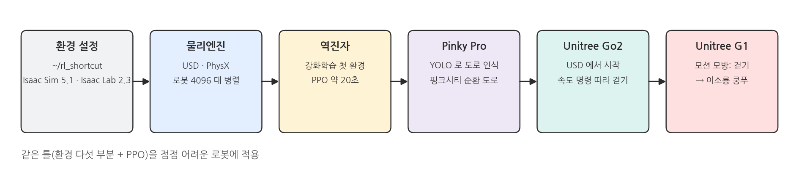
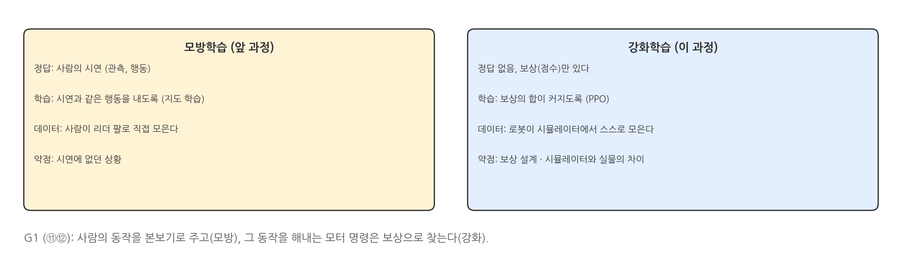
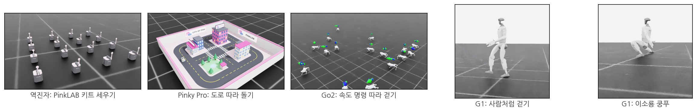
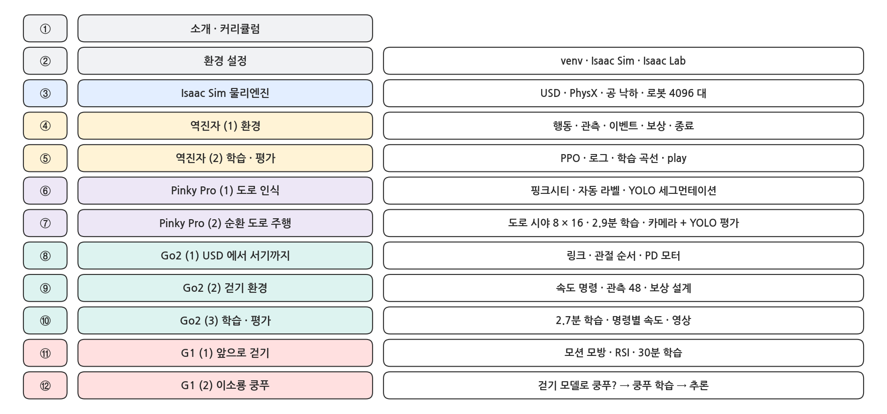
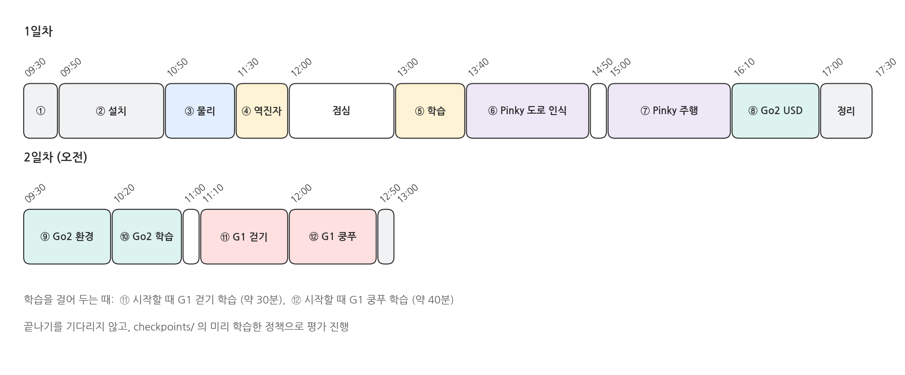
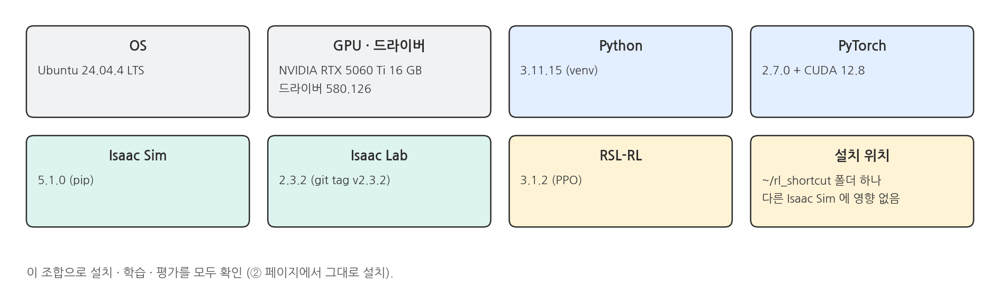

## 1. 이 과정은 무엇인가

### 한 줄 소개

{width=1000}

- NVIDIA **Isaac Sim** · **Isaac Lab** 으로 1.5일 동안 해 보는 **강화학습(Reinforcement Learning)**
- 보상만 정해 주면 로봇이 시행착오로 스스로 동작을 익힘
- 역진자(PinkLAB 키트) → 주행 로봇 **Pinky Pro** → 4족 Unitree **Go2** → 휴머노이드 Unitree **G1** · 같은 틀(환경 다섯 부분 + PPO)을 점점 어려운 로봇에 적용

### 앞 과정과의 관계

{width=1000}

- 앞 과정(모방학습 - MuJoCo 와 실물 Lead Device): 사람이 리더 팔로 시연 → 정책이 시연을 따라 함
- 이 과정: 시연 없음 · 무엇이 좋은지(보상)만 적음 → 로봇 수천 대가 동시에 연습하며 방법을 찾음
- 마지막 G1: 두 방법의 만남 · 사람의 동작(모션 캡처)이 본보기 · 그 동작을 해내는 모터 명령은 강화학습으로 찾음

### 결과 미리 보기

{width=1000}

## 2. 커리큘럼

### 페이지 구성

{width=1000}

### 1.5일 일정 (예시)

{width=1000}

- 학습 시간 실측 (RTX 5060 Ti 16 GB): 역진자 약 20초 · Pinky Pro 2.9분(+ YOLO 약 70초) · Go2 2.7분 · G1 걷기 약 30분 · G1 쿵푸 약 40분
- G1 의 두 학습: 수업 중에 시작해 두고 설명 진행
- 기다리지 않도록 저장소에 **미리 학습한 정책**(`checkpoints/`) 포함

## 3. 준비물과 버전

### 검증한 환경

{width=1000}

- 모든 것을 `~/rl_shortcut` 폴더 하나에 설치 (② 페이지)
- 다른 버전의 Isaac Sim 을 이미 쓰고 있어도 영향 없음

### 저장소

- 코드 · 레퍼런스 동작 · 미리 학습한 정책: `https://github.com/PinkWink/rl_shortcut`
- 강의 원고 · 그림 스크립트: 같은 저장소의 `docs/lecture/`
