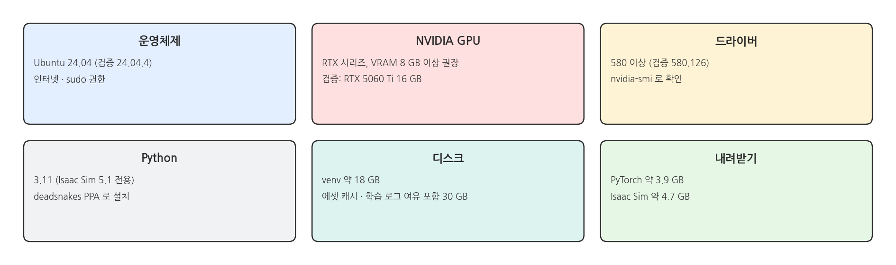
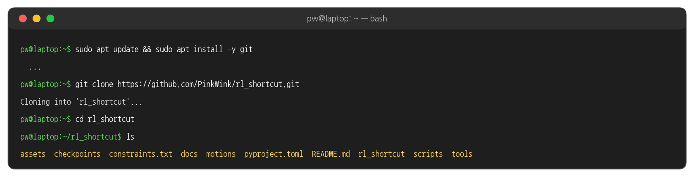
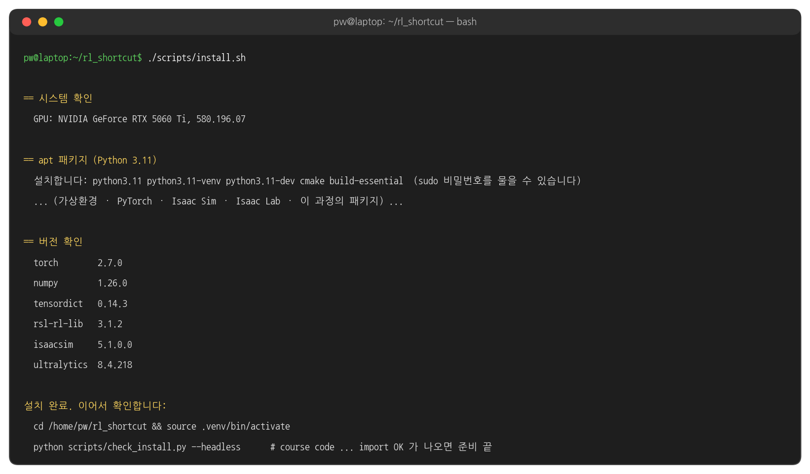
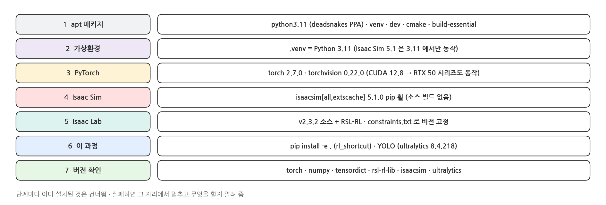
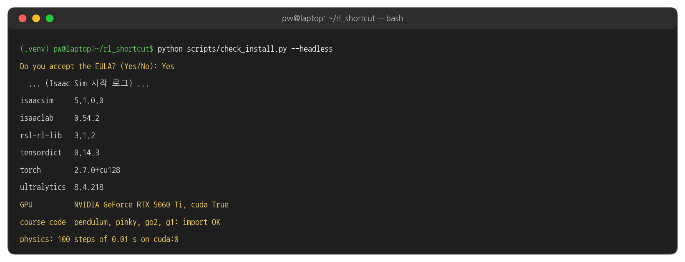
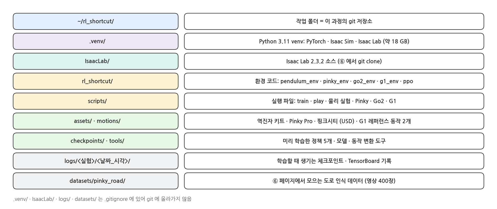
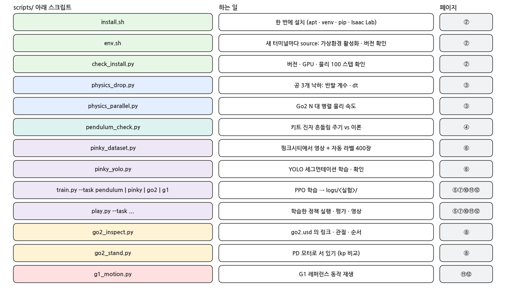
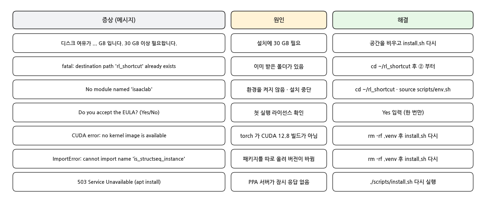

## 0. 시작 전에

### 필요한 것

{width=1000}

### 설치 흐름

{width=1000}

- 세 단계를 순서대로 한 번만 수행 · 약 20분 (인터넷 속도에 따라 달라짐)
- 모든 것을 `~/rl_shortcut` 폴더 하나에 설치 → 이 폴더를 지우면 설치한 것이 모두 사라짐
- 설치를 시작해 두고 다음 설명을 들어도 됨

## 1. 설치

### 터미널: ① 저장소 받기

```bash
cd ~
sudo apt update
sudo apt install -y git
git clone https://github.com/PinkWink/rl_shortcut.git
cd rl_shortcut
ls
```

- 새로 설치한 Ubuntu 에는 `git` 없음 → 먼저 설치
- `~/rl_shortcut` 폴더 생성 = 이 과정의 작업 폴더

### 실행 결과: 저장소 받기

{width=1000}

### 터미널: ② 설치 스크립트

```bash
cd ~/rl_shortcut
./scripts/install.sh
```

- 수행 순서: apt 패키지 → 가상환경 → PyTorch → Isaac Sim → Isaac Lab → 이 과정의 패키지 → 버전 확인
- 시작할 때 sudo 비밀번호 질문 (apt 패키지 설치)
- 마지막에 "설치 완료" 출력 시 성공

### 실행 결과: 설치 스크립트

{width=1000}

### 설치 스크립트: 주의할 점

- 여러 번 실행해도 안전 → 네트워크 끊김 등으로 멈추면 같은 명령을 다시 실행 (설치된 것은 건너뜀 · 두 번째부터 약 20초)
- conda 가 켜진 터미널도 가능 (가상환경은 항상 `python3.11` 로 생성)
- 설치 후 `pip install --upgrade ...` 로 패키지를 올리지 말 것 → 검증한 버전이 바뀌어 실습 코드에서 `ImportError` 발생

### install.sh 가 하는 일

{width=1000}

- Isaac Sim 5.1 은 **Python 3.11** 에서만 동작 · Ubuntu 24.04 의 기본은 3.12 → 3.11 을 따로 설치 (시스템 파이썬은 그대로)
- `constraints.txt` = 이 과정에서 검증한 패키지 버전 211개 → 언제 설치해도 같은 버전
- 내려받는 양: PyTorch 약 3.9 GB · Isaac Sim 약 4.7 GB · 설치 후 `.venv` 약 18 GB

### 터미널: ③ 설치 확인

```bash
cd ~/rl_shortcut
source .venv/bin/activate
python scripts/check_install.py --headless
```

- 처음 실행할 때 NVIDIA Omniverse 라이선스(EULA) 동의 질문 → `Yes` 입력 · 한 번 동의하면 다시 묻지 않음
- `--headless` = 창 없이 실행 · 학습도 이 옵션으로 빠르게 실행
- `course code ... import OK` = 네 로봇의 실습 코드를 불러오는 데 성공 → 준비 끝

### 실행 결과: 설치 확인

{width=1000}

### 터미널: 새 터미널을 열 때마다

```bash
cd ~/rl_shortcut
source .venv/bin/activate
```

- `source .venv/bin/activate` 후: 프롬프트 앞에 `(.venv)` 표시 · `python` · `pip` 이 이 가상환경의 것
- 이 강의의 명령은 모두 이 상태에서 실행

## 2. 폴더 구조

### ~/rl_shortcut

{width=1000}

### 스크립트와 페이지

{width=1000}

## 3. 문제 해결

### 자주 나는 오류

{width=1000}
