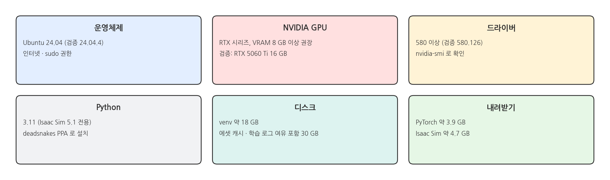
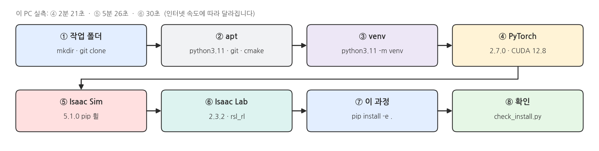
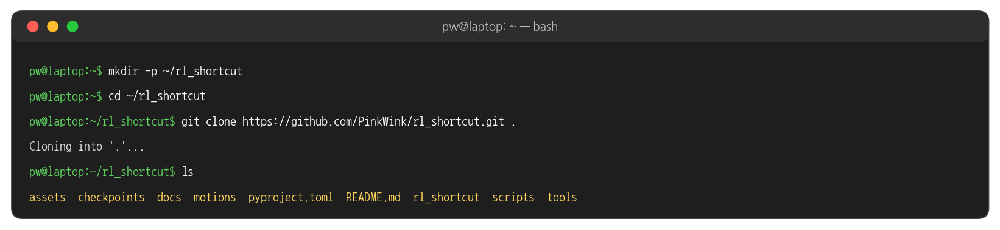
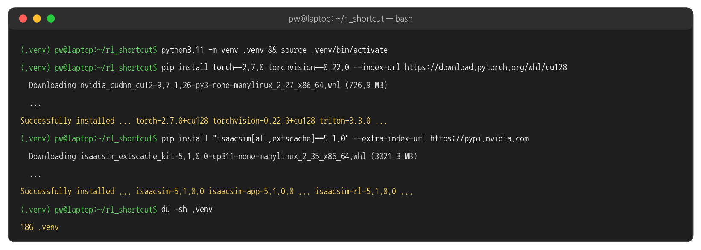
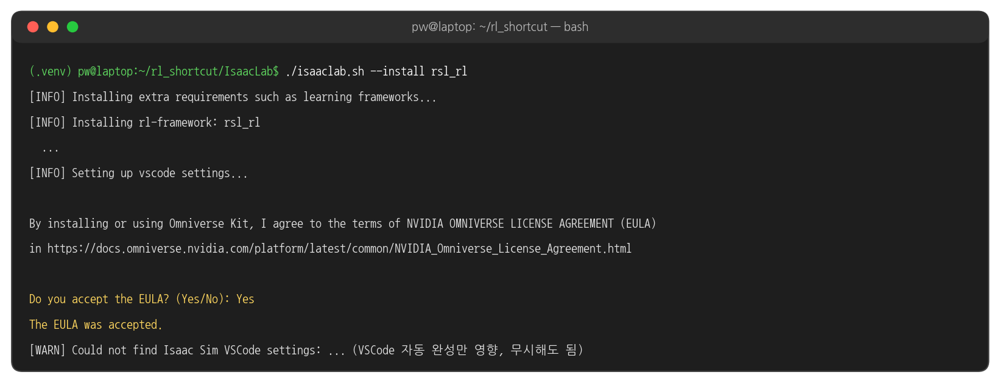
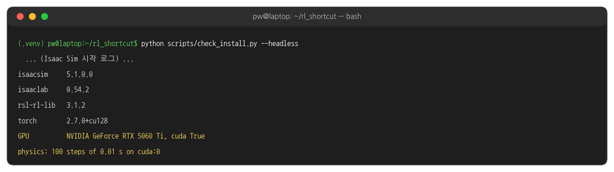
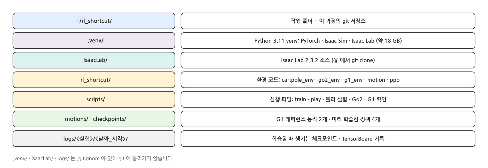
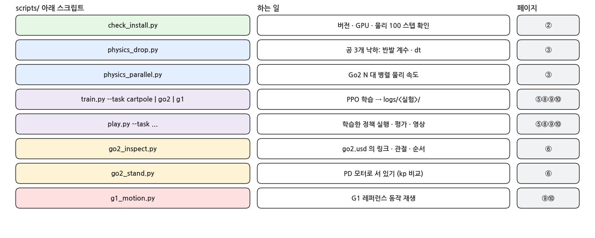
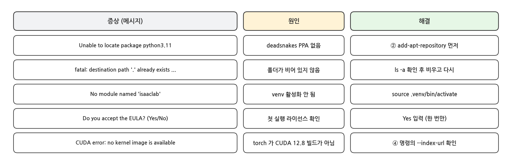

## 0. 시작 전에

### 필요한 것

{width=1000}

### 설치 흐름

{width=1000}

- 모든 것을 `~/rl_shortcut` 폴더 하나에 설치합니다. 이 폴더를 지우면 이 과정에서 설치한 것이 모두 사라집니다.
- 내려받는 양이 많습니다 (PyTorch 약 3.9 GB, Isaac Sim 약 4.7 GB, 설치 후 venv 약 18 GB). 설치를 시작해 두고 다음 설명을 들어도 됩니다.

## 1. 설치

### ① 작업 폴더 만들기

```bash
mkdir -p ~/rl_shortcut
cd ~/rl_shortcut
git clone https://github.com/PinkWink/rl_shortcut.git .
ls
```

- 마지막 `.` 은 "지금 폴더에 받기"라는 뜻입니다. `~/rl_shortcut/rl_shortcut` 처럼 한 단계 더 생기지 않습니다.
- `git clone ... .` 은 빈 폴더에서만 됩니다. 이미 파일이 있다면 `ls -a` 로 확인하고 비운 뒤 다시 합니다.

### 실행 결과: 작업 폴더

{width=1000}

### ② apt 패키지 (Python 3.11)

```bash
sudo add-apt-repository -y ppa:deadsnakes/ppa
sudo apt update
sudo apt install -y python3.11 python3.11-venv python3.11-dev git cmake build-essential
python3.11 --version
```

- Isaac Sim 5.1 은 **Python 3.11** 에서만 동작합니다. Ubuntu 24.04 의 기본 파이썬은 3.12 라서 3.11 을 따로 설치합니다 (deadsnakes PPA).
- 시스템 파이썬(3.12)은 그대로 둡니다. 3.11 은 `python3.11` 이라는 이름으로만 부릅니다.

### ③ venv 만들기

```bash
cd ~/rl_shortcut
python3.11 -m venv .venv
source .venv/bin/activate
pip install --upgrade pip
python --version
```

- `source .venv/bin/activate` 후에는 프롬프트 앞에 `(.venv)` 가 붙고, `python` · `pip` 이 이 venv 의 것을 가리킵니다.
- 새 터미널을 열 때마다 `cd ~/rl_shortcut && source .venv/bin/activate` 를 먼저 합니다. 이 강의의 명령은 모두 이 상태에서 실행합니다.

### ④ PyTorch (CUDA 12.8)

```bash
pip install torch==2.7.0 torchvision==0.22.0 --index-url https://download.pytorch.org/whl/cu128
```

- Isaac Lab 2.3 이 맞춰 둔 버전입니다. CUDA 12.8 빌드라서 RTX 50 시리즈(Blackwell)에서도 동작합니다.

### ⑤ Isaac Sim 5.1.0 (pip)

```bash
pip install "isaacsim[all,extscache]==5.1.0" --extra-index-url https://pypi.nvidia.com
```

- 소스 빌드 없이 pip 휠로 설치합니다. `all` 은 Isaac Sim 의 모든 확장, `extscache` 는 확장을 미리 받아 둔 묶음입니다.

### 실행 결과: pip 설치

{width=1000}

### ⑥ Isaac Lab 2.3.2

```bash
cd ~/rl_shortcut
git clone --depth 1 --branch v2.3.2 https://github.com/isaac-sim/IsaacLab.git
cd IsaacLab
./isaaclab.sh --install rsl_rl
cd ..
```

- Isaac Lab 은 Isaac Sim 위에서 로봇 학습 환경을 만드는 프레임워크입니다. `--install rsl_rl` 은 Isaac Lab 확장들과 이 강의에서 쓰는 강화학습 라이브러리 RSL-RL 만 설치합니다.
- `IsaacLab/` 폴더는 `~/rl_shortcut` 안에 생기지만 이 과정의 git 에는 들어가지 않습니다 (`.gitignore`).
- 마지막에 NVIDIA Omniverse 라이선스(EULA) 동의를 묻습니다. `Yes` 를 입력합니다. 한 번 동의하면 다시 묻지 않습니다.

### 실행 결과: Isaac Lab 설치의 끝

{width=1000}

### ⑦ 이 과정의 패키지

```bash
cd ~/rl_shortcut
pip install -e .
```

- `rl_shortcut/` 폴더의 환경 코드(역진자 · Go2 · G1)를 `import rl_shortcut` 으로 쓸 수 있게 합니다. `-e` 라서 코드를 고치면 바로 반영됩니다.

### ⑧ 설치 확인

```bash
python scripts/check_install.py --headless
```

- `--headless` : 창 없이 실행합니다. 화면이 필요 없는 확인 · 학습은 이 옵션으로 빠르게 돌립니다.

### 실행 결과: 설치 확인

{width=1000}

## 2. 폴더 구조

### ~/rl_shortcut

{width=1000}

### 스크립트와 페이지

{width=1000}

## 3. 문제 해결

### 자주 나는 오류

{width=1000}
