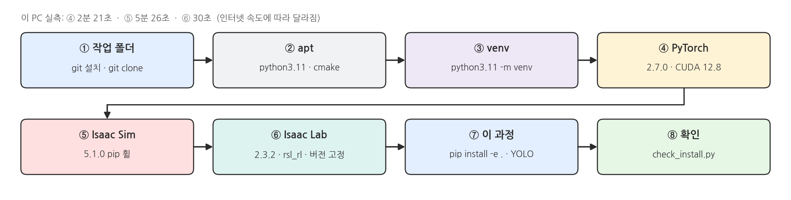
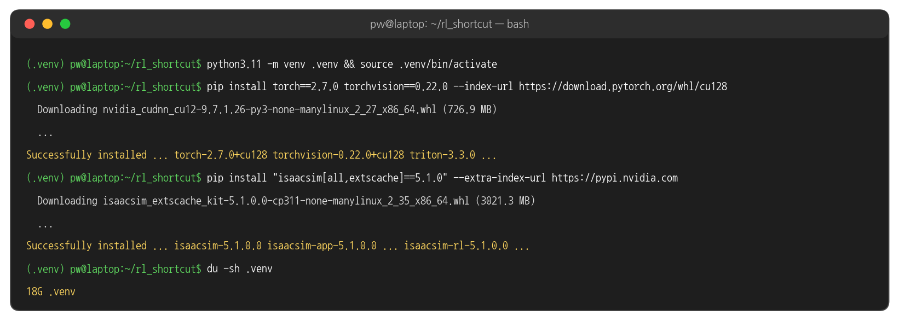
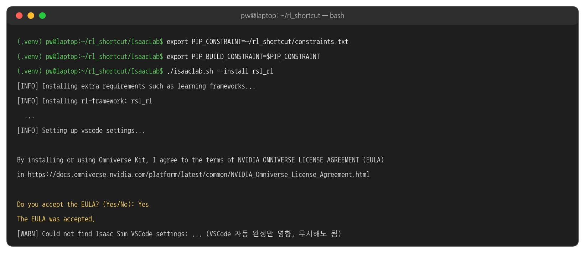

## 0. 시작 전에

### 필요한 것

{width=1000}

### 설치 흐름

{width=1000}

- 모든 것을 `~/rl_shortcut` 폴더 하나에 설치 → 이 폴더를 지우면 설치한 것이 모두 사라짐
- 내려받는 양: PyTorch 약 3.9 GB · Isaac Sim 약 4.7 GB · 설치 후 venv 약 18 GB
- 설치를 시작해 두고 다음 설명을 들어도 됨

## 1. 설치

### 터미널: ① 작업 폴더 만들기

```bash
sudo apt update
sudo apt install -y git
mkdir -p ~/rl_shortcut
cd ~/rl_shortcut
git clone https://github.com/PinkWink/rl_shortcut.git .
ls
```

- 마지막 `.` = "지금 폴더에 받기" → `~/rl_shortcut/rl_shortcut` 처럼 한 단계 더 생기지 않음
- `git clone ... .` 은 빈 폴더에서만 가능 · 파일이 있으면 `ls -a` 로 확인하고 비운 뒤 다시 실행
- 새로 설치한 Ubuntu 에는 `git` 없음 → 먼저 설치

### 실행 결과: 작업 폴더

{width=1000}

### 터미널: ② apt 패키지 (Python 3.11)

```bash
sudo add-apt-repository -y ppa:deadsnakes/ppa
sudo apt update
sudo apt install -y python3.11 python3.11-venv python3.11-dev git cmake build-essential
python3.11 --version
```

- Isaac Sim 5.1 은 **Python 3.11** 에서만 동작
- Ubuntu 24.04 의 기본 파이썬은 3.12 → 3.11 을 따로 설치 (deadsnakes PPA)
- 시스템 파이썬(3.12)은 그대로 · 3.11 은 `python3.11` 이라는 이름으로만 호출

### 터미널: ③ venv 만들기

```bash
cd ~/rl_shortcut
python3.11 -m venv .venv
source .venv/bin/activate
pip install --upgrade pip
python --version
```

- `source .venv/bin/activate` 후: 프롬프트 앞에 `(.venv)` 표시 · `python` · `pip` 이 이 venv 의 것
- 새 터미널마다 먼저 `cd ~/rl_shortcut && source .venv/bin/activate`
- 이 강의의 명령은 모두 이 상태에서 실행

### 터미널: ④ PyTorch (CUDA 12.8)

```bash
cd ~/rl_shortcut
pip install torch==2.7.0 torchvision==0.22.0 --index-url https://download.pytorch.org/whl/cu128
```

- Isaac Lab 2.3 이 맞춰 둔 버전
- CUDA 12.8 빌드 → RTX 50 시리즈(Blackwell)에서도 동작

### 터미널: ⑤ Isaac Sim 5.1.0 (pip)

```bash
cd ~/rl_shortcut
pip install "isaacsim[all,extscache]==5.1.0" --extra-index-url https://pypi.nvidia.com
```

- 소스 빌드 없이 pip 휠로 설치
- `all` = Isaac Sim 의 모든 확장 · `extscache` = 확장을 미리 받아 둔 묶음

### 실행 결과: pip 설치

{width=1000}

### 터미널: ⑥ Isaac Lab 2.3.2

```bash
cd ~/rl_shortcut
git clone --depth 1 --branch v2.3.2 https://github.com/isaac-sim/IsaacLab.git
cd IsaacLab
export PIP_CONSTRAINT=~/rl_shortcut/constraints.txt
export PIP_BUILD_CONSTRAINT=$PIP_CONSTRAINT
./isaaclab.sh --install rsl_rl
cd ..
```

- Isaac Lab = Isaac Sim 위의 로봇 학습 프레임워크 · `--install rsl_rl` = Isaac Lab 확장 + 강화학습 라이브러리 RSL-RL 만 설치
- `export` 두 줄 = 이 과정에서 검증한 패키지 버전(`constraints.txt`)으로 고정 · 빼면 최신 버전이 설치되어 실습 코드에서 `ImportError` 발생
- 마지막에 NVIDIA Omniverse 라이선스(EULA) 동의 질문 → `Yes` 입력 · 한 번 동의하면 다시 묻지 않음

### 실행 결과: Isaac Lab 설치의 끝

{width=1000}

### 터미널: ⑦ 이 과정의 패키지

```bash
cd ~/rl_shortcut
pip install -e . -c constraints.txt
pip install --no-deps -c constraints.txt ultralytics==8.4.218 ultralytics-thop polars polars-runtime-32
```

- `rl_shortcut/` 폴더의 환경 코드(역진자 · Pinky Pro · Go2 · G1)를 `import rl_shortcut` 으로 사용 가능 · `-e` → 코드를 고치면 바로 반영
- 둘째 줄 = ⑥ 페이지의 YOLO(ultralytics) · `-c constraints.txt` = 검증한 버전으로 고정
- `--no-deps` 필수 · 빼면 numpy 가 2.x 로 바뀌어 Isaac Sim 이 동작하지 않음

### 터미널: ⑧ 설치 확인

```bash
cd ~/rl_shortcut
python scripts/check_install.py --headless
```

- `--headless` = 창 없이 실행
- 화면이 필요 없는 확인 · 학습은 이 옵션으로 빠르게 실행
- `course code ... import OK` = 네 로봇의 실습 코드를 불러오는 데 성공 → 준비 끝

### 실행 결과: 설치 확인

{width=1000}

## 2. 폴더 구조

### ~/rl_shortcut

{width=1000}

### 스크립트와 페이지

{width=1000}

## 3. 문제 해결

### 자주 나는 오류

{width=1000}
