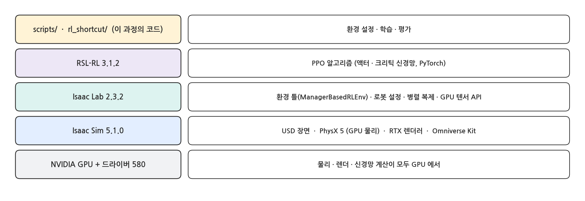
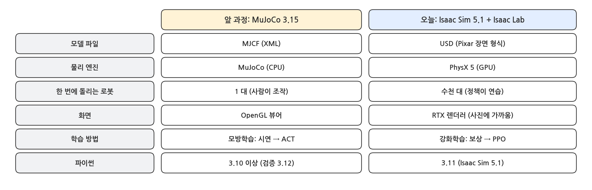
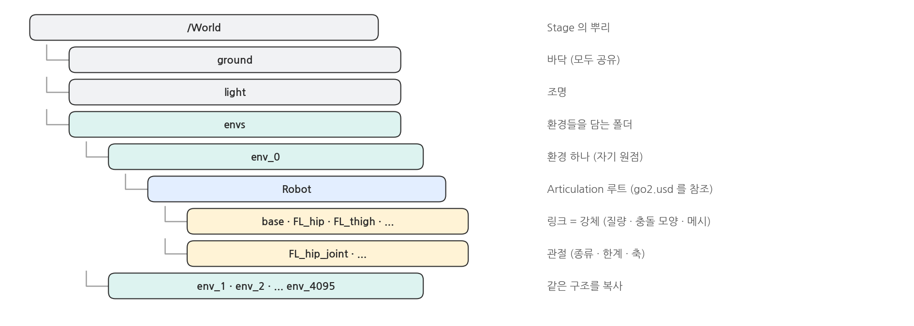
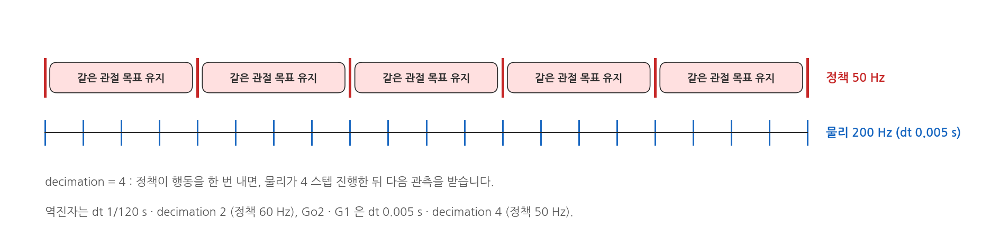
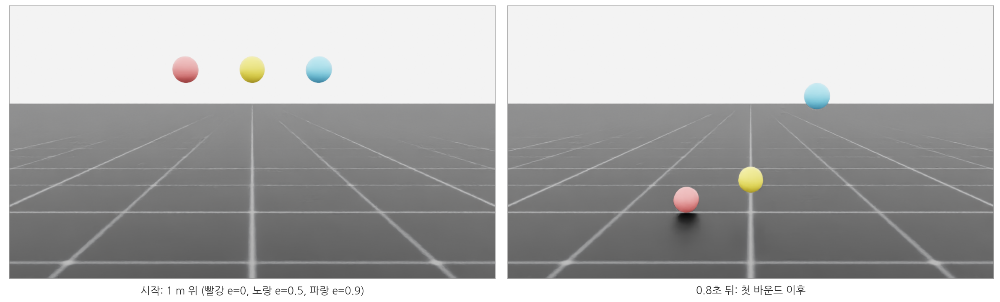
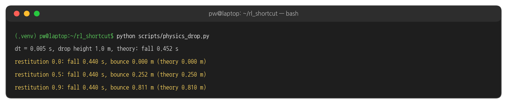
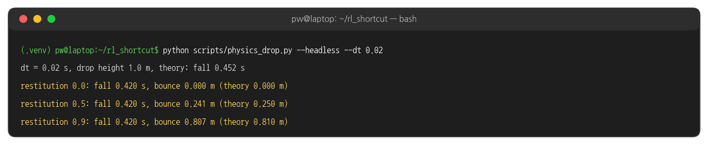
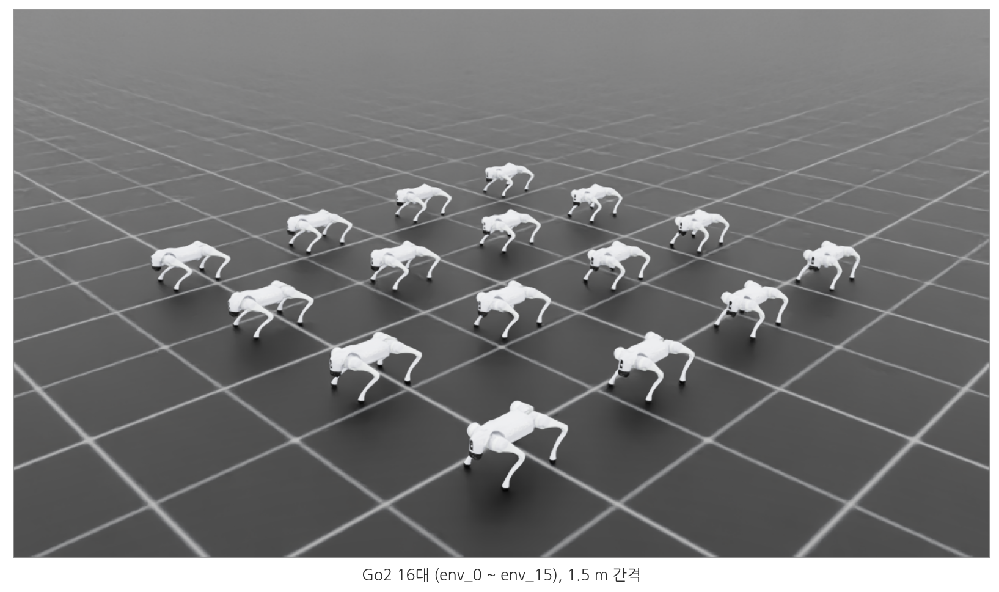
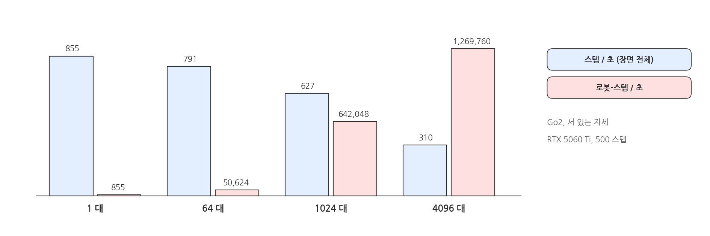

## 1. Isaac Sim 은 무엇인가

### 구성

{width=1000}

- **Isaac Sim** : NVIDIA Omniverse 위에서 돌아가는 로봇 시뮬레이터. 장면은 **USD**, 물리는 **PhysX 5**, 화면은 **RTX** 렌더러가 맡습니다.
- **Isaac Lab** : Isaac Sim 위의 로봇 학습 프레임워크. 같은 로봇을 수천 대 복사하고, 관측 · 보상 · 리셋을 GPU 텐서로 한꺼번에 계산합니다.
- **RSL-RL** : PPO 구현 (ETH Zürich). Isaac Lab 의 보행 예제들이 기본으로 씁니다.

### MuJoCo 와 비교

{width=1000}

- 앞 과정은 로봇 한 대를 정밀하게 다뤘다면, 오늘은 **같은 로봇 수천 대를 동시에** 돌려 시행착오를 빨리 모으는 것이 목적입니다.

### USD: 장면은 나무 구조

{width=1000}

- **Stage** : 장면 전체(파일 하나 또는 여러 파일의 조합). **Prim** : 장면 안의 물체 하나하나. 경로(`/World/envs/env_0/Robot/base`)로 부릅니다.
- 로봇 USD 안에는 링크(강체) · 관절 · 충돌 모양 · 질량 · 시각 메시가 함께 들어 있습니다. ⑥ 페이지에서 Go2 USD 를 직접 열어 봅니다.

### 물리 한 스텝, 정책 한 스텝

{width=1000}

- `sim.dt` : 물리 엔진이 한 번에 진행하는 시간. Go2 · G1 은 0.005 초(200 Hz)입니다.
- `decimation` : 정책이 행동을 한 번 낼 때 물리를 몇 번 돌리는지. 4 이면 정책은 50 Hz 로 동작합니다. 같은 행동(관절 목표)이 물리 4 스텝 동안 유지됩니다.

## 2. 실험 1: 공 떨어뜨리기

### 실행

```bash
python scripts/physics_drop.py
```

- 반발 계수(restitution) 0.0 · 0.5 · 0.9 인 공 세 개를 1 m 높이에서 떨어뜨립니다. 3초 뒤 결과를 출력하고, 창을 닫을 때까지 시뮬레이션이 계속됩니다.

### 실행 결과: 화면

{width=1000}

### 실행 결과: 터미널

{width=1000}

- 반발 계수 e 인 공은 높이 e² 배까지 튀어 오릅니다. 0.5 → 0.25 m, 0.9 → 0.81 m 로 이론과 1 cm 안에서 맞습니다.
- 낙하 시간은 이론(0.452 s)보다 조금 이르게 잡힙니다. PhysX 는 표면이 닿기 직전(contact offset 거리)부터 접촉을 계산하기 때문입니다.

### dt 를 키우면

```bash
python scripts/physics_drop.py --headless --dt 0.02
```

{width=1000}

- 물리 스텝을 4배(0.02 s) 키우면 계산은 빨라지지만, 접촉을 잡는 시점이 스텝 단위로 뭉개져 오차가 커집니다. 로봇 학습에서는 보통 0.005 s 안팎을 씁니다.

### 코드: 공 하나 만들기

```python
RigidObjectCfg(
    prim_path=f"/World/ball_{i}",
    spawn=sim_utils.SphereCfg(
        radius=RADIUS,
        rigid_props=sim_utils.RigidBodyPropertiesCfg(),
        mass_props=sim_utils.MassPropertiesCfg(mass=1.0),
        collision_props=sim_utils.CollisionPropertiesCfg(),
        physics_material=sim_utils.RigidBodyMaterialCfg(restitution=e, restitution_combine_mode="max"),
    ),
    init_state=RigidObjectCfg.InitialStateCfg(pos=(0.0, 0.5 * (i - 1), args.drop_height + RADIUS)),
)
```

- 강체 하나 = 모양(Sphere) + 강체 속성 + 질량 + 충돌 + 재질. 이 중 하나라도 빠지면 떨어지지 않거나(강체 없음) 바닥을 통과합니다(충돌 없음).
- `restitution_combine_mode="max"` : 공과 바닥 중 큰 반발 계수를 씁니다. 기본값(평균)이면 바닥(0)과 섞여 반으로 줄어듭니다.

## 3. 실험 2: 로봇 4096 대

### 실행

```bash
python scripts/physics_parallel.py --num_envs 16
python scripts/physics_parallel.py --headless --num_envs 4096
```

- Go2 를 `--num_envs` 대 만들어 서 있는 자세로 500 스텝 시뮬레이션하고, 1초에 몇 스텝을 계산하는지 잽니다.

### 실행 결과: 16 대

{width=1000}

### 실행 결과: 대수별 속도

{width=1000}

- 로봇이 1대에서 4096대로 4096배 늘어도 스텝 속도는 약 1/3 로만 줄었습니다. 1초에 계산하는 로봇-스텝은 **약 1,500배** 늘어납니다.
- 이것이 GPU 물리의 핵심입니다. 강화학습은 시행착오가 많이 필요해서, 같은 시간에 경험을 1,500배 모으면 몇 시간 걸릴 학습이 몇 분으로 줄어듭니다.

### 코드: 로봇을 환경 수만큼 복사

```python
@configclass
class SceneCfg(InteractiveSceneCfg):
    ground = AssetBaseCfg(prim_path="/World/ground", spawn=sim_utils.GroundPlaneCfg())
    light = AssetBaseCfg(prim_path="/World/light", spawn=sim_utils.DomeLightCfg(intensity=2000.0))
    robot = GO2_CFG.replace(prim_path="{ENV_REGEX_NS}/Robot")   # copied into env_0, env_1, ...

scene = InteractiveScene(SceneCfg(num_envs=args.num_envs, env_spacing=1.5))
```

- `InteractiveScene` 이 `/World/envs/env_0` … `env_4095` 를 만들고 로봇을 복사합니다. 바닥과 조명은 하나만 있고 모두가 공유합니다.
- 로봇 데이터는 `robot.data.root_pos_w` 처럼 (환경 수, …) 모양의 GPU 텐서로 한 번에 읽고 씁니다.

## 4. 해 볼 것

- `physics_drop.py --dt 0.05` 로 더 크게 키우면 어떻게 되는지 봅니다.
- `physics_parallel.py --headless --num_envs 1024` · `8192` 로 바꿔 속도를 재 보고, 그래프의 어디에 오는지 확인합니다.
