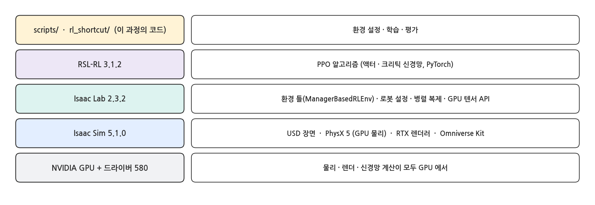
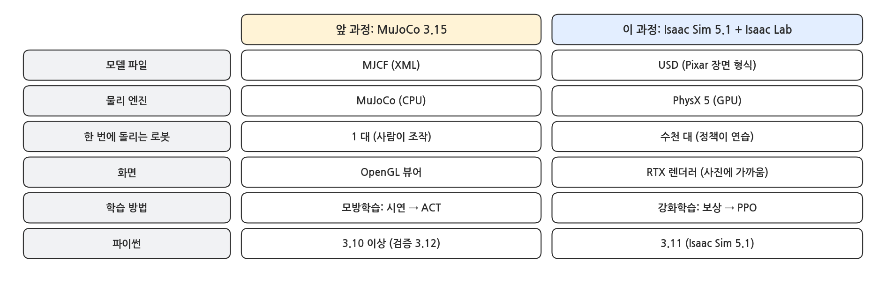
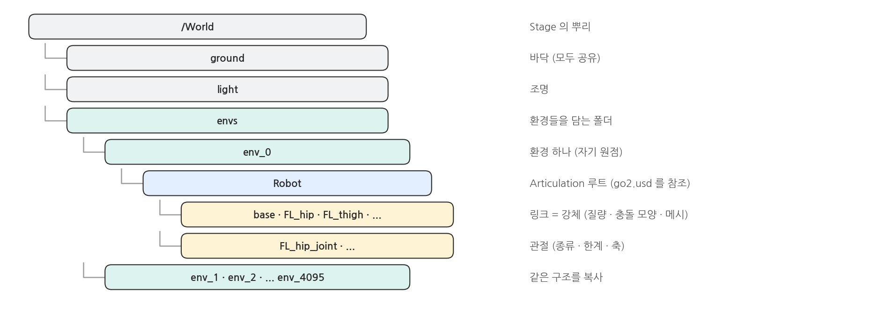
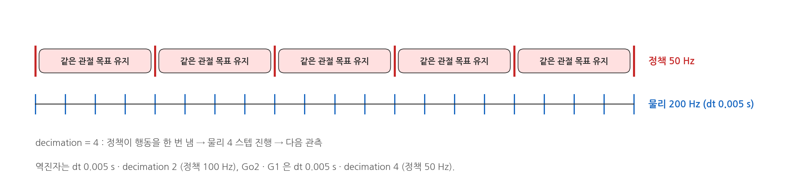
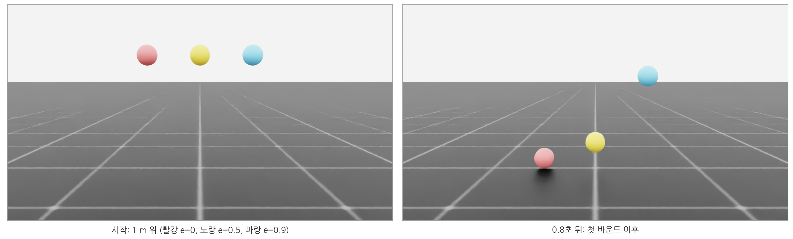
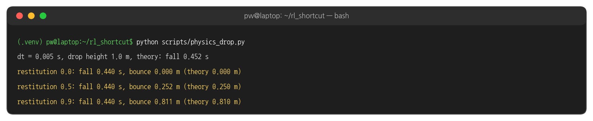
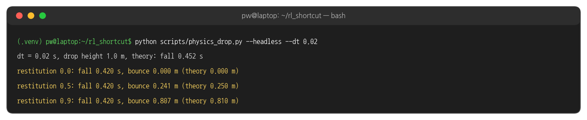
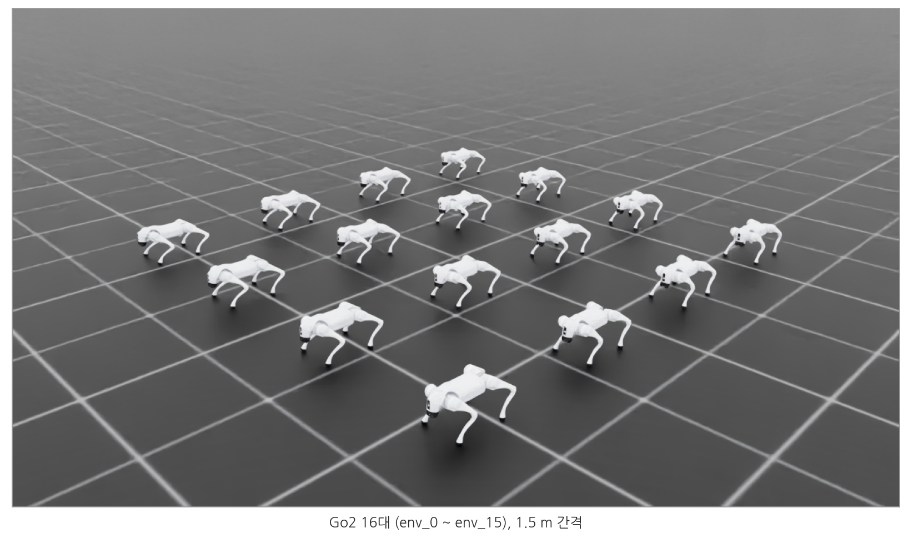
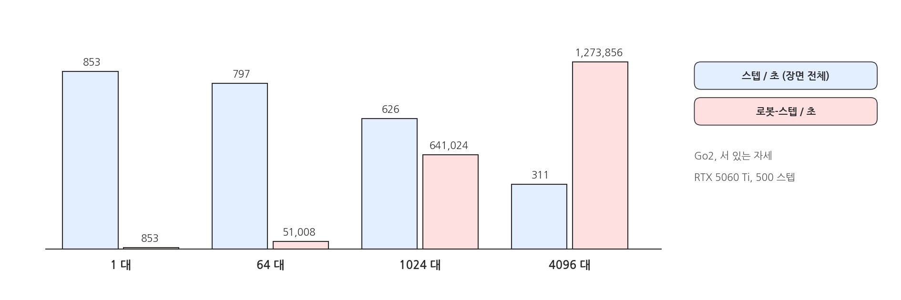

## 1. Isaac Sim 은 무엇인가

### 구성

{width=1000}

- **Isaac Sim** : NVIDIA Omniverse 위의 로봇 시뮬레이터 · 장면 = **USD** · 물리 = **PhysX 5** · 화면 = **RTX** 렌더러
- **Isaac Lab** : Isaac Sim 위의 로봇 학습 프레임워크 · 같은 로봇 수천 대 복사 · 관측 · 보상 · 리셋을 GPU 텐서로 한꺼번에 계산
- **RSL-RL** : PPO 구현 (ETH Zürich) · Isaac Lab 보행 예제의 기본 학습기

### MuJoCo 와 비교

{width=1000}

- 앞 과정: 로봇 한 대를 정밀하게
- 이 과정: **같은 로봇 수천 대를 동시에** → 시행착오를 빨리 모으는 것이 목적

### USD: 장면은 나무 구조

{width=1000}

- **Stage** = 장면 전체 (파일 하나 또는 여러 파일의 조합)
- **Prim** = 장면 안의 물체 하나하나 · 경로(`/World/envs/env_0/Robot/base`)로 호출
- 로봇 USD 의 내용: 링크(강체) · 관절 · 충돌 모양 · 질량 · 시각 메시 → ⑧ 페이지에서 Go2 USD 를 직접 확인

### 물리 한 스텝, 정책 한 스텝

{width=1000}

- `sim.dt` = 물리 엔진이 한 번에 진행하는 시간 · Go2 · G1 은 0.005 초(200 Hz)
- `decimation` = 정책 행동 한 번에 물리를 몇 번 돌리는지 · 4 이면 정책은 50 Hz
- 같은 행동(관절 목표)이 물리 4 스텝 동안 유지

## 2. 실험 1: 공 떨어뜨리기

### 터미널: 공 떨어뜨리기

```bash
cd ~/rl_shortcut
python scripts/physics_drop.py
```

- 반발 계수(restitution) 0.0 · 0.5 · 0.9 인 공 세 개를 1 m 높이에서 낙하
- 3초 뒤 결과 출력 · 창을 닫을 때까지 시뮬레이션 계속

### 실행 결과: 화면

{width=1000}

### 실행 결과: 터미널

{width=1000}

- 반발 계수 e 인 공 → 높이 e² 배까지 튀어 오름 · 0.5 → 0.25 m · 0.9 → 0.81 m (이론과 1 cm 안에서 일치)
- 낙하 시간은 이론(0.452 s)보다 조금 이름
- 이유: PhysX 는 표면이 닿기 직전(contact offset 거리)부터 접촉을 계산

### 터미널: dt 를 키우면

```bash
cd ~/rl_shortcut
python scripts/physics_drop.py --headless --dt 0.02
```

### 실행 결과: dt 0.005 와 0.02

{width=1000}

- 물리 스텝 4배(0.02 s) → 계산은 빨라짐
- 접촉을 잡는 시점이 스텝 단위로 뭉개져 오차 증가
- 로봇 학습에서는 보통 0.005 s 안팎 사용

### 공 하나 만들기 (코드) - physics_drop.py 발췌

```python
# scripts/physics_drop.py  (발췌)
RigidObjectCfg(
    prim_path=f"/World/ball_{i}",
    spawn=sim_utils.SphereCfg(
        radius=RADIUS,
        rigid_props=sim_utils.RigidBodyPropertiesCfg(),
        mass_props=sim_utils.MassPropertiesCfg(mass=1.0),
        collision_props=sim_utils.CollisionPropertiesCfg(),
        physics_material=sim_utils.RigidBodyMaterialCfg(restitution=e, restitution_combine_mode="max"),
    ),
    init_state=RigidObjectCfg.InitialStateCfg(pos=(0.0, 0.5 * (i - 1), args.drop_height + RADIUS)),
)
```

- 강체 하나 = 모양(Sphere) + 강체 속성 + 질량 + 충돌 + 재질
- 하나라도 빠지면: 떨어지지 않음(강체 없음) · 바닥 통과(충돌 없음)
- `restitution_combine_mode="max"` = 공과 바닥 중 큰 반발 계수 사용 · 기본값(평균)이면 바닥(0)과 섞여 반으로 감소

## 3. 실험 2: 로봇 4096 대

### 터미널: 로봇 여러 대 띄우기

```bash
cd ~/rl_shortcut
python scripts/physics_parallel.py --num_envs 16
python scripts/physics_parallel.py --headless --num_envs 4096
```

- Go2 를 `--num_envs` 대 만들어 서 있는 자세로 500 스텝 시뮬레이션
- 1초에 몇 스텝을 계산하는지 측정

### 실행 결과: 16 대

{width=1000}

### 실행 결과: 대수별 속도

{width=1000}

- 로봇 1대 → 4096대(4096배): 스텝 속도는 약 1/3 로만 감소
- 1초에 계산하는 로봇-스텝은 **약 1,500배** 증가 = GPU 물리의 핵심
- 강화학습은 시행착오가 많이 필요 → 같은 시간에 경험을 1,500배 모으면 몇 시간짜리 학습이 몇 분

### 로봇을 환경 수만큼 복사 (코드) - physics_parallel.py 발췌

```python
# scripts/physics_parallel.py  (발췌)
@configclass
class SceneCfg(InteractiveSceneCfg):
    ground = AssetBaseCfg(prim_path="/World/ground", spawn=sim_utils.GroundPlaneCfg())
    light = AssetBaseCfg(prim_path="/World/light", spawn=sim_utils.DomeLightCfg(intensity=2000.0))
    robot = GO2_CFG.replace(prim_path="{ENV_REGEX_NS}/Robot")   # copied into env_0, env_1, ...

scene = InteractiveScene(SceneCfg(num_envs=args.num_envs, env_spacing=1.5))
```

- `InteractiveScene` 이 `/World/envs/env_0` … `env_4095` 를 만들고 로봇을 복사
- 바닥 · 조명은 하나 · 모두가 공유
- 로봇 데이터는 `robot.data.root_pos_w` 처럼 (환경 수, …) 모양의 GPU 텐서로 한 번에 읽고 씀

## 4. 해 볼 것

- `physics_drop.py --dt 0.05` 로 더 키우면 어떻게 되는지 확인
- `physics_parallel.py --headless --num_envs 1024` · `8192` 로 속도 측정 → 그래프의 어디에 오는지 확인
