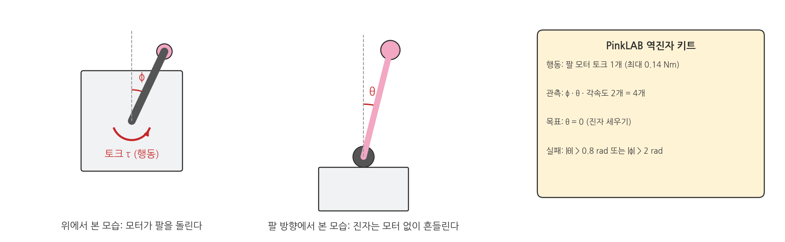
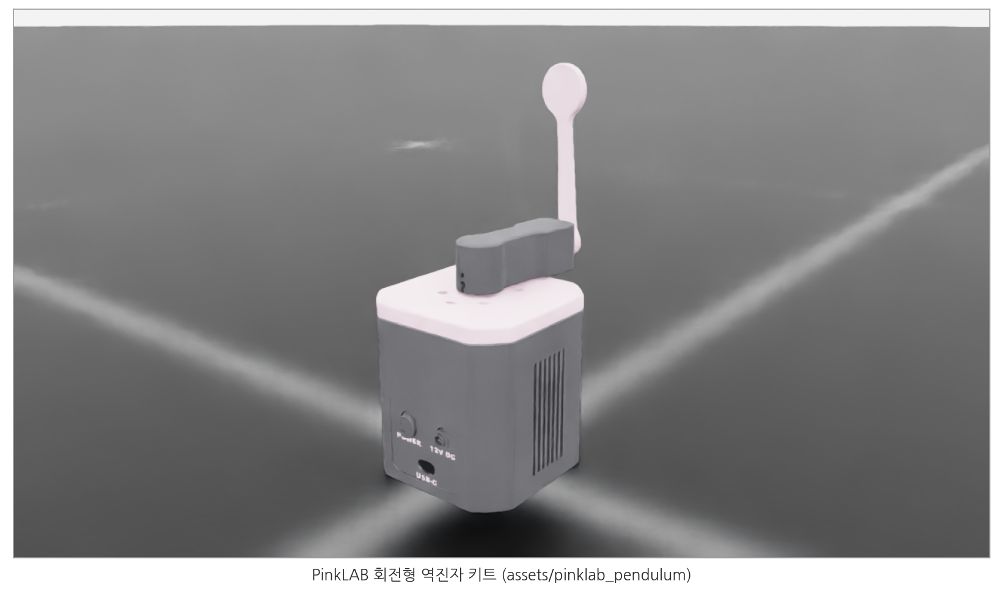
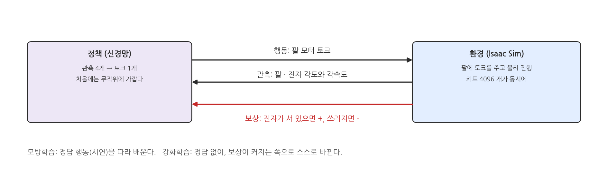
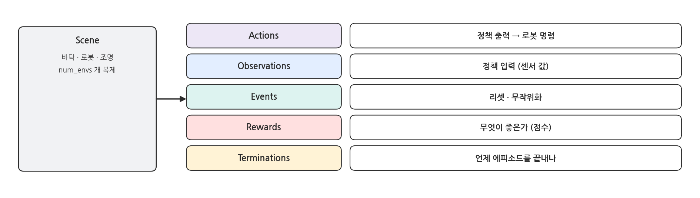
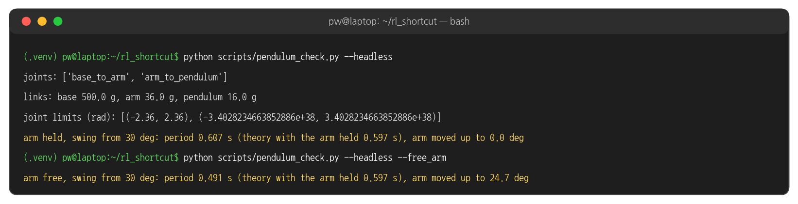
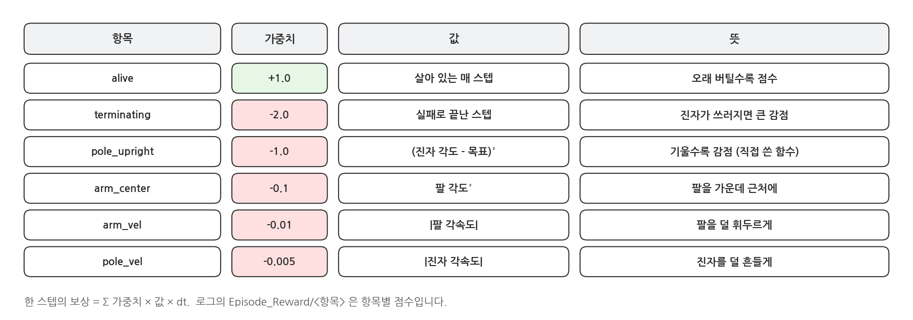

## 1. 역진자: PinkLAB 회전형 역진자 키트

### 과제

{width=1000}

- PinkLAB 이 sim-to-real 학습용으로 내놓은 회전형 역진자(Furuta pendulum) 키트를 그대로 시뮬레이션에 올립니다.
- 모터가 팔(arm)을 수평으로 돌립니다. 팔 끝에 핀으로 달린 진자(pendulum)에는 모터가 없습니다.
- 정책이 할 수 있는 일은 **팔 모터에 토크를 주는 것 하나**뿐입니다. 팔을 좌우로 돌려 진자가 쓰러지지 않게 세웁니다.

### 시뮬레이션 속의 키트

{width=1000}

- 키트의 URDF 와 메시(3D 프린트 부품 모양)를 그대로 썼습니다. 질량은 실제로 잰 값입니다: 팔 36 g(베어링 · 엔코더 포함), 진자 16 g(끝에 동전 6 g).
- 팔 모터의 최대 토크는 0.14 Nm, 팔이 돌 수 있는 범위는 ±135° 입니다.

### 강화학습의 한 바퀴

{width=1000}

- 모방학습(앞 과정)은 사람의 시연을 정답으로 삼았습니다. 강화학습에는 정답 행동이 없고, **보상(점수)** 만 있습니다.
- 정책은 수많은 시도 중 점수가 높았던 행동을 더 자주 하도록 바뀝니다. 그래서 "무엇이 좋은가"를 보상으로 잘 적는 것이 환경 설계의 핵심입니다.

### 환경을 이루는 다섯 부분

{width=1000}

- Isaac Lab 의 `ManagerBasedRLEnv` 는 장면(scene) 위에 다섯 가지 설정을 얹어 환경을 만듭니다. 각 부분을 맡은 매니저(Manager)가 있어 이름이 그렇습니다.
- 오늘 만드는 역진자 · Go2 · G1 환경이 모두 같은 틀입니다. 바뀌는 것은 다섯 칸에 넣는 내용뿐입니다.

## 2. 키트 모델 불러오기

### URDF → USD: tools/convert_pendulum.py

```python
cfg = UrdfConverterCfg(
    asset_path=str(ROOT / "assets/pinklab_pendulum/model_v3.urdf"),
    usd_dir=str(ROOT / args.out),
    usd_file_name="model_v3.usd",
    fix_base=True,                       # the base sits on the desk
    collision_from_visuals=True,         # the URDF has no <collision>; use the visual meshes
    collider_type="convex_hull",
    self_collision=False,
    ...
```

- Isaac Sim 은 USD 를 씁니다 (③ 페이지). Isaac Lab 의 `UrdfConverter` 가 URDF 를 USD 로 바꿉니다.
- 변환한 USD 는 저장소의 `assets/pinklab_pendulum/usd/` 에 이미 들어 있습니다. 직접 해 보려면 `python tools/convert_pendulum.py` 를 실행합니다 (같은 파일을 다시 만듭니다).

### 충돌 형상이 없으면 생기는 일

- 키트 URDF 에는 모양(`<visual>`)만 있고 충돌 형상(`<collision>`)이 없습니다. 그대로 변환해도 진자는 정상으로 움직입니다.
- 그런데 4096개를 띄우면 PhysX 가 시뮬레이션을 시작하는 데만 **약 4분**이 걸렸습니다. 링크에 충돌 형상이 하나도 없으면 환경 하나당 약 50 ms 씩 시작이 느려집니다.
- `collision_from_visuals=True` 로 모양 메시에서 충돌 형상(볼록 껍질)을 만들자 **2초**로 줄었습니다. 서로 부딪히는 부품이 없으니(`self_collision=False`, 받침 고정) 움직임은 똑같습니다.
- 교훈: 시뮬레이션이 이상하게 느리면, 모델 파일부터 의심합니다.

### 모델 확인: scripts/pendulum_check.py

```bash
python scripts/pendulum_check.py --headless               # arm held, pendulum swings from 30 deg
python scripts/pendulum_check.py --headless --free_arm    # motor off, the arm moves too
```

{width=1000}

- 팔을 붙잡고 진자를 30° 에서 놓으면 주기가 0.607 초입니다. URDF 의 질량 · 관성으로 계산한 이론값(작은 진폭) 0.597 초와 맞습니다.
- 모터를 끄면 진자가 흔들릴 때 팔도 반대로 25° 까지 돌고, 주기가 0.491 초로 짧아집니다. 팔과 진자가 서로 힘을 주고받는 하나의 시스템이라는 뜻이고, 정책이 팔을 돌려 진자를 세울 수 있는 이유이기도 합니다.

## 3. 코드: rl_shortcut/pendulum_env.py

### 로봇 설정 (1): USD 와 시작 자세

```python
PENDULUM_CFG = ArticulationCfg(
    spawn=sim_utils.UsdFileCfg(
        usd_path=PENDULUM_USD,
        articulation_props=sim_utils.ArticulationRootPropertiesCfg(solver_position_iteration_count=8),
    ),
    # the default pose is the goal: arm in the middle, pendulum upright
    init_state=ArticulationCfg.InitialStateCfg(joint_pos={"base_to_arm": 0.0, "arm_to_pendulum": math.pi}),
```

- 관절은 `base_to_arm`(팔, 모터)과 `arm_to_pendulum`(진자, 모터 없음) 두 개입니다.
- 진자 각도는 매달려 있을 때 0, 똑바로 섰을 때 π(180°)입니다. 기본 자세를 "팔 가운데, 진자 섬"으로 두고, 이것을 목표로 씁니다.

### 로봇 설정 (2): 모터

```python
    actuators={
        # torque control: no position gains, the policy's torque goes straight to the arm
        "arm_motor": ImplicitActuatorCfg(joint_names_expr=["base_to_arm"], stiffness=0.0, damping=0.0,
                                         effort_limit_sim=MAX_TORQUE),
        # no motor on the pendulum; only the bearing damping from the URDF
        "pendulum": ImplicitActuatorCfg(joint_names_expr=["arm_to_pendulum"], stiffness=0.0, damping=3.16e-5,
                                        effort_limit_sim=0.0),
    },
)
```

- `stiffness=0, damping=0` : 위치 제어(PD) 없이, 정책이 낸 토크가 그대로 팔에 걸립니다. 최대 `MAX_TORQUE = 0.14` Nm (키트 모터).
- 진자 쪽은 `effort_limit_sim=0` 이라 힘을 줄 수 없고, 베어링 마찰(감쇠)만 남습니다.

### 장면 (Scene)

```python
@configclass
class SceneCfg(InteractiveSceneCfg):
    ground = AssetBaseCfg(prim_path="/World/ground", spawn=sim_utils.GroundPlaneCfg())
    robot: ArticulationCfg = PENDULUM_CFG.replace(prim_path="{ENV_REGEX_NS}/Robot")
    light = AssetBaseCfg(prim_path="/World/light", spawn=sim_utils.DomeLightCfg(intensity=2000.0))
```

- `{ENV_REGEX_NS}` 는 `/World/envs/env_0`, `env_1`, … 로 바뀝니다. 같은 키트가 환경 수만큼 복사됩니다 (③ 페이지의 병렬 시뮬레이션).

### 행동 (Actions)

```python
@configclass
class ActionsCfg:
    # one number per env: arm motor torque, action 1.0 = 0.14 Nm (the motor's limit)
    arm_torque = mdp.JointEffortActionCfg(asset_name="robot", joint_names=["base_to_arm"], scale=MAX_TORQUE)
```

- 정책의 출력은 숫자 하나입니다. `scale=0.14` 라서 정책이 1.0 을 내면 팔에 0.14 Nm 이 걸립니다.
- 진자 관절은 행동에 없습니다. 진자는 팔의 움직임으로만 간접적으로 제어됩니다.

### 관측 (Observations)

```python
@configclass
class ObservationsCfg:
    @configclass
    class PolicyCfg(ObsGroup):
        joint_pos = ObsTerm(func=mdp.joint_pos_rel)    # arm angle, pendulum angle from upright (2)
        joint_vel = ObsTerm(func=mdp.joint_vel_rel)    # arm and pendulum angular velocity (2)

        def __post_init__(self):
            self.concatenate_terms = True

    policy: PolicyCfg = PolicyCfg()
```

- 정책이 보는 것은 팔 각도 · 진자 각도 · 팔 각속도 · 진자 각속도, 숫자 4개입니다. 실제 키트의 엔코더로도 잴 수 있는 값들입니다.
- `joint_pos_rel` 은 기본 자세와의 차이입니다. 그래서 진자 각도는 "똑바로 선 자세에서 얼마나 기울었나"가 됩니다.

### 이벤트 (Events): 리셋

```python
@configclass
class EventsCfg:
    reset_arm = EventTerm(func=mdp.reset_joints_by_offset, mode="reset",
                          params={"asset_cfg": ARM, "position_range": (-0.5, 0.5), "velocity_range": (-1.0, 1.0)})
    reset_pole = EventTerm(func=mdp.reset_joints_by_offset, mode="reset",
                           params={"asset_cfg": POLE, "position_range": (-0.2, 0.2), "velocity_range": (-1.0, 1.0)})
```

- 에피소드가 끝날 때마다(`mode="reset"`) 팔은 ±0.5 rad(29°), 진자는 똑바로 선 자세에서 ±0.2 rad(11°) 안에서 무작위로 시작합니다. 각속도도 ±1 rad/s 로 흔듭니다.
- 매번 같은 자세에서만 시작하면 그 자세만 잘하는 정책이 됩니다. 다양한 시작 상태가 곧 다양한 연습 문제입니다.

### 보상 (Rewards)

```python
@configclass
class RewardsCfg:
    alive = RewTerm(func=mdp.is_alive, weight=1.0)
    terminating = RewTerm(func=mdp.is_terminated, weight=-2.0)
    pole_upright = RewTerm(func=angle_sq, weight=-1.0, params={"asset_cfg": POLE})
    arm_center = RewTerm(func=angle_sq, weight=-0.1, params={"asset_cfg": ARM})
    arm_vel = RewTerm(func=mdp.joint_vel_l1, weight=-0.01, params={"asset_cfg": ARM})
    pole_vel = RewTerm(func=mdp.joint_vel_l1, weight=-0.005, params={"asset_cfg": POLE})
```

{width=1000}

### 보상 함수 직접 쓰기

```python
def angle_sq(env, asset_cfg):
    """Joint angle from the default pose, squared: 0 at the goal, grows away from it."""
    robot = env.scene[asset_cfg.name]
    angle = robot.data.joint_pos[:, asset_cfg.joint_ids] - robot.data.default_joint_pos[:, asset_cfg.joint_ids]
    return torch.sum(torch.square(angle), dim=1)
```

- 보상 함수는 `env` 를 받아 **환경 수만큼의 숫자**(텐서 한 줄)를 돌려주는 파이썬 함수입니다. 4096개 환경을 한 번에 GPU에서 계산합니다.
- 기본 자세(목표)와의 각도 차이를 제곱합니다. 목표에 있으면 0, 멀어질수록 커집니다. 같은 함수를 진자(`pole_upright`, -1)와 팔(`arm_center`, -0.1)에 함께 씁니다.

### 종료 (Terminations)

```python
@configclass
class TerminationsCfg:
    time_out = DoneTerm(func=mdp.time_out, time_out=True)
    pole_fell = DoneTerm(func=mdp.joint_pos_out_of_manual_limit,
                         params={"asset_cfg": POLE, "bounds": (math.pi - 0.8, math.pi + 0.8)})
    arm_out = DoneTerm(func=mdp.joint_pos_out_of_manual_limit, params={"asset_cfg": ARM, "bounds": (-2.0, 2.0)})
```

- `time_out` : 5초(`episode_length_s`)가 지나면 끝. 실패가 아니라 "시간이 다 됨"이라서 `time_out=True` 로 구분합니다.
- `pole_fell` : 진자가 똑바로 선 자세에서 0.8 rad(46°) 넘게 기울면 실패입니다. `arm_out` : 팔이 ±2 rad(115°)를 넘으면 실패입니다. 키트의 기구 한계(±135°)에 닿기 전에 멈춥니다. 실패하면 `terminating` 보상(-2)을 받습니다.

### 환경 조립

```python
@configclass
class PendulumEnvCfg(ManagerBasedRLEnvCfg):
    scene: SceneCfg = SceneCfg(num_envs=4096, env_spacing=0.5)
    actions: ActionsCfg = ActionsCfg()
    observations: ObservationsCfg = ObservationsCfg()
    events: EventsCfg = EventsCfg()
    rewards: RewardsCfg = RewardsCfg()
    terminations: TerminationsCfg = TerminationsCfg()
```

### 시간 설정

```python
    def __post_init__(self):
        self.sim.dt = 0.005               # physics 200 Hz
        self.decimation = 2               # policy 100 Hz
        self.sim.render_interval = self.decimation
        self.episode_length_s = 5.0
```

- 물리는 0.005 초(200 Hz)마다, 정책은 물리 2번에 한 번(100 Hz) 행동을 냅니다 (③ 페이지의 dt · decimation). 진자가 작고 가벼워서(흔들림 주기 0.6초) 빠르게 제어합니다.
- 에피소드 5초 = 정책 500 스텝입니다. 학습 로그의 `Mean episode length` 가 500 에 가까우면 대부분 끝까지 버틴 것입니다.

## 4. 해 볼 것

- `MAX_TORQUE` 를 0.0014 로 줄이면 모터가 100배 약해집니다. 그래도 진자를 세울 수 있을까요? ⑤ 페이지에서 학습해 보고 결과를 비교합니다.
- `EventsCfg` 의 진자 시작 범위를 ±0.2 rad 에서 ±0.6 rad 로 넓히면 어떻게 될까요? `pole_fell` 의 경계(0.8 rad)와 비교해 봅니다.
