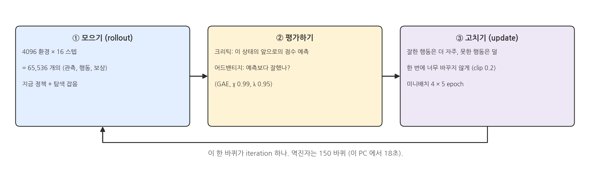
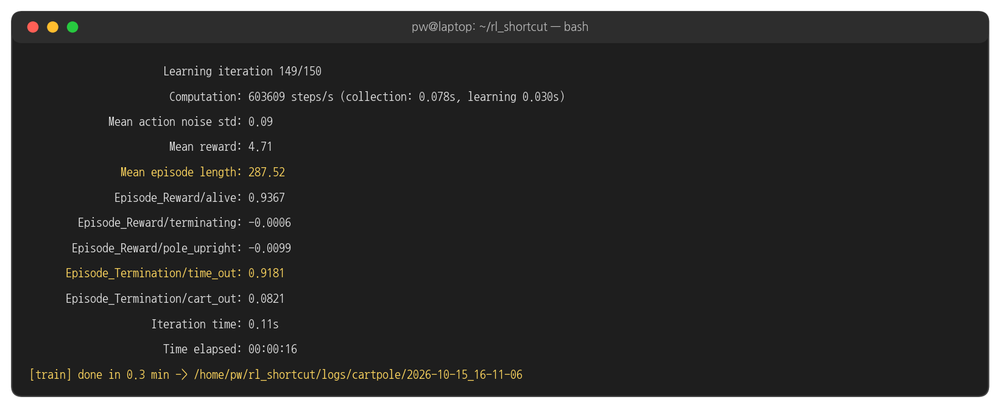
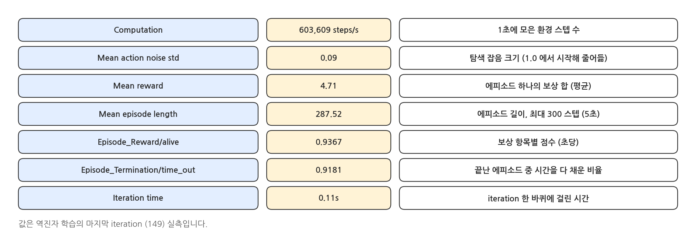
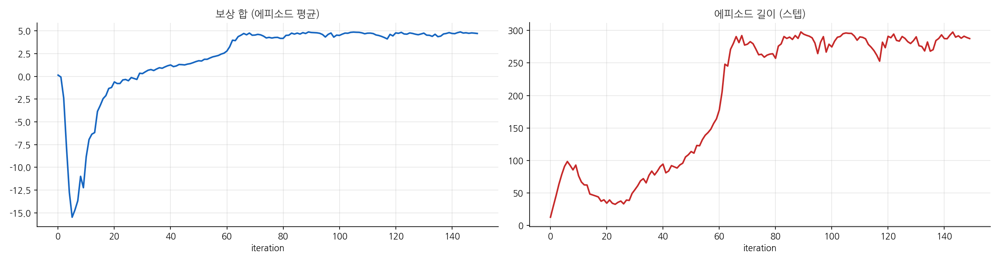
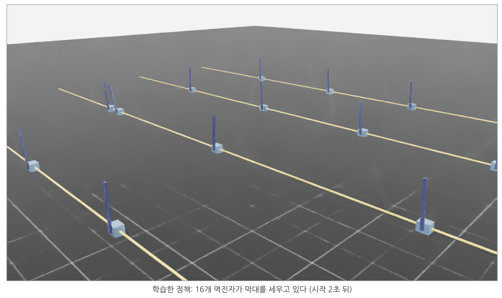
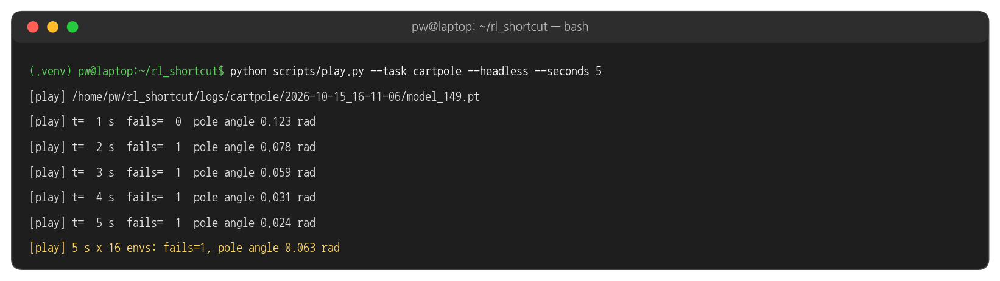
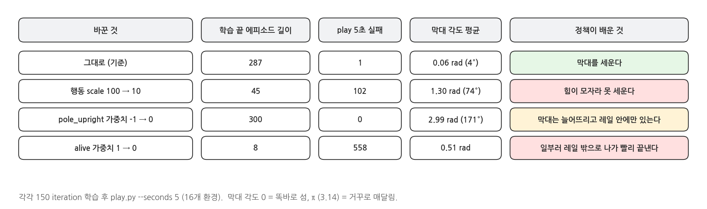

## 1. PPO 로 학습하기

### PPO 한 바퀴 (iteration)

{width=1000}

- **모으기**: 4096개 환경에서 지금의 정책으로 16 스텝씩 움직여 봅니다. 관측 · 행동 · 보상 65,536 묶음이 모입니다.
- **고치기**: 그 경험으로 신경망 두 개를 고칩니다. 행동을 내는 **액터(actor)** 와, 지금 상태가 앞으로 얼마나 좋은지 점수를 예측하는 **크리틱(critic)** 입니다.
- PPO(Proximal Policy Optimization)는 한 번에 정책을 너무 크게 바꾸지 않도록 제한합니다. 그래서 학습이 안정적이고, Isaac Lab 의 보행 학습들도 기본으로 씁니다.

### 학습 실행

```bash
cd ~/rl_shortcut && source .venv/bin/activate
python scripts/train.py --task cartpole --headless
```

- 150 iteration 을 학습합니다. 이 PC(RTX 5060 Ti)에서 18초 걸렸습니다.
- `--headless` 를 빼면 창이 열리고 4096개 역진자가 움직이는 모습을 볼 수 있지만, 화면을 그리느라 느려집니다.

### 실행 결과: 마지막 iteration

{width=1000}

### 로그 읽기

{width=1000}

- `Episode_Reward/…` 는 보상 항목별 점수(초당 평균)입니다. `alive` 0.94 가 대부분이고 감점 항목은 작습니다. 막대를 세운 채 오래 버틴다는 뜻입니다.
- `Episode_Termination/time_out` 0.92 : 끝난 에피소드의 92% 가 5초를 다 채웠습니다. 나머지 8% 는 카트가 레일 밖으로 나갔습니다.

### 학습 곡선

{width=1000}

- 처음 20 iteration 쯤까지는 보상이 오히려 떨어집니다. 카트를 세게 밀다가 레일 밖으로 나가며 감점을 받기 때문입니다.
- 60 iteration 근처에서 에피소드 길이가 갑자기 300 스텝(5초) 가까이로 뛰어오릅니다. 막대를 세운 채 카트를 레일 안에 붙잡아 두는 법을 찾은 순간입니다.
- 같은 그래프를 TensorBoard 로 볼 수 있습니다: `tensorboard --logdir logs/cartpole` 후 브라우저에서 `http://localhost:6006`.

### 저장된 것

```bash
ls logs/cartpole/
ls logs/cartpole/*/
```

- 학습할 때마다 `logs/cartpole/<날짜_시각>/` 폴더가 생깁니다. `model_<iteration>.pt` 가 50 iteration 마다 저장되고, 마지막 것(`model_149.pt`)이 완성된 정책입니다.
- `events.out.tfevents…` 는 TensorBoard 기록입니다.

## 2. 평가: 학습한 정책 돌려 보기

### play.py

```bash
python scripts/play.py --task cartpole
```

- 가장 최근 학습의 마지막 체크포인트를 자동으로 찾아 16개 환경에서 돌립니다. 창을 닫으면 끝납니다.
- 다른 체크포인트를 보려면 `--checkpoint logs/cartpole/<날짜_시각>/model_50.pt` 처럼 경로를 줍니다.

### 실행 결과: 화면

{width=1000}

### 실행 결과: 터미널

{width=1000}

- `fails` : 실패로 끝난 에피소드 수 (카트가 레일 밖으로). `pole angle` : 막대 각도의 평균 절댓값(rad).
- 리셋 직후에는 막대가 크게 기운 상태(최대 ±45°)에서 시작하므로 각도가 크고, 곧 0 근처로 세웁니다.

## 3. 코드: scripts/train.py

### 환경과 학습기 만들기

```python
task = importlib.import_module(f"rl_shortcut.{args.task}_env")   # cartpole_env, go2_env, g1_env
env_cfg = task.make_env_cfg(args)
runner_cfg = task.make_runner_cfg(args)

env = ManagerBasedRLEnv(cfg=env_cfg)
runner = OnPolicyRunner(RslRlVecEnvWrapper(env), runner_cfg.to_dict(), log_dir=str(log_dir), device="cuda:0")
runner.learn(num_learning_iterations=runner_cfg.max_iterations, init_at_random_ep_len=True)
```

- `--task` 이름으로 환경 모듈을 고릅니다. 오늘 쓰는 세 환경 모두 이 `train.py` 하나로 학습합니다.
- `RslRlVecEnvWrapper` : Isaac Lab 환경을 RSL-RL 라이브러리가 쓰는 형식으로 감쌉니다. `OnPolicyRunner` 가 PPO 의 모으기 · 고치기를 반복합니다.

### PPO 설정: rl_shortcut/ppo.py

```python
policy=RslRlPpoActorCriticCfg(
    init_noise_std=init_noise_std,     # exploration noise at the start
    actor_hidden_dims=list(hidden),
    critic_hidden_dims=list(hidden),
    activation="elu",
    actor_obs_normalization=True,
    critic_obs_normalization=True,
),
```

- 역진자는 관측이 4개뿐이라 `hidden=(32, 32)` 의 작은 신경망으로 충분합니다. Go2 는 (128, 128, 128), G1 은 (256, 128, 64) 를 씁니다.
- `init_noise_std` : 처음에는 행동에 잡음을 섞어 이것저것 시도합니다(탐색). 학습이 진행되면 로그의 `Mean action noise std` 가 줄어듭니다 (역진자 1.0 → 0.09).

## 4. 해 볼 것

### 보상을 바꿔 보기

{width=1000}

- `rl_shortcut/cartpole_env.py` 의 값 하나를 고치고 같은 명령으로 다시 학습한 뒤 `play.py` 로 봅니다 (`pip install -e .` 라서 다시 설치할 필요 없음). 결과를 비교한 뒤에는 원래 값으로 되돌려 둡니다.
- **scale 10** : 카트를 미는 힘이 10 N 까지라 막대를 되세울 수 없습니다. 행동의 범위도 환경 설계의 일부입니다.
- **pole_upright 0** : 에피소드는 매번 5초를 채우지만, 막대는 아래로 늘어져 있습니다(171°). 보상은 "오래 살기"뿐이고, 막대가 쓰러져도 끝나지 않으니 정책은 카트를 가만히 두는 쉬운 길을 찾았습니다.
- **alive 0** : 남은 보상이 모두 감점이면, 에피소드를 빨리 끝낼수록 감점이 적습니다. 정책은 8 스텝 만에 레일 밖으로 나가는 법을 배웠습니다.
- 정책은 우리가 **의도한 것**이 아니라 **보상으로 적은 것**을 최대로 만듭니다. Go2 · G1 의 보상 항목이 많은 이유입니다.
