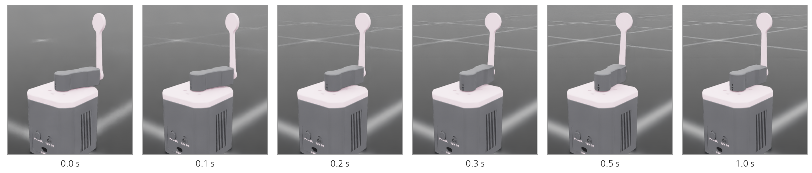

## 1. PPO 로 학습하기

### PPO 한 바퀴 (iteration)

{width=1000}

- **모으기**: 4096개 환경에서 지금의 정책으로 16 스텝씩 움직여 봅니다. 관측 · 행동 · 보상 65,536 묶음이 모입니다.
- **고치기**: 그 경험으로 신경망 두 개를 고칩니다. 행동을 내는 **액터(actor)** 와, 지금 상태가 앞으로 얼마나 좋은지 점수를 예측하는 **크리틱(critic)** 입니다.
- PPO(Proximal Policy Optimization)는 한 번에 정책을 너무 크게 바꾸지 않도록 제한합니다. 그래서 학습이 안정적이고, Isaac Lab 의 보행 학습들도 기본으로 씁니다.

### 학습 실행

```bash
cd ~/rl_shortcut && source .venv/bin/activate
python scripts/train.py --task pendulum --headless
```

- 150 iteration 을 학습합니다. 이 PC(RTX 5060 Ti)에서 학습 15초, 프로그램 시작부터 끝까지 22초 걸렸습니다.
- `--headless` 를 빼면 창이 열리고 4096개 키트가 움직이는 모습을 볼 수 있지만, 화면을 그리느라 느려집니다.

### 실행 결과: 마지막 iteration

{width=1000}

### 로그 읽기

{width=1000}

- `Episode_Reward/…` 는 보상 항목별 점수(초당 평균)입니다. `alive` 1.0 이 거의 전부이고 감점 항목은 0.001 수준입니다. 진자를 세운 채 팔도 거의 움직이지 않는다는 뜻입니다.
- `Episode_Termination/time_out` 1.0 : 끝난 에피소드가 모두 5초를 다 채웠습니다. 쓰러진 진자(`pole_fell`)도, 범위를 벗어난 팔(`arm_out`)도 없습니다.

### 학습 곡선

{width=1000}

- 처음 15 iteration 동안 에피소드 길이가 90 스텝(약 1초)까지 늘고, 한동안 그대로 머뭅니다. 쓰러지는 것을 조금 늦추는 법만 배운 단계입니다.
- 37 iteration 근처에서 길이가 갑자기 500 스텝(5초)으로 뛰어오릅니다. 팔을 돌려 진자를 다시 세우는 법을 찾은 순간이고, 그 뒤로 끝까지 유지합니다.
- 같은 그래프를 TensorBoard 로 볼 수 있습니다: `tensorboard --logdir logs/pendulum` 후 브라우저에서 `http://localhost:6006`.

### 저장된 것

```bash
ls logs/pendulum/
ls logs/pendulum/*/
```

- 학습할 때마다 `logs/pendulum/<날짜_시각>/` 폴더가 생깁니다. `model_<iteration>.pt` 가 50 iteration 마다 저장되고, 마지막 것(`model_149.pt`)이 완성된 정책입니다.
- `events.out.tfevents…` 는 TensorBoard 기록입니다. 저장소의 `checkpoints/pendulum.pt` 는 이 페이지의 학습 결과입니다.

## 2. 평가: 학습한 정책 돌려 보기

### play.py

```bash
python scripts/play.py --task pendulum
```

- 가장 최근 학습의 마지막 체크포인트를 자동으로 찾아 16개 환경에서 돌립니다. 창을 닫으면 끝납니다. `logs/pendulum/` 이 없으면 `checkpoints/pendulum.pt` 를 씁니다.
- 다른 체크포인트를 보려면 `--checkpoint logs/pendulum/<날짜_시각>/model_50.pt` 처럼 경로를 줍니다.

### 실행 결과: 화면

{width=1000}

### 기울어진 진자를 바로 세우기

{width=1000}

- 리셋 직후 진자는 조금 기운 채(최대 ±11°), 팔과 진자 모두 무작위 속도로 시작합니다. 정책은 진자가 기운 쪽으로 팔을 돌려 진자 아래를 받쳐 세웁니다.

### 실행 결과: 터미널

{width=1000}

- `fails` : 실패로 끝난 에피소드 수 (진자가 쓰러지거나 팔이 범위를 벗어남). `pendulum angle from upright` : 똑바로 선 자세에서 기운 각도의 평균 절댓값(rad).
- 첫 1초에는 기운 상태에서 시작한 진자를 세우느라 0.027 rad 이고, 그 뒤로는 0.001 rad(0.06°) 아래로 거의 꼿꼿이 섭니다.

## 3. 코드: scripts/train.py

### 환경과 학습기 만들기

```python
task = importlib.import_module(f"rl_shortcut.{args.task}_env")   # pendulum_env, go2_env, g1_env
env_cfg = task.make_env_cfg(args)
runner_cfg = task.make_runner_cfg(args)

env = ManagerBasedRLEnv(cfg=env_cfg)
runner = OnPolicyRunner(RslRlVecEnvWrapper(env), runner_cfg.to_dict(), log_dir=str(log_dir), device="cuda:0")
runner.learn(num_learning_iterations=runner_cfg.max_iterations, init_at_random_ep_len=True)
```

- `--task` 이름으로 환경 모듈을 고릅니다. 오늘 쓰는 세 환경 모두 이 `train.py` 하나로 학습합니다.
- `RslRlVecEnvWrapper` : Isaac Lab 환경을 RSL-RL 라이브러리가 쓰는 형식으로 감쌉니다. `OnPolicyRunner` 가 PPO 의 모으기 · 고치기를 반복합니다.

### PPO 설정: rl_shortcut/ppo.py

```python
policy=RslRlPpoActorCriticCfg(
    init_noise_std=init_noise_std,     # exploration noise at the start
    actor_hidden_dims=list(hidden),
    critic_hidden_dims=list(hidden),
    activation="elu",
    actor_obs_normalization=True,
    critic_obs_normalization=True,
),
```

- 역진자는 관측이 4개뿐이라 `hidden=(32, 32)` 의 작은 신경망으로 충분합니다. Go2 는 (128, 128, 128), G1 은 (256, 128, 64) 를 씁니다.
- `init_noise_std` : 처음에는 행동에 잡음을 섞어 이것저것 시도합니다(탐색). 학습이 진행되면 로그의 `Mean action noise std` 가 줄어듭니다 (역진자 1.0 → 0.00).

### 역진자의 PPO 설정: entropy_coef

```python
def make_runner_cfg(args):
    return make_ppo_cfg(EXPERIMENT, max_iterations=150, hidden=(32, 32), steps_per_env=16, entropy_coef=0.01)
```

- `entropy_coef` 는 탐색 잡음을 너무 빨리 줄이지 않도록 붙잡는 값입니다. 기본값 0.005 로는 잡음이 40 iteration 만에 0.03 아래로 줄고, 그 뒤 학습이 출렁였습니다. 한때 다 세우던 정책이 다시 쓰러뜨리기도 했습니다.
- 300 iteration 씩 학습해 비교했습니다. 100 iteration 이후 가장 짧았던 에피소드 길이가 0.005 에서는 283 스텝, 0.01 에서는 442 스텝입니다. 값 하나로 학습이 끝까지 안정됩니다.

## 4. 해 볼 것

### 보상 · 행동 · 관측을 바꿔 보기

{width=1000}

- `rl_shortcut/pendulum_env.py` 의 값 하나를 고치고 같은 명령으로 다시 학습한 뒤 `play.py` 로 봅니다 (`pip install -e .` 라서 다시 설치할 필요 없음). 결과를 비교한 뒤에는 원래 값으로 되돌려 둡니다.
- **MAX_TORQUE 1/100** : 0.0014 Nm 으로도 세웁니다. 거의 서 있는 진자를 유지하는 데는 힘이 거의 들지 않습니다. 매달린 진자를 흔들어 올리는(swing-up) 과제라면 이야기가 다릅니다.
- **joint_vel 관측 빼기** : 각도만 보면 진자가 지금 넘어지는 중인지 일어서는 중인지 알 수 없습니다. 57 스텝(0.6초) 만에 쓰러집니다. 관측도 환경 설계의 일부입니다.

### 결과 읽기: 보상

- **pole_upright 0** : 그래도 세웁니다. 46° 넘게 기울면 에피소드가 끝나고 `alive` 점수를 잃으니, "쓰러지지 마라"는 종료 조건이 대신 가르칩니다. 다만 학습 끝 길이가 333 으로 덜 안정적입니다.
- **alive 0** : 남은 보상이 모두 감점이면, 에피소드를 빨리 끝낼수록 감점이 적습니다. 정책은 3 스텝 만에 진자를 쓰러뜨리는 법을 배웠습니다.
- 정책은 우리가 **의도한 것**이 아니라 **보상과 종료 조건으로 적은 것**을 최대로 만듭니다. Go2 · G1 의 보상 항목이 많은 이유입니다.
- ④ 페이지의 질문: 진자 시작 범위를 ±0.6 rad 로 넓히면 학습 끝 에피소드 길이가 177 로 떨어집니다. 쓰러지는 경계(0.8 rad) 바로 앞에서 빠르게 시작하면 되살릴 수 없는 경우가 많습니다.
