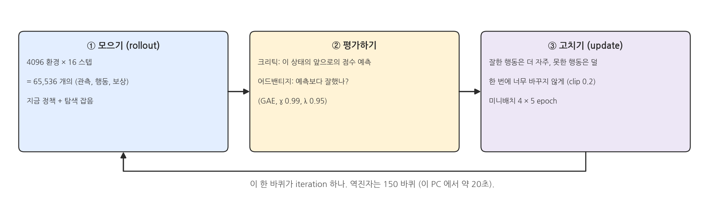
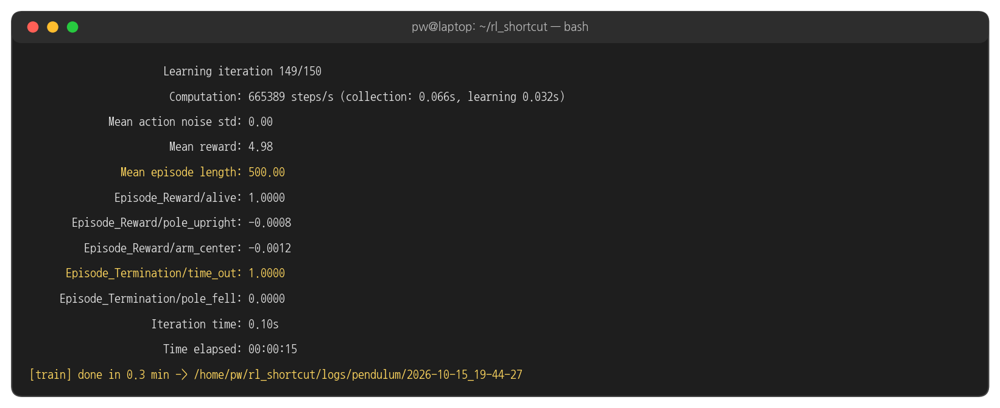
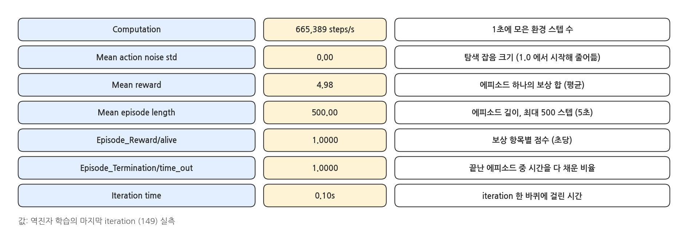
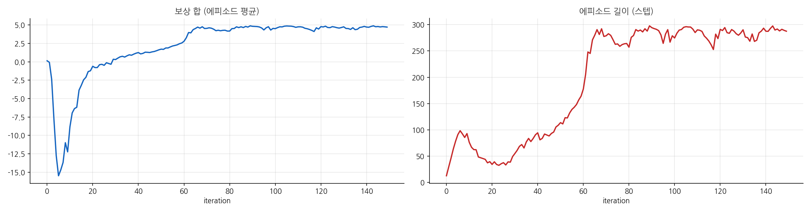
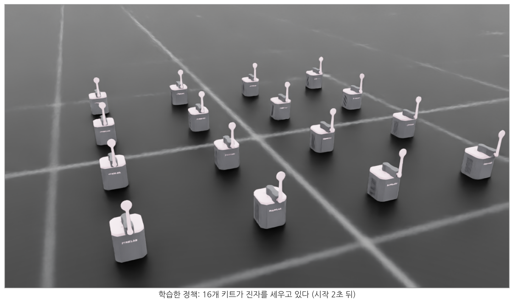
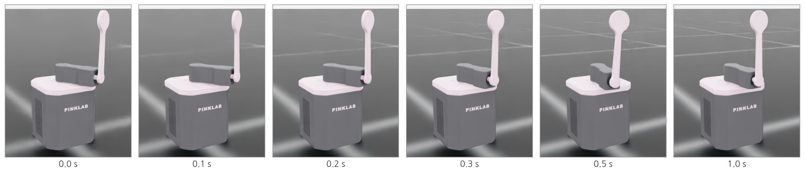
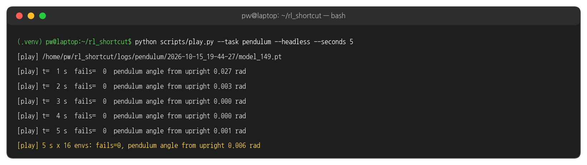
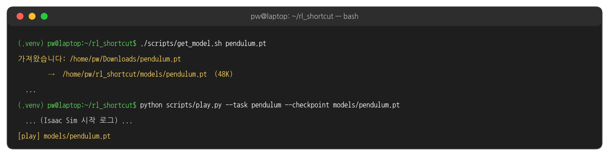
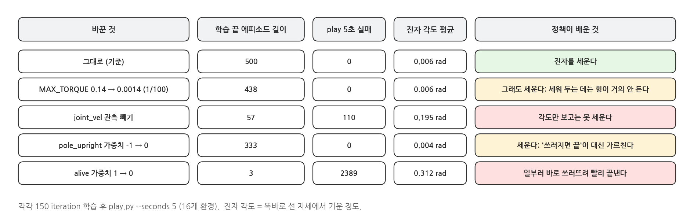

## 1. PPO 로 학습하기

### PPO 한 바퀴 (iteration)

{width=1000}

- **모으기**: 4096개 환경에서 지금의 정책으로 16 스텝씩 실행 → 관측 · 행동 · 보상 65,536 묶음
- **고치기**: 그 경험으로 신경망 두 개를 수정 · 행동을 내는 **액터(actor)** · 지금 상태가 앞으로 얼마나 좋은지 예측하는 **크리틱(critic)**
- PPO(Proximal Policy Optimization) = 한 번에 정책을 너무 크게 바꾸지 않도록 제한 → 학습이 안정적 · Isaac Lab 보행 학습의 기본

### 터미널: 학습 실행

```bash
cd ~/rl_shortcut
source scripts/env.sh
python scripts/train.py --task pendulum --headless
```

- 150 iteration 학습 · 이 PC(RTX 5060 Ti)에서 학습 15초 · 프로그램 시작부터 끝까지 22초
- `--headless` 를 빼면 창에서 4096개 키트가 움직이는 모습 확인 가능 · 화면을 그리느라 느려짐

### 실행 결과: 마지막 iteration

{width=1000}

### 로그 읽기

{width=1000}

- `Episode_Reward/…` = 보상 항목별 점수(초당 평균) · `alive` 1.0 이 거의 전부 · 감점 항목은 0.001 수준
- → 진자를 세운 채 팔도 거의 움직이지 않음
- `Episode_Termination/time_out` 1.0 = 끝난 에피소드가 모두 5초를 채움 · 쓰러진 진자(`pole_fell`) · 범위를 벗어난 팔(`arm_out`) 없음

### 학습 곡선

{width=1000}

- 처음 15 iteration: 에피소드 길이 90 스텝(약 1초)까지 늘고 정체 = 쓰러지는 것을 조금 늦추는 단계
- 37 iteration 근처: 길이가 갑자기 500 스텝(5초)으로 상승 = 팔을 돌려 진자를 다시 세우는 법을 찾은 순간 · 끝까지 유지
- TensorBoard 로 같은 그래프 확인: `tensorboard --logdir logs/pendulum` → 브라우저 `http://localhost:6006`

### 터미널: 저장된 것 보기

```bash
cd ~/rl_shortcut
ls logs/pendulum/
ls logs/pendulum/*/
```

- 학습할 때마다 `logs/pendulum/<날짜_시각>/` 폴더 생성 · `model_<iteration>.pt` 를 50 iteration 마다 저장
- 마지막 것(`model_149.pt`) = 완성된 정책 · `events.out.tfevents…` = TensorBoard 기록
- 저장소의 `checkpoints/pendulum.pt` = 이 페이지의 학습 결과

## 2. 평가: 학습한 정책 돌려 보기

### 터미널: play.py

```bash
cd ~/rl_shortcut
source scripts/env.sh
python scripts/play.py --task pendulum
```

- 가장 최근 학습의 마지막 체크포인트를 자동으로 찾아 16개 환경에서 실행 · 창을 닫으면 종료
- `logs/pendulum/` 이 없으면 `checkpoints/pendulum.pt` 사용
- 다른 체크포인트: `--checkpoint logs/pendulum/<날짜_시각>/model_50.pt` 처럼 경로 지정

### 실행 결과: 화면

{width=1000}

### 기울어진 진자를 바로 세우기

{width=1000}

- 리셋 직후: 진자는 조금 기운 채(최대 ±11°) · 팔과 진자 모두 무작위 속도로 시작
- 정책은 진자가 기운 쪽으로 팔을 돌려 진자 아래를 받쳐 세움

### 실행 결과: 터미널

{width=1000}

- `fails` = 실패로 끝난 에피소드 수 (진자가 쓰러지거나 팔이 범위를 벗어남)
- `pendulum angle from upright` = 똑바로 선 자세에서 기운 각도의 평균 절댓값(rad)
- 첫 1초 0.027 rad (기운 진자를 세우는 중) → 그 뒤 0.001 rad(0.06°) 아래

## 3. 코드: scripts/train.py

### 환경과 학습기 만들기 (코드) - train.py 발췌

```python
# scripts/train.py  (발췌)
task = importlib.import_module(f"rl_shortcut.{args.task}_env")   # pendulum_env, pinky_env, go2_env, g1_env
env_cfg = task.make_env_cfg(args)
runner_cfg = task.make_runner_cfg(args)

env = ManagerBasedRLEnv(cfg=env_cfg)
runner = OnPolicyRunner(RslRlVecEnvWrapper(env), runner_cfg.to_dict(), log_dir=str(log_dir), device="cuda:0")
runner.learn(num_learning_iterations=runner_cfg.max_iterations, init_at_random_ep_len=True)
```

- `--task` 이름으로 환경 모듈 선택 · 이 과정의 네 환경 모두 이 `train.py` 하나로 학습
- `RslRlVecEnvWrapper` = Isaac Lab 환경을 RSL-RL 형식으로 감쌈
- `OnPolicyRunner` 가 PPO 의 모으기 · 고치기를 반복

### PPO 설정 (코드) - ppo.py 발췌

```python
# rl_shortcut/ppo.py  (발췌)
policy=RslRlPpoActorCriticCfg(
    init_noise_std=init_noise_std,     # exploration noise at the start
    actor_hidden_dims=list(hidden),
    critic_hidden_dims=list(hidden),
    activation="elu",
    actor_obs_normalization=True,
    critic_obs_normalization=True,
),
```

- 신경망 크기: 역진자는 관측 4개 → `hidden=(32, 32)` 로 충분 · Go2 (128, 128, 128) · G1 (256, 128, 64)
- `init_noise_std` = 처음에는 행동에 잡음을 섞어 이것저것 시도(탐색)
- 학습이 진행되면 로그의 `Mean action noise std` 감소 (역진자 1.0 → 0.00)

### 역진자의 PPO 설정: entropy_coef (코드) - pendulum_env.py 발췌

```python
# rl_shortcut/pendulum_env.py  (발췌)
def make_runner_cfg(args):
    return make_ppo_cfg(EXPERIMENT, max_iterations=150, hidden=(32, 32), steps_per_env=16, entropy_coef=0.01)
```

- `entropy_coef` = 탐색 잡음을 너무 빨리 줄이지 않도록 붙잡는 값
- 기본값 0.005: 잡음이 40 iteration 만에 0.03 아래로 감소 → 학습이 출렁임 (다 세우던 정책이 다시 쓰러뜨리기도 함)
- 300 iteration 비교 · 100 iteration 이후 가장 짧았던 에피소드 길이: 0.005 → 283 스텝 · 0.01 → 442 스텝

## 4. 학습을 못 했다면

### 강사가 배포한 모델 받기

- 학습이 중간에 끊기면 덜 학습된 모델이 `logs/` 에 남고 다음 단계가 그것을 사용 → 강사가 배포한 `pendulum.pt` 로 진행 (이 페이지 아래 댓글의 첨부 파일)
- 브라우저로 내려받으면 다운로드 폴더에 저장됨 (`~/Downloads` · 한글 Ubuntu 는 `~/다운로드`)
- 내려받을 수 없을 때: 저장소에 같은 모델 포함 → `--checkpoint checkpoints/pendulum.pt`

### 터미널: 받은 모델로 실행

```bash
cd ~/rl_shortcut
source scripts/env.sh
./scripts/get_model.sh pendulum.pt
python scripts/play.py --task pendulum --checkpoint models/pendulum.pt
```

- `get_model.sh` = 다운로드 폴더의 파일을 작업 폴더의 `models/` 로 복사 (`~/rl_shortcut/models/pendulum.pt`)
- `--checkpoint models/pendulum.pt` = 이 파일의 정책으로 실행 · 출력의 `[play] models/pendulum.pt` 로 확인
- 이 페이지의 다른 `play.py` 명령에도 같은 옵션을 붙여 실행

### 실행 결과: 받은 모델

{width=1000}

## 5. 해 볼 것

### 보상 · 행동 · 관측을 바꿔 보기

{width=1000}

- 방법: `rl_shortcut/pendulum_env.py` 의 값 하나 수정 → 같은 명령으로 다시 학습 → `play.py` 로 확인 · 비교 뒤 원래 값으로 복구
- **MAX_TORQUE 1/100** : 0.0014 Nm 으로도 세움 · 거의 서 있는 진자를 유지하는 데는 힘이 거의 들지 않음 (흔들어 올리는 swing-up 과제라면 다름)
- **joint_vel 관측 빼기** : 각도만으로는 넘어지는 중인지 일어서는 중인지 알 수 없음 → 57 스텝(0.6초) 만에 쓰러짐 · 관측도 환경 설계의 일부

### 결과 읽기: 보상

- **pole_upright 0** : 그래도 세움 · 46° 넘게 기울면 `alive` 점수를 잃으므로 종료 조건이 대신 가르침 · 다만 학습 끝 길이 333 으로 덜 안정적
- **alive 0** : 남은 보상이 모두 감점 → 빨리 끝낼수록 감점이 적음 → 3 스텝 만에 진자를 쓰러뜨리는 법을 배움
- 정책은 **의도한 것**이 아니라 **보상과 종료 조건으로 적은 것**을 최대로 만듦 = Go2 · G1 의 보상 항목이 많은 이유

### 결과 읽기: 시작 범위

- ④ 페이지의 질문: 진자 시작 범위를 ±0.6 rad 로 넓히면 학습 끝 에피소드 길이 177 로 감소
- 쓰러지는 경계(0.8 rad) 바로 앞에서 빠르게 시작하면 되살릴 수 없는 경우가 많음
