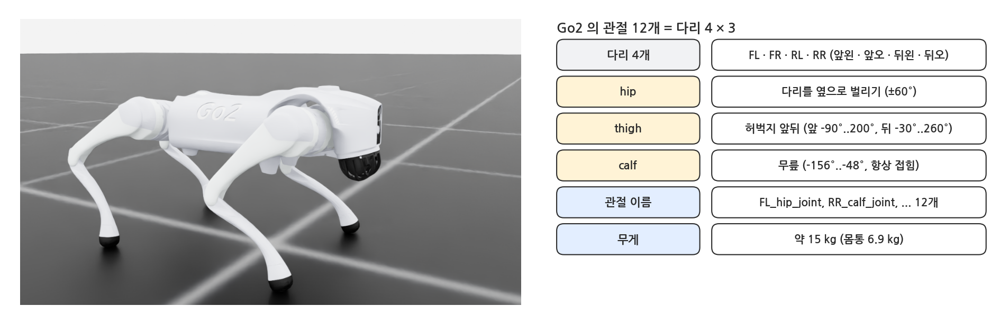
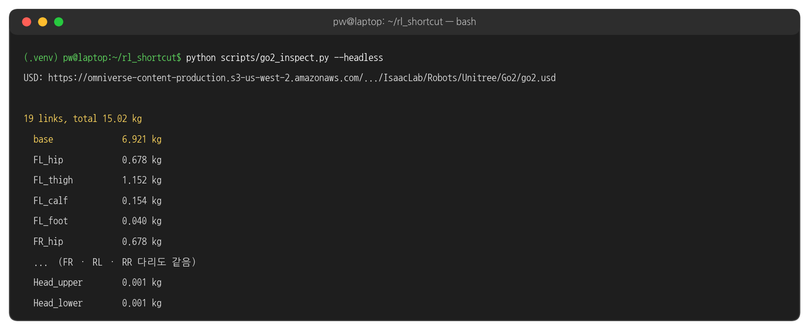
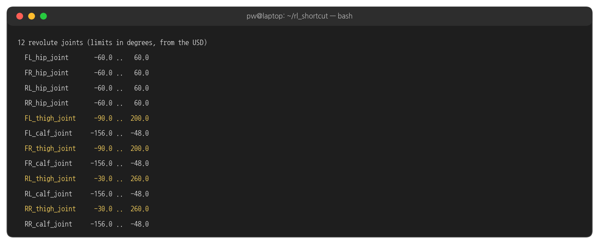
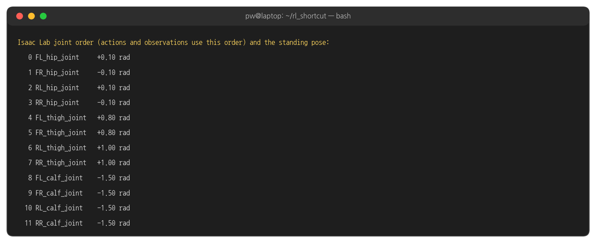
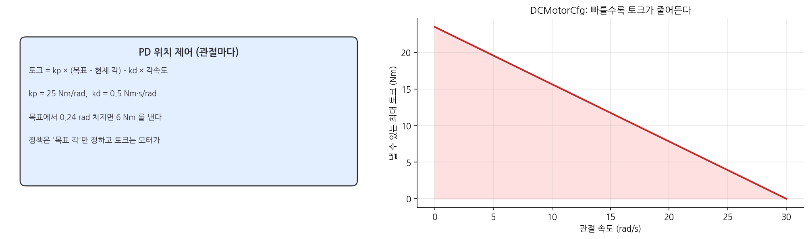
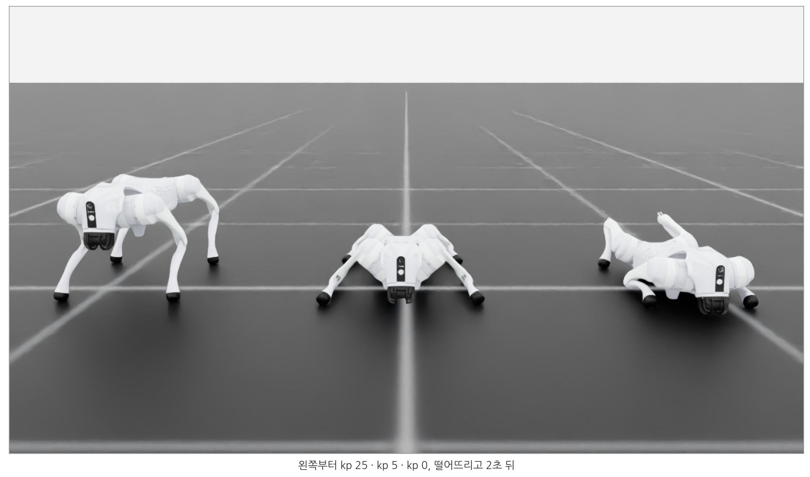
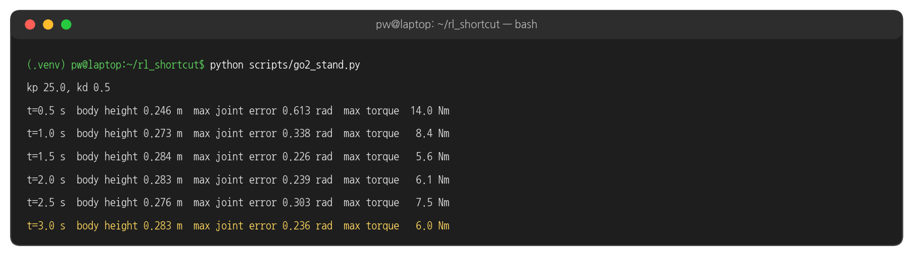

## 1. Unitree Go2

### 로봇

{width=1000}

- Unitree 의 4족 보행 로봇. 다리마다 모터 3개(hip · thigh · calf), 모두 12개입니다.
- 이 페이지에서는 Go2 의 USD 파일 하나에서 출발해, 학습에 필요한 정보(관절 이름 · 순서 · 한계, 질량)를 꺼내고, 모터를 설정해 서 있게 합니다. ⑦ 페이지에서 이 로봇으로 걷기 환경을 만듭니다.

### go2.usd

```python
from isaaclab.utils.assets import ISAACLAB_NUCLEUS_DIR

GO2_USD = f"{ISAACLAB_NUCLEUS_DIR}/Robots/Unitree/Go2/go2.usd"
```

- NVIDIA 가 공개한 Isaac Lab 에셋 서버의 파일입니다. 처음 쓸 때 내려받아 캐시(`~/.cache/ov`)에 저장하므로, 처음 실행은 인터넷이 필요합니다.
- Unitree 가 공개한 URDF 를 USD 로 바꾼 것입니다. 링크 · 관절 · 충돌 모양 · 질량이 들어 있고, 모터의 세기(게인)는 들어 있지 않습니다. 모터는 아래 2절에서 우리가 정합니다.

## 2. USD 안을 들여다보기

### 실행

```bash
python scripts/go2_inspect.py --headless
```

- `--headless` 를 빼면 창이 열립니다. 오른쪽 위 **Stage** 탭에서 `/World/Go2` 를 펼치면 아래 출력과 같은 나무 구조가 보입니다.

### 실행 결과: 링크와 질량

{width=1000}

- 몸통(base) 6.9 kg 에 다리 하나가 약 2 kg 입니다. `foot` 은 발끝 공(충돌용), `Head_upper/lower` 는 머리 모양(질량 거의 0)입니다.

### 실행 결과: 관절 한계

{width=1000}

- 앞다리와 뒷다리의 thigh 범위가 다릅니다 (앞 -90°..200°, 뒤 -30°..260°). calf 는 -156°..-48° 로 무릎이 항상 접혀 있습니다.

### 실행 결과: Isaac Lab 의 관절 순서

{width=1000}

- USD 의 나열 순서(다리별)와 Isaac Lab 이 쓰는 순서(관절 종류별: hip 4 → thigh 4 → calf 4)가 다릅니다.
- 정책의 행동 12개 · 관측의 관절 12개는 모두 **Isaac Lab 순서**입니다. 학습한 정책을 실물 로봇에 옮길 때 가장 흔한 실수가 이 순서를 섞는 것입니다.

### 코드: USD 나무 훑기

```python
stage = sim_utils.get_current_stage()
for prim in stage.Traverse():
    if prim.HasAPI(UsdPhysics.RigidBodyAPI):          # a link
        links.append((prim.GetName(), UsdPhysics.MassAPI(prim).GetMassAttr().Get()))
    if prim.IsA(UsdPhysics.RevoluteJoint):            # a joint
        j = UsdPhysics.RevoluteJoint(prim)
        joints.append((prim.GetName(), j.GetLowerLimitAttr().Get(), j.GetUpperLimitAttr().Get()))
```

- USD 의 물리 정보는 스키마(API)로 붙어 있습니다. `RigidBodyAPI` 가 있으면 링크, `RevoluteJoint` 이면 회전 관절입니다.

## 3. 모터 설정: GO2_CFG

### 서 있는 자세

```python
# standing pose: hips slightly out, thighs forward, knees bent (rad)
STAND_POSE = {".*L_hip_joint": 0.1, ".*R_hip_joint": -0.1,
              "F[L,R]_thigh_joint": 0.8, "R[L,R]_thigh_joint": 1.0, ".*_calf_joint": -1.5}
```

- 관절 이름은 정규식으로 고릅니다. `.*L_hip_joint` = 왼쪽 hip 두 개(FL · RL), `F[L,R]_thigh_joint` = 앞다리 thigh 두 개.
- 이 자세가 **기본 자세**입니다. ⑦ 페이지에서 정책의 행동은 이 자세로부터의 차이로 정의됩니다.

### 모터 모델

```python
actuators={
    # 12 leg motors: PD position control, torque limited by a DC motor curve (23.5 Nm, 30 rad/s)
    "legs": DCMotorCfg(joint_names_expr=[".*_hip_joint", ".*_thigh_joint", ".*_calf_joint"],
                       stiffness=25.0, damping=0.5, effort_limit=23.5, saturation_effort=23.5,
                       velocity_limit=30.0, friction=0.0),
},
```

{width=1000}

- 모터는 **PD 위치 제어**를 합니다: 토크 = kp × (목표 각 − 현재 각) − kd × 각속도. kp(`stiffness`) 25, kd(`damping`) 0.5 입니다.
- `DCMotorCfg` 는 실제 모터처럼 빠르게 돌수록 낼 수 있는 토크가 줄어드는 한계를 흉내 냅니다 (정지 시 최대 23.5 Nm, 30 rad/s 에서 0).

### 로봇 설정 전체

```python
GO2_CFG = ArticulationCfg(
    spawn=sim_utils.UsdFileCfg(
        usd_path=GO2_USD,
        activate_contact_sensors=True,
        # slow push-out when bodies overlap (otherwise an overlap at spawn launches the robot)
        rigid_props=sim_utils.RigidBodyPropertiesCfg(max_depenetration_velocity=1.0),
        articulation_props=sim_utils.ArticulationRootPropertiesCfg(
            enabled_self_collisions=False, solver_position_iteration_count=4, solver_velocity_iteration_count=0),
    ),
    init_state=ArticulationCfg.InitialStateCfg(pos=(0.0, 0.0, 0.4), joint_pos=STAND_POSE),
    soft_joint_pos_limit_factor=0.9,
```

- `activate_contact_sensors` : 발 접촉을 잴 수 있게 합니다 (⑦ 페이지의 발 공중 시간 보상).
- `max_depenetration_velocity` : USD 의 처음 자세는 다리를 쭉 편 상태라 바닥을 뚫고 생성됩니다. 이 값이 없으면 PhysX 가 겹침을 한 번에 밀어내면서 로봇이 튀어 오릅니다 (실제로 0.8 m 까지 솟았습니다).
- `soft_joint_pos_limit_factor=0.9` : 관절 한계의 90% 를 넘으면 ⑦ 페이지의 감점을 받습니다.

## 4. 서 있게 하기

### 실행

```bash
python scripts/go2_stand.py
python scripts/go2_stand.py --kp 5
python scripts/go2_stand.py --kp 0
```

- 0.4 m 높이에서 떨어뜨리고, 모터가 기본 자세를 붙잡게 합니다. kp 를 바꿔 세 번 실행해 봅니다.

### 실행 결과: kp 에 따라

{width=1000}

### 실행 결과: 터미널 (kp 25)

{width=1000}

- kp 25 에서도 관절이 목표보다 약 0.2~0.3 rad 처져 있습니다. 몸무게를 버티려면 토크가 필요하고, PD 제어는 오차가 있어야 토크를 내기 때문입니다 (토크 6 Nm ÷ kp 25 ≈ 0.24 rad).
- kp 5 는 최대 토크가 5 Nm 안팎이라 몸을 못 버티고 주저앉습니다(몸통 높이 0.08 m). kp 0 은 모터가 없는 것과 같습니다.
- 학습할 정책은 이 처짐까지 고려해 **목표 각을 조금씩 더 크게** 내는 법을 배웁니다. 모터 게인은 정책이 다룰 "몸"의 일부입니다.

## 5. 해 볼 것

- `go2_stand.py --kp 100` : 더 단단히 서지만, 실물에서 큰 게인은 진동 · 발열의 원인이 됩니다.
- `STAND_POSE` 의 calf 값을 -1.5 에서 -2.0 으로 바꾸면 몸통 높이가 어떻게 달라지는지 봅니다.
