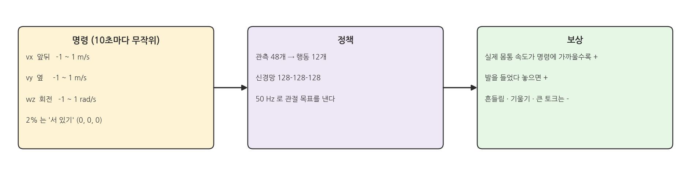
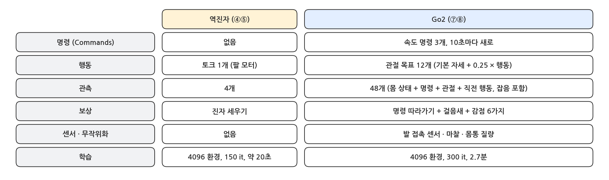
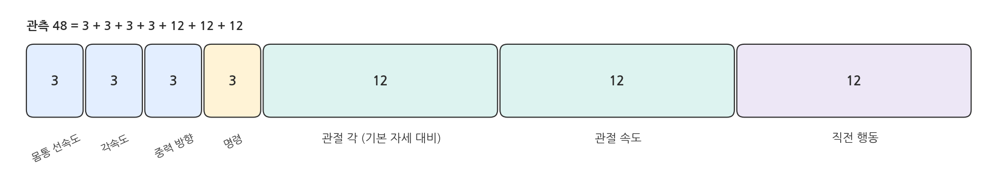
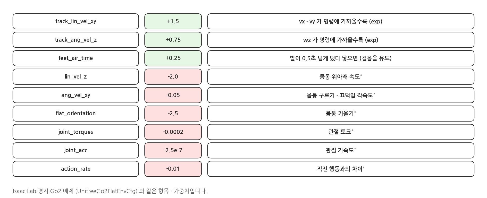
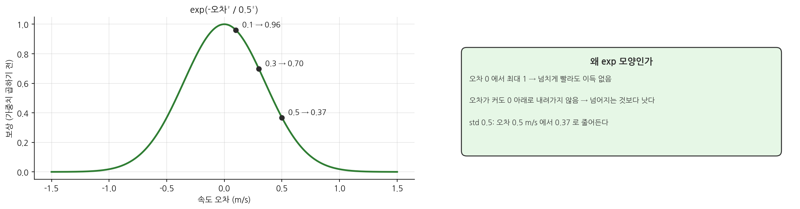

## 1. 무엇을 배우게 하나

### 과제: 속도 명령 따라 걷기

{width=1000}

- 정책은 매 순간 **속도 명령** 세 개를 받습니다: 앞뒤 속도 vx, 옆 속도 vy (각 -1 ~ 1 m/s), 회전 속도 wz (-1 ~ 1 rad/s).
- "다리를 이렇게 움직여라"는 어디에도 적혀 있지 않습니다. 명령한 속도로 몸이 움직이면 점수를 주고, 걸음새는 정책이 시행착오로 찾습니다.
- Isaac Lab 의 평지 Go2 예제(`Isaac-Velocity-Flat-Unitree-Go2-v0`)와 같은 설계를, 한 파일에 풀어 썼습니다: `rl_shortcut/go2_env.py`.

### 역진자와 무엇이 달라졌나

{width=1000}

## 2. 코드: rl_shortcut/go2_env.py

### 장면: 접촉 센서

```python
@configclass
class SceneCfg(InteractiveSceneCfg):
    ground = AssetBaseCfg(prim_path="/World/ground", spawn=sim_utils.GroundPlaneCfg(
        physics_material=sim_utils.RigidBodyMaterialCfg(static_friction=1.0, dynamic_friction=1.0)))
    robot: ArticulationCfg = GO2_CFG.replace(prim_path="{ENV_REGEX_NS}/Robot")
    # contact forces on every body: feet for air time, base for "fell over"
    contact_forces = ContactSensorCfg(prim_path="{ENV_REGEX_NS}/Robot/.*", history_length=3, track_air_time=True)
    light = AssetBaseCfg(prim_path="/World/light", spawn=sim_utils.DomeLightCfg(intensity=2000.0))
```

- 모든 링크의 접촉력을 잽니다. 발(`.*_foot`)은 언제 떴다 닿았는지(공중 시간), 몸통(`base`)은 바닥에 닿았는지(넘어짐)를 봅니다.

### 명령 (Commands)

```python
@configclass
class CommandsCfg:
    base_velocity = mdp.UniformVelocityCommandCfg(
        asset_name="robot", resampling_time_range=(10.0, 10.0), rel_standing_envs=0.02,
        heading_command=False, debug_vis=True,
        ranges=mdp.UniformVelocityCommandCfg.Ranges(lin_vel_x=(-1.0, 1.0), lin_vel_y=(-1.0, 1.0),
                                                    ang_vel_z=(-1.0, 1.0)),
    )
```

- 10초마다 환경별로 새 명령을 무작위로 뽑습니다. 2% 의 환경은 "제자리에 서 있기"(명령 0) 를 받습니다.
- `debug_vis=True` : 창에서 로봇 위에 화살표 두 개가 보입니다 (초록: 명령, 파랑: 실제 속도).

### 행동

```python
@configclass
class ActionsCfg:
    # 12 joint targets = standing pose + 0.25 * action
    joint_pos = mdp.JointPositionActionCfg(asset_name="robot", joint_names=[".*"], scale=0.25,
                                           use_default_offset=True)
```

- 정책은 12개 숫자를 내고, 각 관절의 목표 각 = 기본 자세 + 0.25 × 행동 입니다. 이 목표를 ⑥ 페이지의 PD 모터가 따라갑니다.
- 정책이 0 을 내면 그냥 서 있는 자세입니다. 학습 초반에 엉뚱한 자세로 버둥거리는 시간을 줄여 줍니다.

### 관측: 48개

```python
base_lin_vel = ObsTerm(func=mdp.base_lin_vel, noise=Unoise(n_min=-0.1, n_max=0.1))           # 3
base_ang_vel = ObsTerm(func=mdp.base_ang_vel, noise=Unoise(n_min=-0.2, n_max=0.2))           # 3
projected_gravity = ObsTerm(func=mdp.projected_gravity, noise=Unoise(n_min=-0.05, n_max=0.05))  # 3
velocity_commands = ObsTerm(func=mdp.generated_commands, params={"command_name": "base_velocity"})  # 3
joint_pos = ObsTerm(func=mdp.joint_pos_rel, noise=Unoise(n_min=-0.01, n_max=0.01))         # 12
joint_vel = ObsTerm(func=mdp.joint_vel_rel, noise=Unoise(n_min=-1.5, n_max=1.5))           # 12
actions = ObsTerm(func=mdp.last_action)                                                     # 12
```

{width=1000}

- `projected_gravity` : 몸통 좌표에서 본 중력 방향. 몸이 얼마나 기울었는지 알려 줍니다 (평평하면 (0, 0, -1)).
- `noise=Unoise(...)` : 학습 때 관측에 작은 잡음을 섞습니다. 실제 센서는 잡음이 있으므로, 잡음에 흔들리지 않는 정책을 만들기 위해서입니다. `play.py` 에서는 끕니다.

### 이벤트: 무작위화

```python
friction = EventTerm(func=mdp.randomize_rigid_body_material, mode="startup",
                     params={"asset_cfg": SceneEntityCfg("robot", body_names=".*"),
                             "static_friction_range": (0.8, 0.8), "dynamic_friction_range": (0.6, 0.6),
                             "restitution_range": (0.0, 0.0), "num_buckets": 64})
base_mass = EventTerm(func=mdp.randomize_rigid_body_mass, mode="startup",
                      params={"asset_cfg": SceneEntityCfg("robot", body_names="base"),
                              "mass_distribution_params": (-1.0, 3.0), "operation": "add"})
```

- `mode="startup"` : 처음 한 번, 환경마다 다르게 정합니다. 몸통 질량을 -1 ~ +3 kg 바꿔서, 짐을 얹은 로봇 · 가벼운 로봇이 섞여 학습합니다.
- 이렇게 물리 값을 일부러 흩뜨리는 것을 **도메인 무작위화(domain randomization)** 라고 합니다. 시뮬레이터와 실물의 차이를 견디게 하는 대표적인 방법입니다.

### 이벤트: 리셋

```python
reset_base = EventTerm(func=mdp.reset_root_state_uniform, mode="reset",
                       params={"pose_range": {"x": (-0.5, 0.5), "y": (-0.5, 0.5), "yaw": (-math.pi, math.pi)},
                               "velocity_range": {}})
reset_joints = EventTerm(func=mdp.reset_joints_by_scale, mode="reset",
                         params={"position_range": (1.0, 1.0), "velocity_range": (0.0, 0.0)})
```

- 리셋할 때 위치는 ±0.5 m, 방향은 360° 아무 쪽이나 보고 시작합니다. 관절은 기본 자세 그대로입니다.

## 3. 보상 설계

### 보상 항목

```python
track_lin_vel_xy = RewTerm(func=mdp.track_lin_vel_xy_exp, weight=1.5,
                           params={"command_name": "base_velocity", "std": 0.5})
track_ang_vel_z = RewTerm(func=mdp.track_ang_vel_z_exp, weight=0.75,
                          params={"command_name": "base_velocity", "std": 0.5})
feet_air_time = RewTerm(func=loco.feet_air_time, weight=0.25,
                        params={"sensor_cfg": SceneEntityCfg("contact_forces", body_names=".*_foot"),
                                "command_name": "base_velocity", "threshold": 0.5})
```

{width=1000}

### 따라가기 보상의 모양

{width=1000}

- 속도 오차가 0 이면 1, 커질수록 0 에 가까워집니다. 최대값이 정해져 있어서 "빠를수록 좋다"가 아니라 "명령에 가까울수록 좋다"가 됩니다.
- 따라가기 보상만 있으면 정책은 발을 질질 끌거나 몸을 떨면서도 속도를 맞춥니다. 그래서 감점 항목으로 "보기 좋고 몸에 무리가 없는" 걸음을 유도합니다.

### 감점 항목

```python
lin_vel_z = RewTerm(func=mdp.lin_vel_z_l2, weight=-2.0)
ang_vel_xy = RewTerm(func=mdp.ang_vel_xy_l2, weight=-0.05)
flat_orientation = RewTerm(func=mdp.flat_orientation_l2, weight=-2.5)
joint_torques = RewTerm(func=mdp.joint_torques_l2, weight=-2.0e-4)
joint_acc = RewTerm(func=mdp.joint_acc_l2, weight=-2.5e-7)
action_rate = RewTerm(func=mdp.action_rate_l2, weight=-0.01)
```

- 몸통이 위아래로 튀거나(`lin_vel_z`), 구르거나(`ang_vel_xy`), 기울면(`flat_orientation`) 감점입니다.
- 토크 · 관절 가속도 · 행동 변화가 크면 감점합니다. 실물 모터를 아끼고 떨림을 줄이는 항목입니다.

### 종료

```python
@configclass
class TerminationsCfg:
    time_out = DoneTerm(func=mdp.time_out, time_out=True)
    base_contact = DoneTerm(func=mdp.illegal_contact,
                            params={"sensor_cfg": SceneEntityCfg("contact_forces", body_names="base"),
                                    "threshold": 1.0})
```

- 몸통이 바닥에 닿으면(접촉력 1 N 초과) 넘어진 것으로 보고 끝냅니다. 그 밖에는 20초를 다 채웁니다.

## 4. 해 볼 것

- `feet_air_time` 의 가중치를 0 으로 바꾸고 ⑧ 페이지처럼 학습하면 걸음새가 어떻게 달라지는지 봅니다.
- 명령 범위 `lin_vel_x` 를 (-2.0, 2.0) 으로 넓히면 Go2 가 뛰기 시작할까요?
