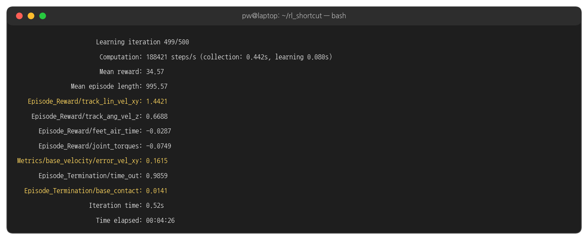
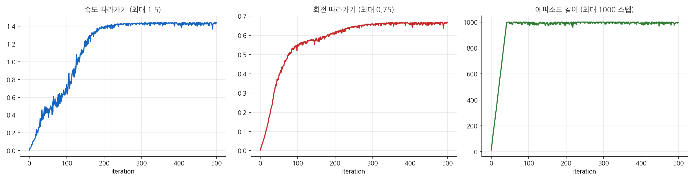
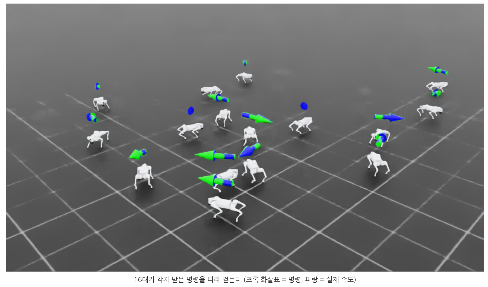
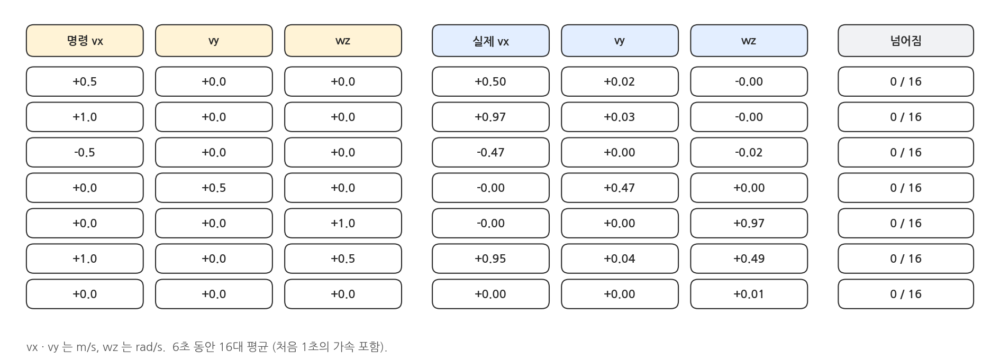
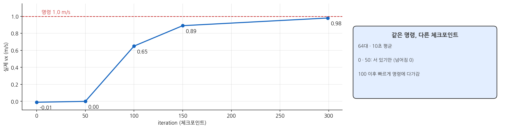
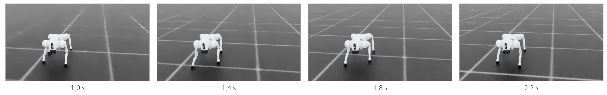

## 1. 학습

### 터미널: 학습 실행

```bash
cd ~/rl_shortcut && source .venv/bin/activate
python scripts/train.py --task go2 --headless
```

- 4096 대의 Go2 가 동시에 연습 · 500 iteration · 이 PC(RTX 5060 Ti)에서 **4.5분** (iteration 당 0.52초)
- 한 iteration = 4096 대 × 24 스텝 = 약 10만 스텝의 경험
- 500 iteration = 약 4천9백만 스텝 = Go2 한 대가 **약 11일** 걸을 분량

### 실행 결과: 마지막 iteration

{width=1000}

- `Episode_Reward/track_lin_vel_xy` 1.44 = 최대값(가중치 1.5)의 96% · 실제 속도 오차 평균 0.16 m/s (`Metrics/base_velocity/error_vel_xy`)
- `Episode_Reward/feet_air_time` -0.03 : 이 보상은 (공중 시간 - 0.5초) → 0.5초보다 짧은 잰걸음이면 음수 · 정책은 작은 감점을 감수하고 짧고 빠른 걸음을 선택
- `Episode_Termination/base_contact` 0.014 = 끝난 에피소드 중 넘어진 것은 1.4%

### 학습 곡선

{width=1000}

- 에피소드 길이: 40 iteration 쯤 최대(1000 스텝 = 20초) 도달 = 넘어지지 않는 법을 먼저 익힘
- 속도 따라가기: 100 ~ 200 iteration 사이에 빠르게 상승 · 300 부터는 거의 그대로
- 회전 따라가기: 400 iteration 까지 천천히 계속 상승

## 2. 평가

### 터미널: 무작위 명령으로

```bash
cd ~/rl_shortcut
python scripts/play.py --task go2
```

### 실행 결과: 무작위 명령

{width=1000}

- 로봇 위의 화살표: **초록 = 명령한 속도 · 파랑 = 실제 속도** → 두 화살표가 겹치면 잘 따라가는 것
- 10초마다 명령 변경 · 창을 닫으면 종료

### 터미널: 정해진 명령으로

```bash
cd ~/rl_shortcut
python scripts/play.py --task go2 --cmd 1.0 0.0 0.0     # 앞으로 1 m/s
python scripts/play.py --task go2 --cmd 0.0 0.0 1.0     # 제자리 회전 1 rad/s
```

- `--cmd vx vy wz` = 모든 로봇에 같은 명령
- 터미널에 1초마다 실제 속도(16대 평균) 출력

### 실행 결과: 명령과 실제 속도

{width=1000}

- 앞뒤 · 옆 · 대각 이동: 명령과 0.05 m/s 안에서 일치
- 제자리 회전: 1.0 rad/s 명령에 0.97 rad/s
- 7가지 모두 넘어진 로봇 없음 (fails=0)

### 터미널: 학습 중간의 정책

```bash
cd ~/rl_shortcut
python scripts/play.py --task go2 --cmd 1.0 0.0 0.0 --checkpoint logs/go2/<날짜_시각>/model_100.pt
```

### 실행 결과: iteration 별 속도

{width=1000}

- iteration 0 · 50 · 100 의 정책: 명령을 받아도 제자리에 서 있음 (넘어지지 않는 것부터 배움)
- 150 에서 0.98 m/s → 200 에서 0.85 m/s 로 흔들린 뒤 → 마지막(499) 0.99 m/s

## 3. 영상으로 저장하기

### 터미널: --video

```bash
cd ~/rl_shortcut
python scripts/play.py --task go2 --headless --enable_cameras --cmd 1.0 0.0 0.0 --seconds 10 \
    --video outputs/go2_forward.mp4
```

- `--enable_cameras` = 창 없이도 화면을 그릴 수 있게 함
- 첫 번째 로봇(env 0)을 따라가는 카메라로 촬영

### 실행 결과: 저장된 영상

{width=1000}

## 4. 코드: play.py 의 핵심

### 정책 불러오기와 실행 (코드) - play.py 발췌

```python
# scripts/play.py (발췌)
env = ManagerBasedRLEnv(cfg=env_cfg, render_mode="rgb_array" if args.video else None)
wrapped = RslRlVecEnvWrapper(env)
runner = OnPolicyRunner(wrapped, runner_cfg.to_dict(), log_dir=None, device="cuda:0")
runner.load(str(ckpt), load_optimizer=False)
policy = runner.get_inference_policy(device="cuda:0")

obs = wrapped.get_observations()
while app.is_running() and (steps is None or step < steps):
    with torch.inference_mode():
        obs, _, dones, extras = wrapped.step(policy(obs))
```

- 학습 때와 같은 환경을 만들고 체크포인트를 불러옴
- **관측 → 정책 → 행동** 을 반복할 뿐
- 평가에서는 관측 잡음(`enable_corruption`)을 끄고 탐색 잡음 없이 평균 행동 사용

## 5. 학습을 못 했다면

- 저장소의 `checkpoints/go2.pt` = 이 페이지의 학습 결과
- `logs/go2/` 가 없으면 `play.py` 가 자동으로 이 파일 사용

## 6. 해 볼 것

- ⑨ 페이지의 `feet_air_time` 가중치를 0 으로 바꿔 학습 → 걸음새를 이 페이지의 영상과 비교
- `--max_iterations 100` 으로 짧게 학습하면 어디까지 걷는지 확인 (이 페이지의 iteration 별 그래프와 비교)
