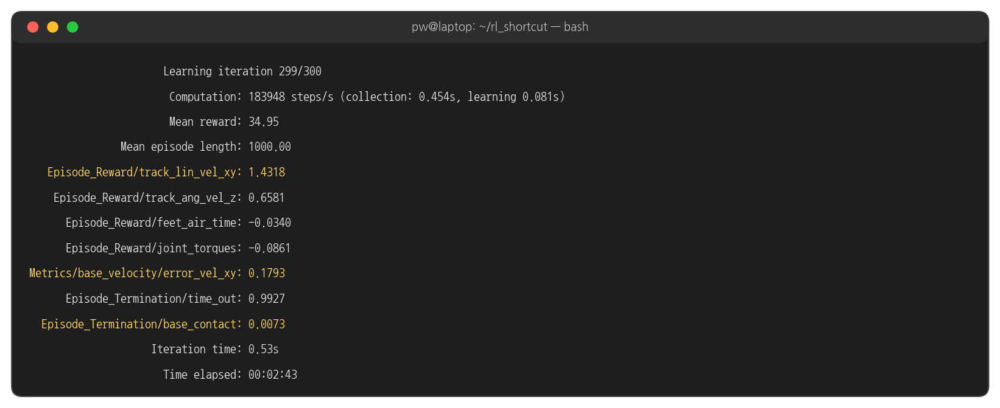
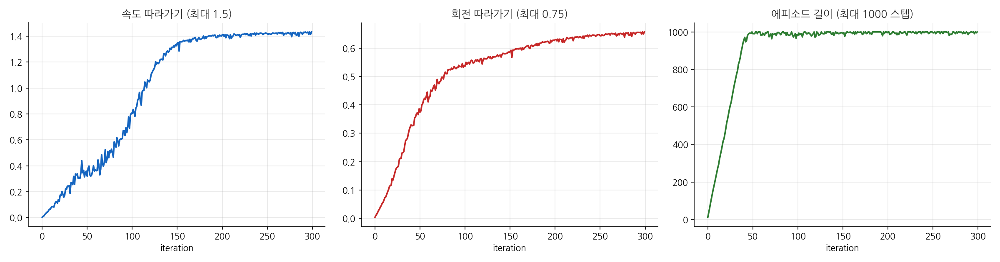
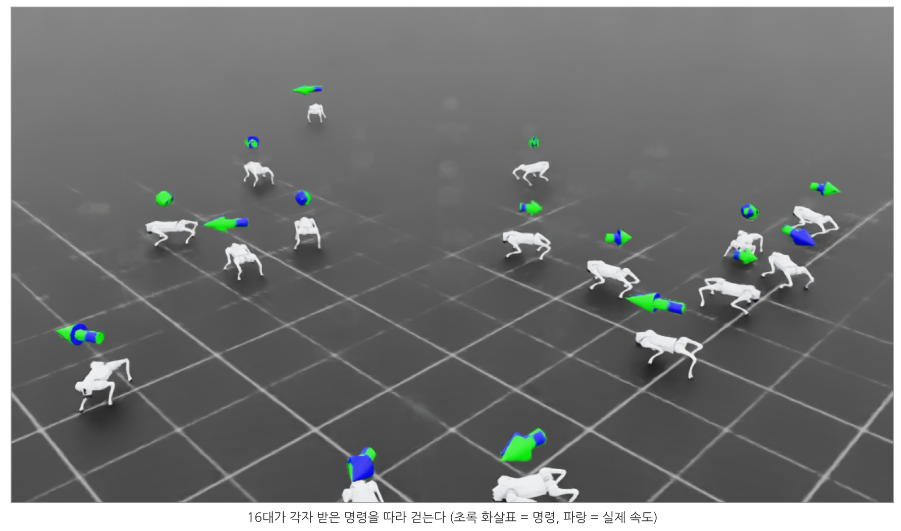
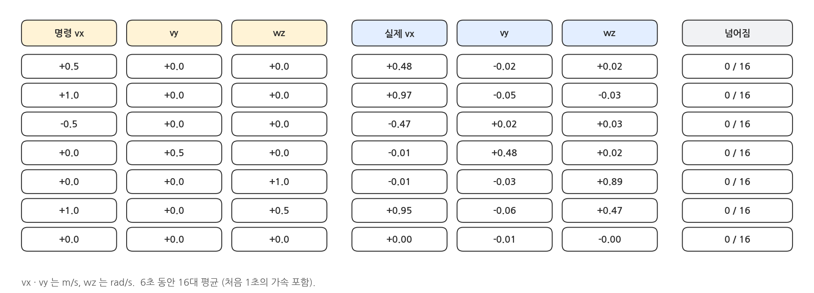
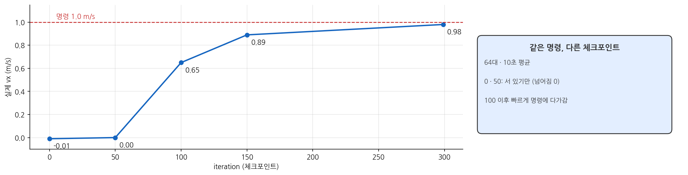
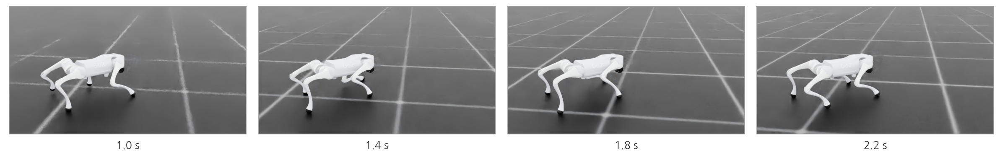

## 1. 학습

### 실행

```bash
cd ~/rl_shortcut && source .venv/bin/activate
python scripts/train.py --task go2 --headless
```

- 4096 대의 Go2 가 동시에 연습합니다. 300 iteration, 이 PC(RTX 5060 Ti)에서 **2.7분** 걸렸습니다 (iteration 당 0.54초).
- 한 iteration = 4096 대 × 24 스텝 = 약 10만 스텝의 경험. 300 iteration 이면 약 3천만 스텝, 실제 시간으로 치면 Go2 한 대가 **약 7일** 걸을 분량입니다.

### 실행 결과: 마지막 iteration

{width=1000}

- `Episode_Reward/track_lin_vel_xy` 1.43 : 최대값이 가중치 1.5 이므로 95% 수준입니다. `Metrics/base_velocity/error_vel_xy` 0.18 m/s 가 실제 속도 오차의 평균입니다.
- `Episode_Reward/feet_air_time` 이 -0.03 으로 음수입니다. 이 보상은 (공중 시간 - 0.5초) 라서, 0.5초보다 짧은 잰걸음이면 음수가 됩니다. 정책은 이 작은 감점을 감수하고 짧고 빠른 걸음을 골랐습니다.
- `Episode_Termination/base_contact` 0.007 : 끝난 에피소드 중 넘어진 것은 1% 미만입니다.

### 학습 곡선

{width=1000}

- 에피소드 길이는 40 iteration 쯤에 최대(1000 스텝 = 20초)에 닿습니다. 넘어지지 않는 법을 먼저 익힌 것입니다.
- 속도 따라가기는 50 ~ 150 iteration 사이에 빠르게 오르고, 회전 따라가기는 300 iteration 까지 천천히 계속 오릅니다.

## 2. 평가

### 무작위 명령으로

```bash
python scripts/play.py --task go2
```

{width=1000}

- 로봇 위의 화살표: **초록 = 명령한 속도, 파랑 = 실제 속도**. 두 화살표가 겹치면 잘 따라가는 것입니다.
- 10초마다 명령이 바뀝니다. 창을 닫으면 끝납니다.

### 정해진 명령으로

```bash
python scripts/play.py --task go2 --cmd 1.0 0.0 0.0     # 앞으로 1 m/s
python scripts/play.py --task go2 --cmd 0.0 0.0 1.0     # 제자리 회전 1 rad/s
```

- `--cmd vx vy wz` 로 모든 로봇에 같은 명령을 줍니다. 터미널에 1초마다 실제 속도(16대 평균)가 나옵니다.

### 실행 결과: 명령과 실제 속도

{width=1000}

- 앞뒤 · 옆 · 대각 이동은 명령과 0.03 m/s 안에서 맞습니다. 제자리 회전은 1.0 rad/s 명령에 0.89 rad/s 로 조금 덜 돕니다.
- 7가지 모두 넘어진 로봇이 없습니다 (fails=0).

### 학습 중간의 정책은

```bash
python scripts/play.py --task go2 --cmd 1.0 0.0 0.0 --checkpoint logs/go2/<날짜_시각>/model_100.pt
```

{width=1000}

- iteration 0 · 50 의 정책은 명령을 받아도 제자리에 서 있습니다. 넘어지지 않는 것부터 배웠기 때문입니다.
- 100 에서 0.65 m/s, 150 에서 0.89 m/s, 마지막(299)에서 0.98 m/s 로 명령에 다가갑니다.

## 3. 영상으로 저장하기

### --video

```bash
python scripts/play.py --task go2 --headless --enable_cameras --cmd 1.0 0.0 0.0 --seconds 10 \
    --video outputs/go2_forward.mp4
```

- `--enable_cameras` : 창 없이도 화면을 그릴 수 있게 합니다. 첫 번째 로봇(env 0)을 따라가는 카메라로 찍습니다.

### 실행 결과

{width=1000}

## 4. 코드: play.py 의 핵심

### 정책 불러오기와 실행

```python
# scripts/play.py (발췌)
env = ManagerBasedRLEnv(cfg=env_cfg, render_mode="rgb_array" if args.video else None)
wrapped = RslRlVecEnvWrapper(env)
runner = OnPolicyRunner(wrapped, runner_cfg.to_dict(), log_dir=None, device="cuda:0")
runner.load(str(ckpt), load_optimizer=False)
policy = runner.get_inference_policy(device="cuda:0")

obs = wrapped.get_observations()
while app.is_running():
    with torch.inference_mode():
        obs, _, dones, extras = wrapped.step(policy(obs))
```

- 학습 때와 같은 환경을 만들고 체크포인트를 불러온 뒤, **관측 → 정책 → 행동** 을 반복할 뿐입니다. 평가에서는 잡음(`enable_corruption`)을 끄고 탐색 잡음 없이 평균 행동을 씁니다.

## 5. 학습을 못 했다면

- 저장소의 `checkpoints/go2.pt` 는 이 페이지의 학습 결과입니다. `logs/go2/` 가 없으면 `play.py` 가 자동으로 이 파일을 씁니다.

## 6. 해 볼 것

- ⑦ 페이지의 `feet_air_time` 가중치를 0 으로 바꿔 학습하고, 걸음새를 이 페이지의 영상과 비교합니다.
- `--max_iterations 100` 으로 짧게 학습하면 어디까지 걷는지 봅니다 (이 페이지의 iteration 별 그래프와 비교).
