## 1. 휴머노이드는 무엇이 어려운가

### Unitree G1

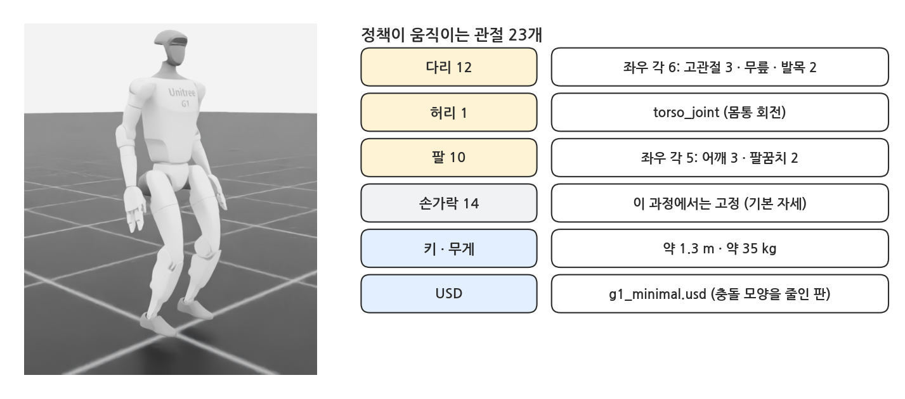{width=1000}

- 키 약 1.3 m 의 휴머노이드. 이 과정에서는 다리 12 · 허리 1 · 팔 10, **23개 관절**을 정책이 움직입니다 (손가락 14개는 기본 자세로 고정).
- Isaac Lab 이 제공하는 `G1_MINIMAL_CFG` (충돌 모양을 줄인 `g1_minimal.usd` + 모터 설정)를 그대로 씁니다.

### Go2 처럼 하면 안 되나

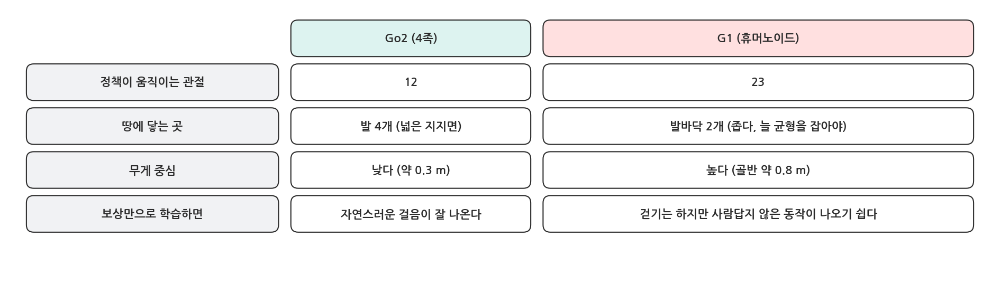{width=1000}

- 두 발로 서는 로봇은 발바닥 두 개로 균형을 잡아야 하고, 관절이 많아(23개) 가능한 움직임이 훨씬 많습니다.
- Go2 처럼 "속도만 맞추면 점수"로 학습하면 걷기는 하지만 사람답지 않은, 이상한 걸음이 나오기 쉽습니다. 원하는 동작을 보상만으로 적어 내기 어렵습니다.

### 모션 모방 (Motion Imitation)

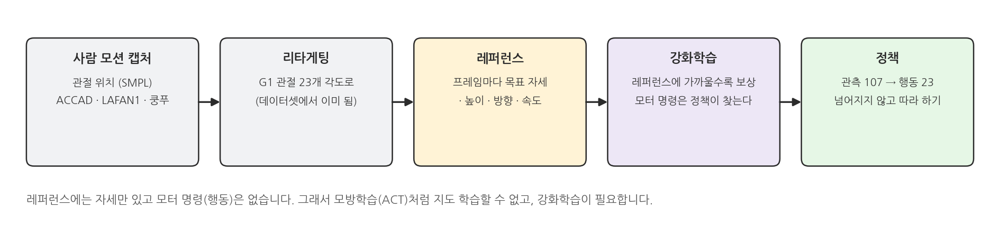{width=1000}

- 사람의 모션 캡처를 G1 의 관절 각도로 바꾼(리타게팅) 동작을 **레퍼런스(reference)** 로 둡니다.
- 보상은 "매 순간 레퍼런스와 같은 자세 · 같은 속도 · 같은 방향이면 높다" 입니다. 걸음새를 보상 식으로 적는 대신, 따라 할 본보기를 보여 줍니다.
- 모방학습(앞 과정)과 비슷해 보이지만 다릅니다. 레퍼런스에는 **행동(모터 명령)이 없고 자세만** 있습니다. 넘어지지 않으면서 그 자세를 만드는 모터 명령은 정책이 강화학습으로 찾아야 합니다.

## 2. 레퍼런스 동작 보기

### 모션 파일

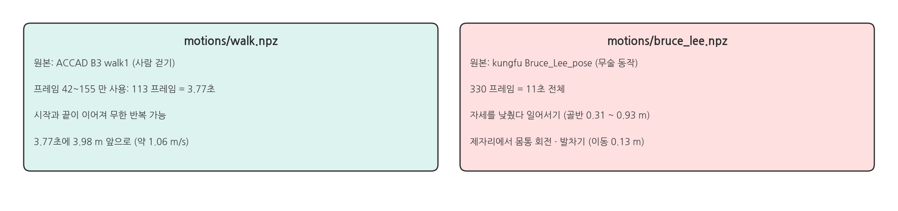{width=1000}

- `openhe/g1-retargeted-motions` (Hugging Face, MIT 라이선스)의 동작 두 개를 `tools/convert_motion.py` 로 작은 `.npz` 로 바꿔 저장소에 넣었습니다.
- `walk.npz` 는 사람 걷기 클립에서 시작과 끝이 자연스럽게 이어지는 구간(3.77초, 세 걸음)만 잘라, 끝없이 반복할 수 있게 했습니다.

### 실행

```bash
python scripts/g1_motion.py --motion walk
```

- 물리 없이 레퍼런스의 자세를 매 프레임 그대로 G1 에 적용합니다. 정책이 따라 해야 할 "정답 동작"입니다.

### 실행 결과

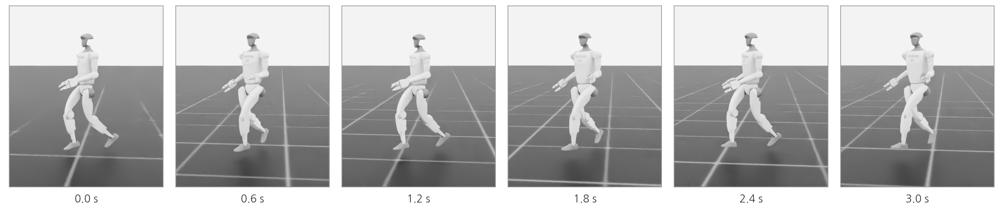{width=1000}

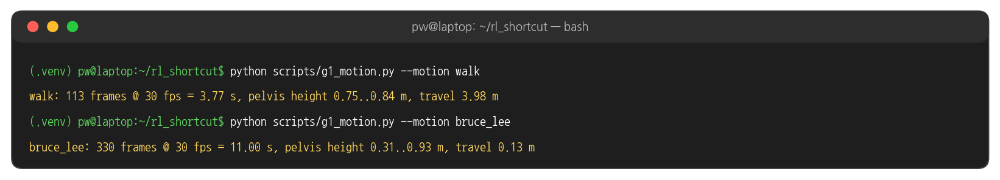{width=1000}

- 걷기는 3.77초에 3.98 m, 평균 약 1.06 m/s 로 앞으로 갑니다. 골반 높이는 0.75 ~ 0.84 m 사이에서 오르내립니다.

## 3. 코드: rl_shortcut/g1_env.py

### 관측: 107개

```python
base_lin_vel = ObsTerm(func=mdp.base_lin_vel)                                  # 3
base_ang_vel = ObsTerm(func=mdp.base_ang_vel)                                  # 3
projected_gravity = ObsTerm(func=mdp.projected_gravity)                        # 3
joint_pos = ObsTerm(func=mdp.joint_pos_rel, params={"asset_cfg": BODY})        # 23
joint_vel = ObsTerm(func=mdp.joint_vel_rel, params={"asset_cfg": BODY})        # 23
actions = ObsTerm(func=mdp.last_action)                                        # 23
ref_joint_pos = ObsTerm(func=ref_joint_pos)                                    # 23
ref_phase = ObsTerm(func=ref_phase)                                            # 2
yaw_error = ObsTerm(func=yaw_error)                                            # 2
ref_velocity = ObsTerm(func=ref_velocity)                                      # 2
```

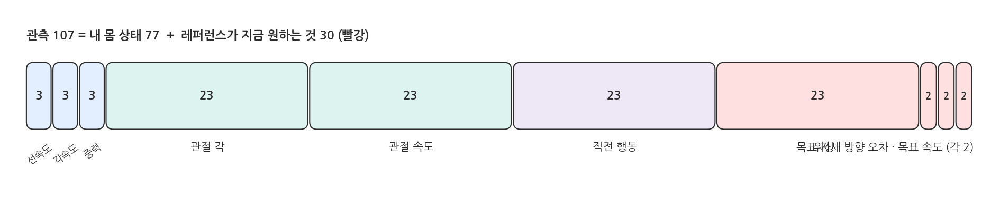{width=1000}

- 앞의 6개(77개)는 Go2 와 같은 "내 몸 상태"입니다. 뒤의 4개(30개)가 **레퍼런스가 지금 원하는 것**: 목표 자세 23 · 동작의 어디쯤인지 2 · 방향 오차 2 · 목표 이동 속도 2.
- 정책은 이 30개를 보고 다음 순간의 자세를 정합니다. 그래서 레퍼런스를 바꾸면 같은 정책에도 다른 목표가 들어갑니다 (⑩ 페이지에서 이용합니다).

### 레퍼런스 따라가기 보상

```python
def track_joints(env, scale=1.0, arms_only=False):
    r = ref(env)
    target = r.motion.dof[r.frame(env)]
    q = env.scene["robot"].data.joint_pos[:, r.ids]
    if arms_only:
        target, q = target[:, ARM_SLICE], q[:, ARM_SLICE]
    return torch.exp(-scale * torch.sum(torch.square(q - target), dim=1))
```

- `r.frame(env)` : 환경마다 지금 따라가야 할 레퍼런스 프레임 번호. 에피소드 시작 프레임 + 지난 시간 × 30 fps 이고, 클립 끝에 닿으면 처음으로 돌아갑니다.
- 23개 관절 오차 제곱합이 0 이면 1, 커질수록 0. ⑦ 페이지의 속도 따라가기와 같은 모양(exp)입니다.

### 보상 항목

```python
alive = RewTerm(func=mdp.is_alive, weight=1.0)
joints = RewTerm(func=track_joints, weight=5.0)                                     # whole-body pose
arms = RewTerm(func=track_joints, weight=2.0, params={"scale": 3.0, "arms_only": True})
velocity = RewTerm(func=track_velocity, weight=2.0)
yaw = RewTerm(func=track_yaw, weight=2.0)
height = RewTerm(func=track_height, weight=2.0)
```

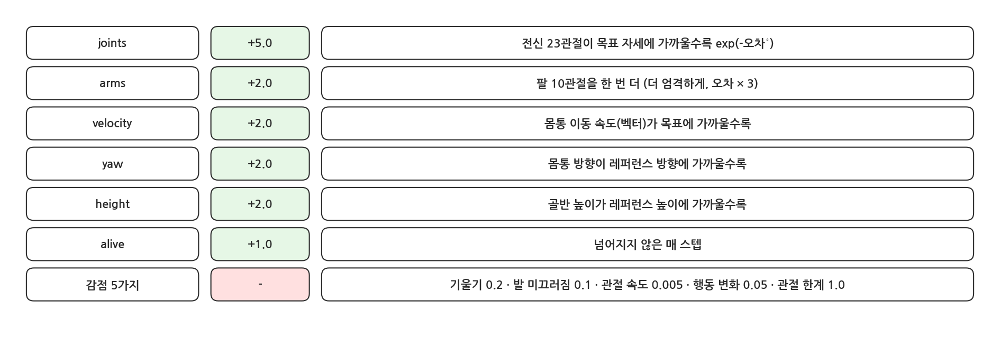{width=1000}

- 가장 큰 가중치(5)는 전신 자세입니다. 팔은 다리보다 몸 균형에 덜 중요해서 쉽게 무시되므로 따로 한 번 더(2) 줍니다.
- 그 밖에 몸 기울기 · 발 미끄러짐 · 관절 속도 · 행동 변화 · 관절 한계에 작은 감점이 있습니다 (Go2 와 같은 역할).

### 시작 자세: RSI (앞부분)

```python
def reset_to_clip(env, env_ids):
    """Reference State Initialization: start each episode at a random frame of the clip."""
    r, robot, m = ref(env), env.scene["robot"], ref(env).motion
    f = torch.randint(0, m.T, (len(env_ids),), device=env.device)
    r.start[env_ids] = f
    joint_pos = robot.data.default_joint_pos[env_ids].clone()
    joint_vel = robot.data.default_joint_vel[env_ids].clone()
    joint_pos[:, r.ids] = m.dof[f]
    joint_vel[:, r.ids] = m.dof_vel[f]
    robot.write_joint_state_to_sim(joint_pos, joint_vel, env_ids=env_ids)
```

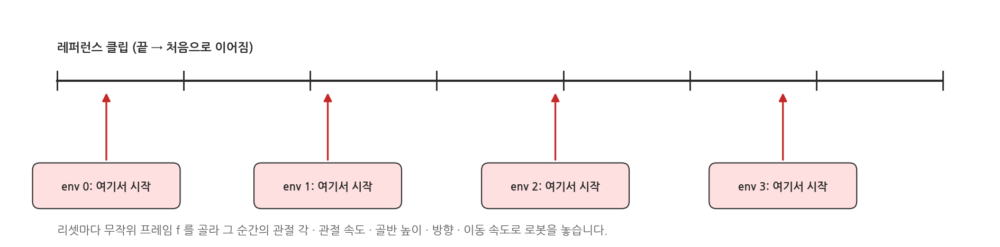{width=1000}

- **RSI(Reference State Initialization)** : 리셋할 때 클립의 무작위 프레임을 골라, 그 순간의 자세 · 관절 속도 · 몸통 높이 · 방향 · 이동 속도로 로봇을 놓습니다.
- 항상 차렷 자세에서 시작하면 첫 걸음에서 넘어지기만 반복하고, 클립의 뒷부분은 연습할 기회가 없습니다. RSI 로 2048 대가 클립의 모든 순간을 고르게 연습합니다.

### 종료

```python
time_out = DoneTerm(func=mdp.time_out, time_out=True)
tilted = DoneTerm(func=mdp.bad_orientation, params={"limit_angle": 0.8})
height_off = DoneTerm(func=height_off, params={"limit": 0.3})
```

- 몸이 46°(0.8 rad) 넘게 기울거나, 골반 높이가 레퍼런스와 0.3 m 넘게 다르면(넘어짐) 끝냅니다. 에피소드는 최대 12초입니다.

## 4. 학습: 앞으로 걷기

### 실행

```bash
python scripts/train.py --task g1 --motion walk --headless
```

- 2048 대, 2000 iteration. 이 PC 에서 **29분** 걸렸습니다 (iteration 당 0.78초).
- 수업 시간이 빠듯하면 `--max_iterations 300` 으로 약 4분만 학습해도 넘어지지 않고 걷습니다 (아래 5절 그래프). 저장소의 `checkpoints/g1_walk.pt` 는 2000 iteration 결과입니다.

### 실행 결과: 마지막 iteration

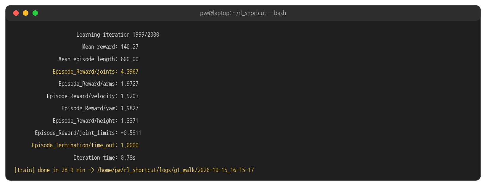{width=1000}

### 학습 곡선

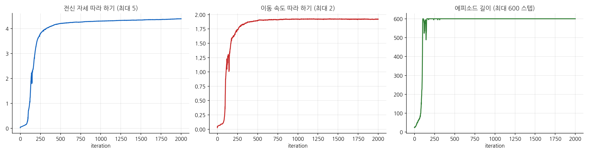{width=1000}

- 처음 100 iteration 쯤까지는 대부분 곧 넘어집니다. 100 ~ 250 iteration 사이에 에피소드가 12초(600 스텝)를 다 채우게 되고, 자세 · 속도 점수가 함께 뛰어오릅니다.
- 500 iteration 이후는 자세 점수가 아주 천천히 오르는 다듬기 단계입니다.

## 5. 평가: 앞으로 걷기

### 실행

```bash
python scripts/play.py --task g1 --motion walk
```

### 실행 결과

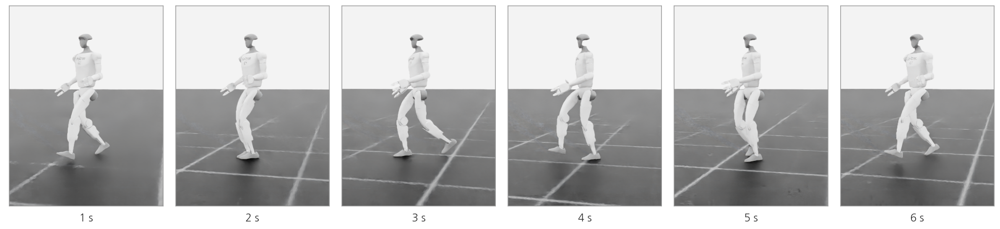{width=1000}

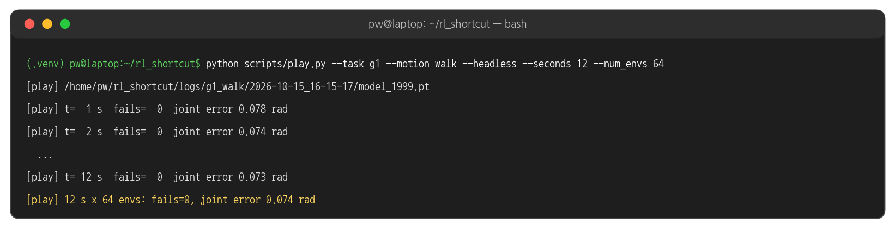{width=1000}

- `fails` : 넘어져서 끝난 에피소드 수. 64 대가 12초 동안 한 번도 넘어지지 않았습니다.
- `joint error` : 23개 관절이 레퍼런스와 평균 몇 rad 다른지(RMS). 0.074 rad ≈ 4.2° 입니다.

### 학습을 짧게 하면

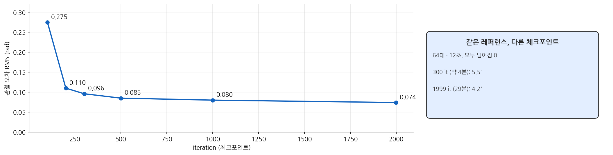{width=1000}

- 100 iteration 정책도 넘어지지는 않지만 자세가 레퍼런스와 꽤 다릅니다(0.275 rad ≈ 16°). 300 iteration 이면 5.5° 로, 눈으로 보기에 이미 사람처럼 걷습니다.

## 6. 해 볼 것

- `--max_iterations 300` 으로 짧게 학습한 정책과 2000 iteration 정책을 `play.py` 로 비교합니다.
- `RewardsCfg` 의 `arms` 가중치를 0 으로 바꾸면 팔 흔들기가 어떻게 되는지 봅니다.
