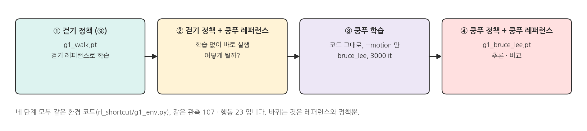
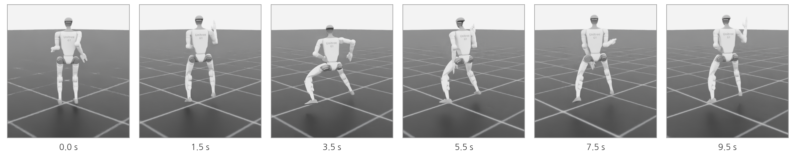
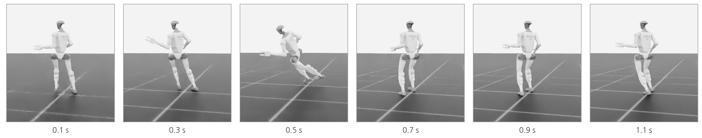
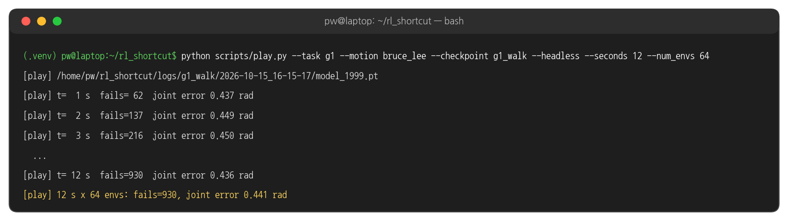
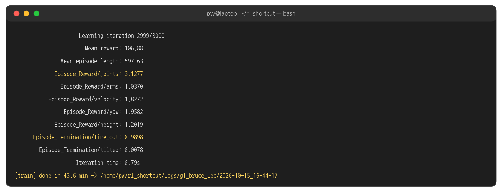
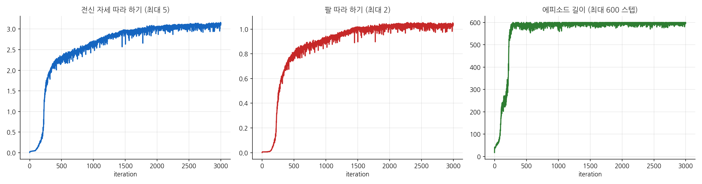
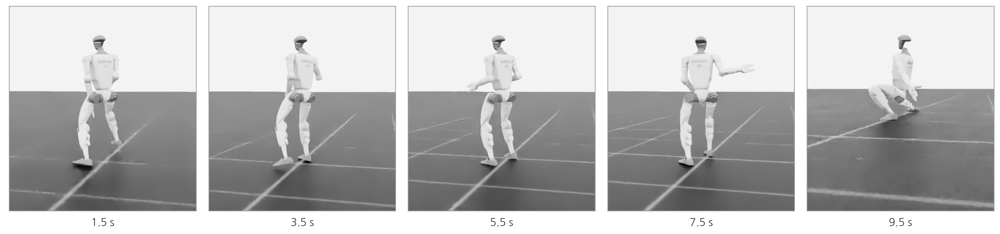
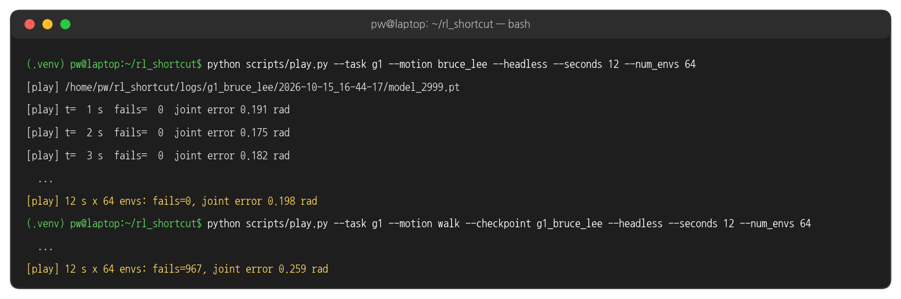
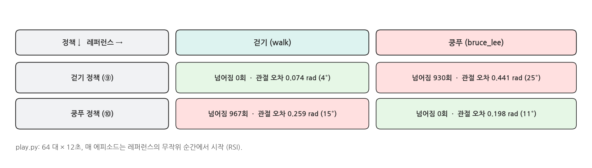
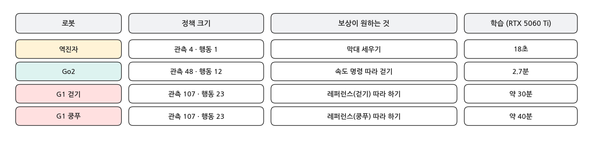

## 1. 오늘의 마지막 실험

### 네 단계

{width=1000}

- 질문: ⑨ 페이지에서 걷기를 익힌 G1 에게 이소룡의 쿵푸 동작을 보여 주면, 따라 할 수 있을까?
- 환경 코드는 그대로입니다. `--motion` 으로 레퍼런스만 바꾸고, `--checkpoint` 로 어느 정책을 쓸지 고릅니다.

### 레퍼런스: 이소룡 쿵푸

```bash
python scripts/g1_motion.py --motion bruce_lee
```

{width=1000}

- 낮게 앉는 자세(골반 0.31 m), 몸통 회전, 발차기가 들어 있습니다. 걷기(골반 0.75 ~ 0.84 m, 앞으로 이동)와는 전혀 다른 동작입니다.

## 2. 걷기 정책에게 쿵푸를 시키면

### 실행

```bash
python scripts/play.py --task g1 --motion bruce_lee --checkpoint g1_walk
```

- `--motion bruce_lee` : 관측의 레퍼런스 30개가 쿵푸 동작으로 바뀝니다.
- `--checkpoint g1_walk` : 정책은 ⑨ 페이지의 걷기 정책입니다 (`logs/g1_walk/` 의 최신, 없으면 `checkpoints/g1_walk.pt`).

### 실행 결과

{width=1000}

{width=1000}

- 시작은 쿵푸 레퍼런스의 자세(RSI)로 놓이지만, 1초도 안 되어 균형을 잃고 넘어집니다. 64 대가 12초 동안 **930 번** 넘어졌습니다. 한 번 시작해서 넘어지기까지 평균 약 0.8초입니다.
- 관절 오차는 0.44 rad(25°)로, 걷기 레퍼런스를 따라갈 때(0.074 rad)의 6배입니다.
- 관측에는 쿵푸 자세가 들어가지만, 정책은 그런 목표를 받아 본 적이 없습니다. 걷기 정책이 아는 것은 **걷기 레퍼런스를 받았을 때 넘어지지 않고 따라가는 법**뿐입니다.

## 3. 쿵푸 학습

### 실행

```bash
python scripts/train.py --task g1 --motion bruce_lee --headless
```

- 코드는 한 줄도 바꾸지 않습니다. 같은 보상 · 같은 관측 · 같은 PPO 설정에, 레퍼런스만 쿵푸입니다.
- 3000 iteration, 이 PC 에서 **BRUCE_MIN분** 걸렸습니다. 걷기(2000 it)보다 동작이 길고 다양해서 더 오래 학습합니다.
- 수업에서는 학습을 시작해 두고 처음 몇 분 동안 로그가 어떻게 변하는지 본 뒤, `checkpoints/g1_bruce_lee.pt` 로 다음 절을 진행합니다.

### 실행 결과: 마지막 iteration

{width=1000}

### 학습 곡선

{width=1000}

## 4. 쿵푸 정책으로 추론

### 실행

```bash
python scripts/play.py --task g1 --motion bruce_lee
```

### 실행 결과

{width=1000}

{width=1000}

### 네 경우 비교

{width=1000}

COMPARE_TEXT

## 5. 정리

### 오늘 한 것

{width=1000}

- 강화학습 환경은 언제나 같은 다섯 부분(행동 · 관측 · 이벤트 · 보상 · 종료)이고, 로봇이 바뀌어도 학습 코드(`train.py` · `play.py`)는 그대로였습니다.
- GPU 물리로 로봇 수천 대를 동시에 돌리면, 실제 시간으로 며칠 걸릴 연습을 몇 분 ~ 수십 분에 끝냅니다.
- 정책은 **연습한 것만 잘합니다**. 앞 과정에서 "시연이 다양해야 처음 보는 큐브 자리에서도 성공한다"를 확인했듯이, 강화학습도 연습한 동작 · 상황의 범위가 곧 정책의 능력입니다.

### 더 해 볼 것

- `tools/convert_motion.py` 로 `openhe/g1-retargeted-motions` 의 다른 동작(춤 · 달리기 등)을 `.npz` 로 바꿔 `--motion` 으로 학습해 봅니다.
- Go2 에 거친 지형(Isaac Lab 의 `TerrainGeneratorCfg`)을 넣고, 높이 지도 관측을 추가해 계단을 오르게 해 봅니다.
- Isaac Lab 의 다른 예제: `python IsaacLab/scripts/reinforcement_learning/rsl_rl/train.py --task Isaac-Velocity-Rough-Unitree-Go2-v0 --headless`
