## 1. 무엇을 하나

### 과제: 핑크시티의 순환 도로 돌기

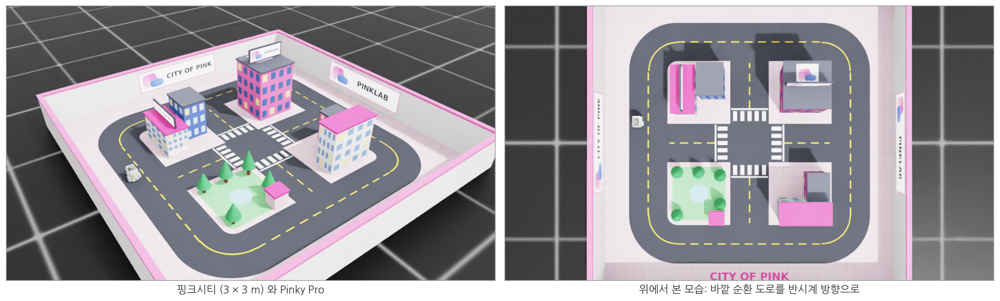{width=1000}

- **핑크시티(City of Pink)** = Pinky Pro 크기에 맞춘 3 × 3 m 의 작은 도시 · 도로 폭 0.4 m (한 차로 0.2 m)
- 과제: 가장 바깥의 순환 도로를 오른쪽 차로로 계속 돌기 (반시계 방향)
- 로봇이 쓸 수 있는 것 = **앞 카메라 영상 하나** · 위치(GPS) · 지도 · 라이다는 쓰지 않음

### 전체 구조

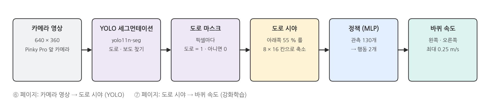{width=1000}

- 카메라 영상을 정책에 그대로 넣지 않음 → YOLO 가 먼저 "어디가 도로인지" 찾음
- 정책은 그 결과를 줄인 **도로 시야 8 × 16** 만 보고 바퀴 속도를 결정
- 이 페이지 = 앞 절반(인식) · ⑦ 페이지 = 뒤 절반(강화학습)

## 2. 로봇과 도시

### Pinky Pro

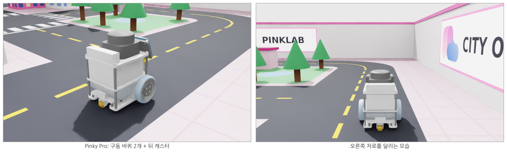{width=1000}

- 폭 약 12 cm 의 작은 주행 로봇 · 구동 바퀴 2개(반지름 2.8 cm) + 뒤 캐스터
- 좌우 바퀴 속도의 차이로 방향을 바꿈 (차동 구동)
- 저장소의 `assets/pinky_pro/` (로봇 USD) · `assets/pink_city/` (도시 USD · 바닥 그림)를 그대로 사용

### 로봇 카메라로 본 도시

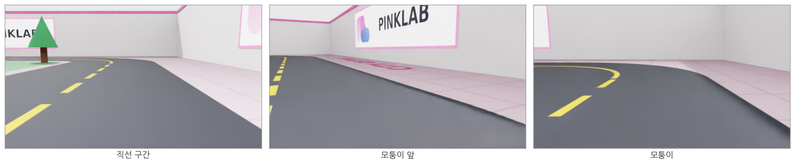{width=1000}

- 카메라: 바닥에서 6.3 cm 높이 · 아래로 8° · 가로 화각 66° (실물 Pinky Pro 와 같은 값)
- 화면의 아래쪽 절반 이상이 바닥 = 약 12 cm 앞부터 60 cm 앞까지의 도로
- 도로 · 차선 · 보도는 바닥에 입힌 그림 한 장 · 벽 · 건물 · 나무만 부딪히는 물체

## 3. 학습 데이터 모으기

### 정답을 자동으로 만드는 방법

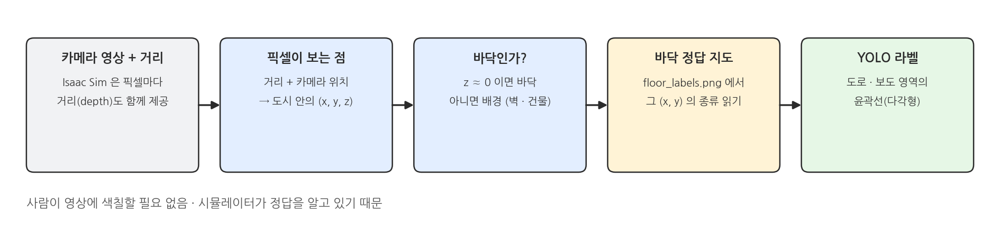{width=1000}

- 세그먼테이션 학습에는 영상마다 "어디가 도로인지" 칠한 정답이 필요
- 시뮬레이터는 픽셀마다의 거리도 함께 줌 → 그 픽셀이 바닥의 어느 점인지 계산 가능
- 바닥 그림과 같은 모양의 정답 지도(`floor_labels.png`)에서 그 점의 종류를 읽음

### 터미널: 400장 모으기

```bash
cd ~/rl_shortcut
source scripts/env.sh
python scripts/pinky_dataset.py --headless --enable_cameras
```

- 도시 16개를 나란히 만들어 한 번에 16장씩 촬영 · 400장 · 프로그램 시작부터 끝까지 약 15초
- 로봇을 도로 위 아무 곳에 순간 이동 · 방향도 여러 가지 · 해의 방향과 밝기도 매번 변경
- `--enable_cameras` = 창 없이(`--headless`) 카메라 영상을 그리게 하는 옵션

### 실행 결과: 터미널

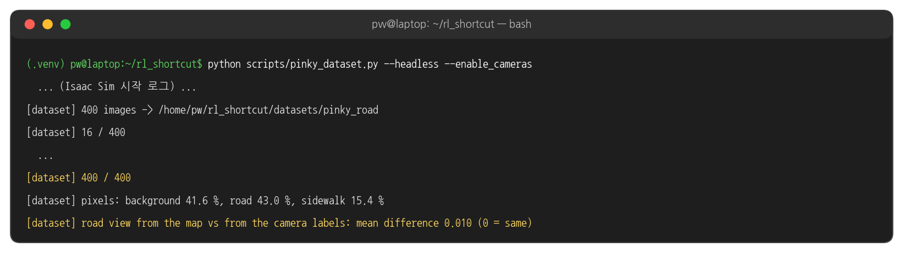{width=1000}

- 픽셀의 43 % 가 도로 · 15 % 가 보도 · 나머지(벽 · 건물 · 하늘)는 배경
- 마지막 줄 = ⑦ 페이지에서 쓸 확인값 (도로 시야를 두 방법으로 만든 것의 차이, 0 이면 같음)

### 실행 결과: 모은 데이터

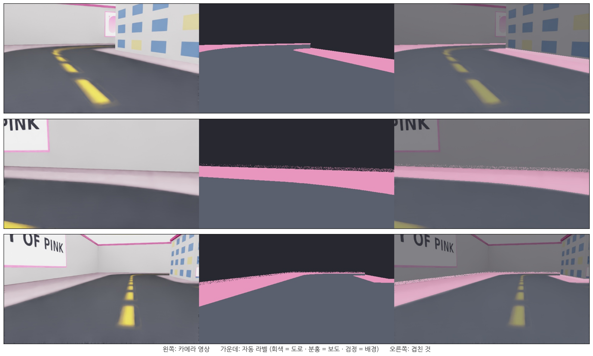{width=1000}

- `datasets/pinky_road/preview/` 에서 확인 · 학습용 360장 · 검증용 40장
- 종류 2개: **도로**(아스팔트 · 중앙선 · 횡단보도) · **보도**(공원 포함)

### 라벨 파일의 모양

```text
# datasets/pinky_road/labels/train/00000.txt  (앞부분)
0 0.99844 0.63611 0.48594 0.43056 0.48125 0.42500 0.48750 0.41667 0.49531 0.41389 ...
1 0.48281 0.42500 0.99844 0.63333 0.99844 0.51111 0.57969 0.40556 0.57031 0.40556 ...
```

- 한 줄 = 영역 하나 · 첫 숫자 = 종류(0 도로 · 1 보도)
- 그 뒤 = 영역 윤곽선의 꼭짓점 (x, y) · 영상 크기로 나눈 0 ~ 1 값 (YOLO 세그먼테이션 형식)

## 4. YOLO 세그먼테이션 학습

### 터미널: 학습 실행

```bash
cd ~/rl_shortcut
source scripts/env.sh
python scripts/pinky_yolo.py
```

- 이미 학습된 `yolo11n-seg.pt` (처음 실행할 때 자동으로 받음)에서 시작해 우리 데이터로 40 epoch 추가 학습
- 이 PC(RTX 5060 Ti)에서 약 70초 · Isaac Sim 은 켜지 않음
- 결과: `logs/pinky_yolo/<날짜_시각>/weights/best.pt`

### 실행 결과: 터미널

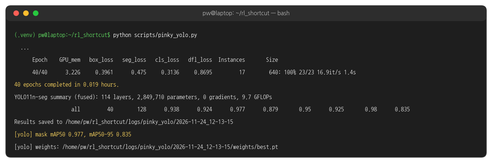{width=1000}

- `mask mAP50` 0.977 = 찾은 영역이 정답과 절반 이상 겹치면 맞은 것으로 볼 때의 정확도
- 파라미터 285만 개의 작은 모델 → 로봇 위의 컴퓨터에서도 실행 가능한 크기

### 학습 곡선

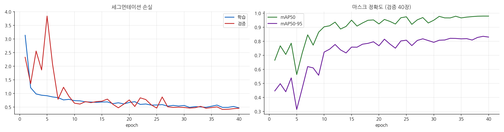{width=1000}

- 처음 몇 epoch 는 검증 손실이 출렁임 → 10 epoch 뒤 안정
- 20 epoch 쯤 mAP50 0.95 도달 · 그 뒤로는 조금씩 상승

### 터미널: 학습한 모델 확인

```bash
cd ~/rl_shortcut
source scripts/env.sh
python scripts/pinky_yolo.py --check
```

### 실행 결과: 터미널

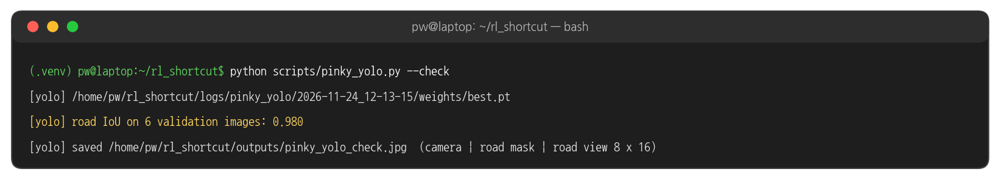{width=1000}

- `road IoU` 0.980 = YOLO 가 찾은 도로와 정답 도로가 겹치는 비율 (검증 영상 6장 평균)

### 실행 결과: 저장된 그림

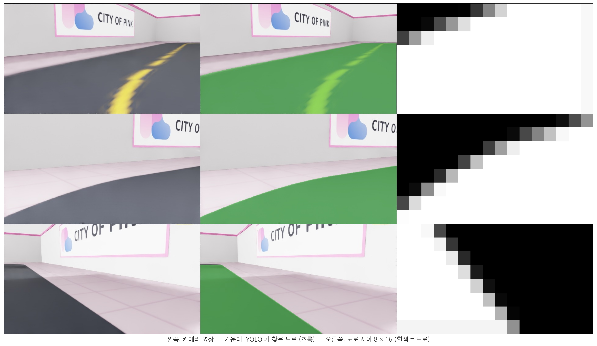{width=1000}

- `outputs/pinky_yolo_check.jpg` · 학습에 쓰지 않은 검증 영상
- 중앙선(노란 점선)도 도로로 인식 · 벽과 보도는 제외

## 5. 도로 시야: 정책이 보는 것

### 마스크를 8 × 16 칸으로

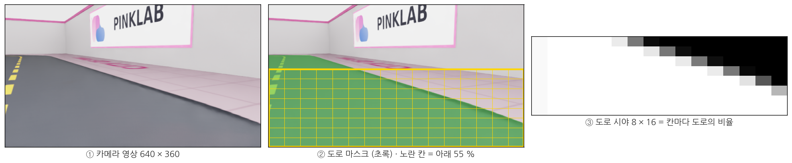{width=1000}

- 영상의 아래 55 % (바닥이 보이는 부분)만 사용
- 가로 16 · 세로 8 칸으로 나누고 칸마다 도로인 픽셀의 비율(0 ~ 1) 계산 = 숫자 128개
- 색 · 밝기 · 그림자는 사라지고 "도로의 모양"만 남음 → 정책이 배우기 쉬운 관측

### 도로 시야 (코드) - road_seg.py 발췌

```python
# rl_shortcut/road_seg.py  (발췌)
def mask_to_view(mask):
    """Road mask (N, H, W) of the whole image -> road view (N, ROWS * COLS): the lower part, averaged into cells."""
    top = round(pink_city.VIEW_TOP * mask.shape[1])
    lower = mask[:, top:].float().unsqueeze(1)
    return F.adaptive_avg_pool2d(lower, (pink_city.VIEW_ROWS, pink_city.VIEW_COLS)).flatten(1)
```

- `VIEW_TOP` 0.45 = 위에서 45 % 지점부터 아래를 사용
- `adaptive_avg_pool2d` = 칸마다 평균 → 도로의 비율

### YOLO 결과에서 도로만 (코드) - road_seg.py 발췌

```python
# rl_shortcut/road_seg.py  (발췌)
results = self.model.predict(x, conf=self.conf, verbose=False)
out = torch.zeros(n, h + pad, w, dtype=torch.bool, device=rgb.device)
for i, r in enumerate(results):
    if r.masks is not None:
        road = r.masks.data[r.boxes.cls == 0]     # every road instance, merged
        if len(road):
            out[i] = F.interpolate(road[None].float(), size=out.shape[1:]).amax(dim=1)[0] > 0.5
```

- YOLO 는 영역마다 마스크 하나씩을 냄 → 종류가 도로(0)인 것을 모두 합쳐 한 장으로
- 영상 여러 장(로봇 여러 대)을 한 번에 처리

## 6. 학습을 못 했다면

- 이 페이지의 학습 결과 `pinky_road_seg.pt` = 이 페이지 아래 댓글의 첨부 파일 (저장소에는 없음)
- 받아서 `~/rl_shortcut/checkpoints/pinky_road_seg.pt` 로 저장
- `logs/pinky_yolo/` 가 없으면 자동으로 이 파일 사용

## 7. 해 볼 것

- `--count 100` 으로 적게 모아 학습 → `--check` 의 road IoU 비교
- `python scripts/pinky_yolo.py --epochs 10` 으로 짧게 학습했을 때의 마스크 확인
