## 1. 학습은 카메라 없이

### 같은 관측을 만드는 두 가지 길

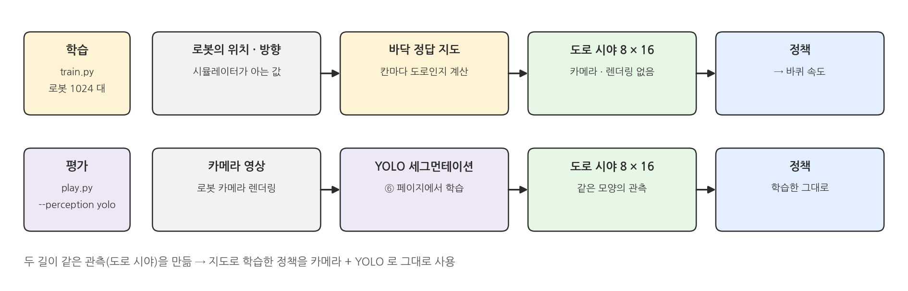{width=1000}

- 강화학습에는 수백만 스텝의 경험이 필요 → 매 스텝 카메라를 그리고 YOLO 를 돌리면 너무 느림
- 학습 때: 로봇의 위치 · 방향과 바닥 정답 지도로 **카메라가 보았을 도로 시야**를 바로 계산
- 평가 때: 실제로 카메라를 그리고 YOLO 로 도로 시야를 만듦 → 정책에게는 같은 모양의 숫자 128개

### 두 길이 정말 같은가

- ⑥ 페이지 `pinky_dataset.py` 의 마지막 줄: 지도에서 계산한 도로 시야 vs 카메라 라벨로 만든 도로 시야
- 400장 평균 차이 0.010 (칸 값의 범위 0 ~ 1) = 거의 같음
- 남는 차이 = 건물에 가려진 곳 · YOLO 의 오차 → 학습 때 도로 시야에 잡음을 섞어 대비 (아래 관측 코드의 `flip`)

### 환경의 다섯 부분

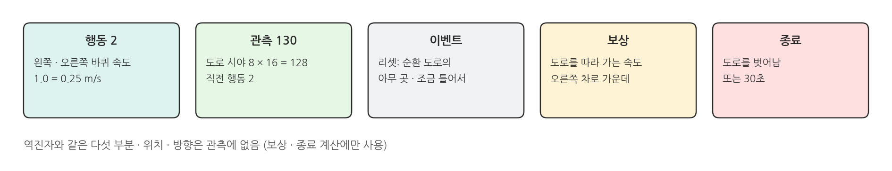{width=1000}

## 2. 코드: rl_shortcut/pinky_env.py

### 행동 (코드) - ActionsCfg

```python
# rl_shortcut/pinky_env.py  (발췌)
@configclass
class ActionsCfg:
    # two numbers per robot: left and right wheel speed, action 1.0 = 0.25 m/s
    wheels = mdp.JointVelocityActionCfg(asset_name="robot", joint_names=WHEELS, scale=MAX_WHEEL,
                                        clip={".*": (-MAX_WHEEL, MAX_WHEEL)})
```

- 정책의 출력 = 숫자 2개 = 왼쪽 · 오른쪽 바퀴의 목표 속도
- 두 값이 같으면 직진 · 다르면 회전
- `clip` = 바퀴 속도를 ±0.25 m/s 로 제한

### 관측 (코드) - ObservationsCfg 발췌

```python
# rl_shortcut/pinky_env.py  (발췌)
class PolicyCfg(ObsGroup):
    road = ObsTerm(func=road_view, params={"flip": 0.03})     # 8 x 16 road view (128)
    actions = ObsTerm(func=mdp.last_action)                   # last wheel speeds (2)
```

- 관측 130개 = 도로 시야 128 + 직전 행동 2
- 로봇의 위치 · 방향 · 속도는 관측에 없음

### 도로 시야 계산 (코드) - road_view 함수

```python
# rl_shortcut/pinky_env.py  (발췌)
def road_view(env, flip=0.0):
    """Road mask of the lower camera image as 8 x 16 cells. flip: share of cells replaced by noise (training only)."""
    if env.cfg.perception == "yolo":
        from rl_shortcut.road_seg import yolo_view
        return yolo_view(env)
    xy, yaw = city_pose(env)
    view = road_map(env).view(xy, yaw)
    if flip > 0.0 and env.cfg.observations.policy.enable_corruption:
        noisy = torch.rand_like(view) < flip
        view = torch.where(noisy, torch.rand_like(view), view)
    return view
```

- `--perception yolo` 이면 카메라 + YOLO (⑥ 페이지) · 아니면 지도에서 계산
- `flip` 0.03 = 학습 때 칸의 3 % 를 아무 값으로 바꿈 → YOLO 가 몇 칸 틀려도 흔들리지 않는 정책
- `play.py` 에서는 이 잡음을 끔

### 이벤트: 리셋 (코드) - reset_on_ring 앞부분

```python
# rl_shortcut/pinky_env.py  (발췌)
def reset_on_ring(env, env_ids, lane_noise=0.04, yaw_noise=0.4):
    """Start anywhere on the ring road, a little off the lane centre and a little turned."""
    robot, n = env.scene["robot"], len(env_ids)
    angle = torch.rand(n, device=env.device) * 2 * math.pi
    offset = pink_city.LANE + (torch.rand(n, device=env.device) * 2 - 1) * lane_noise
    xy, heading = pink_city.ring_point(angle, offset)
    yaw = heading + (torch.rand(n, device=env.device) * 2 - 1) * yaw_noise
```

- 순환 도로의 아무 곳에서 시작 → 직선 · 모퉁이 · 삼거리 앞을 고르게 연습
- 차로 가운데에서 ±4 cm · 방향 ±23° 틀어서 시작 → 벗어나려는 상황에서 돌아오는 법도 연습

## 3. 보상 설계

### 기준이 되는 길

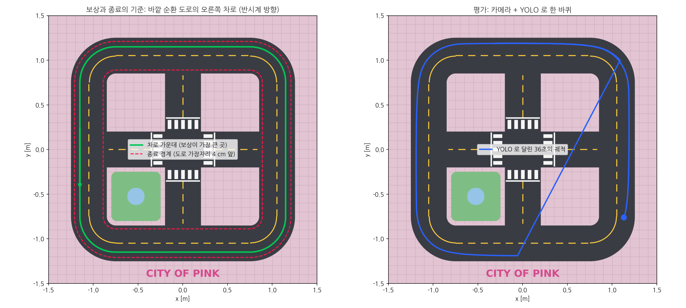{width=1000}

- 초록 선 = 오른쪽 차로의 가운데 (도로 중심선에서 바깥으로 10 cm)
- 빨간 점선을 넘으면 종료 = 로봇 중심이 도로 가장자리 4 cm 앞까지 감
- 오른쪽 그림 = 4절의 평가에서 로봇이 실제로 달린 길

### 보상 항목

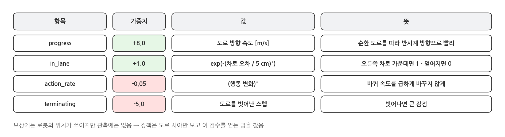{width=1000}

### 보상 (코드) - RewardsCfg

```python
# rl_shortcut/pinky_env.py  (발췌)
@configclass
class RewardsCfg:
    progress = RewTerm(func=progress, weight=8.0)                 # go around, anticlockwise
    in_lane = RewTerm(func=in_lane, weight=1.0)                   # in the middle of the right lane
    action_rate = RewTerm(func=mdp.action_rate_l2, weight=-0.05)  # no jerky steering
    terminating = RewTerm(func=mdp.is_terminated, weight=-5.0)
```

- `progress` 만 있으면: 도로 안에서 가장 짧은 길(안쪽)로 붙어 달림
- `in_lane` 이 오른쪽 차로 가운데로 끌어당김

### 진행 속도와 차로 오차 (코드) - pinky_env.py 발췌

```python
# rl_shortcut/pinky_env.py  (발췌)
def lane_error(env):
    """Distance [m] from the middle of the right lane (+ = towards the outside)."""
    xy, _ = city_pose(env)
    return pink_city.ring_distance(xy)[0] - pink_city.LANE


def progress(env):
    """Speed [m/s] along the ring road (anticlockwise)."""
    xy, _ = city_pose(env)
    return (env.scene["robot"].data.root_lin_vel_w[:, :2] * pink_city.ring_distance(xy)[1]).sum(dim=1)
```

- `ring_distance` = 순환 도로 중심선까지의 거리와 그 자리의 도로 방향
- `progress` = 로봇 속도 중 도로 방향 성분 → 거꾸로 가면 음수 · 옆으로 미끄러지면 0

### 종료 (코드) - off_road 함수

```python
# rl_shortcut/pinky_env.py  (발췌)
def off_road(env, margin=0.04):
    """The robot centre is closer than `margin` to the edge of the ring road, or beyond it."""
    xy, _ = city_pose(env)
    return pink_city.ring_distance(xy)[0].abs() > pink_city.ROAD / 2 - margin
```

- 도로 폭 0.4 m 의 절반(0.2 m)에서 4 cm 를 뺀 16 cm 보다 중심선에서 멀어지면 종료
- 그 밖에는 30초를 다 채움

## 4. 학습

### 터미널: 학습 실행

```bash
cd ~/rl_shortcut
source scripts/env.sh
python scripts/train.py --task pinky --headless
```

- 1024 대 · 300 iteration · 이 PC(RTX 5060 Ti)에서 **2.9분** (iteration 당 0.59초)
- 한 iteration = 1024 대 × 32 스텝 = 약 3만 스텝 · 300 iteration = 약 980만 스텝 = 로봇 한 대가 **약 5.7일** 달릴 분량
- 카메라를 그리지 않으므로 초당 약 5만 6천 스텝

### 실행 결과: 마지막 iteration

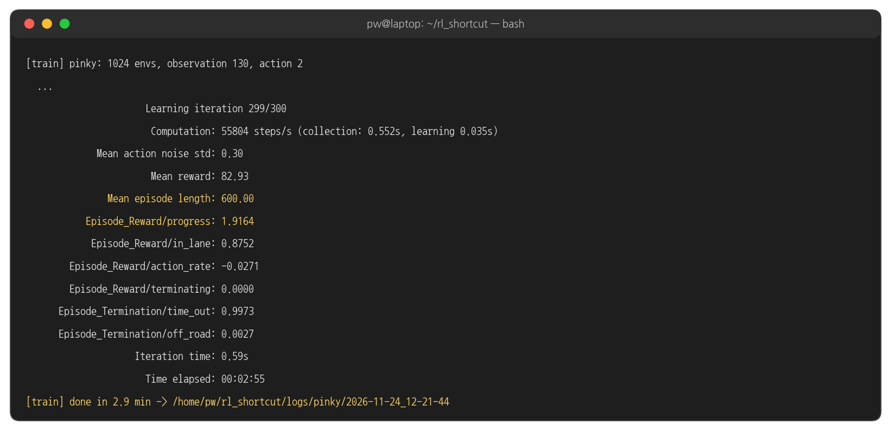{width=1000}

- `Episode_Reward/progress` 1.92 = 가중치 8 × 평균 속도 0.24 m/s (최고 속도 0.25 m/s 의 96 %)
- `Episode_Reward/in_lane` 0.88 = 대부분의 시간 동안 차로 가운데 근처
- `Episode_Termination/off_road` 0.003 = 끝난 에피소드 중 도로를 벗어난 것은 0.3 %

### 학습 장면

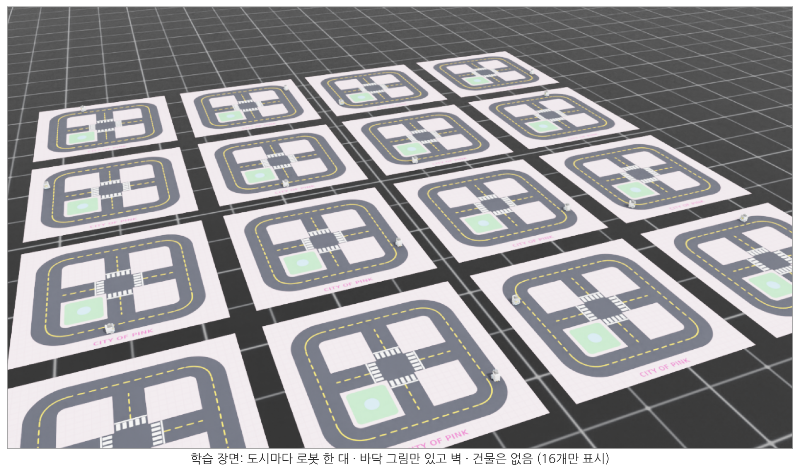{width=1000}

- `--headless` 를 빼면 볼 수 있는 모습 · 학습 때는 바닥 그림만 있고 벽 · 건물은 없음 (부딪힐 것이 없어 빠름)

### 학습 곡선

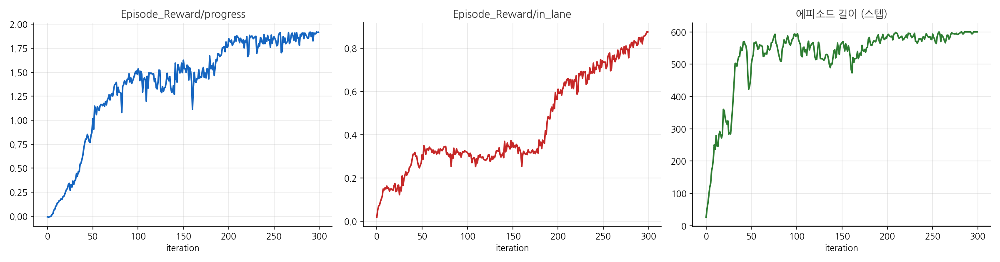{width=1000}

- 50 iteration 쯤: 에피소드가 30초(600 스텝)를 거의 채움 = 도로를 벗어나지 않는 법을 먼저 익힘
- 50 ~ 180 iteration: 속도는 오르지만 `in_lane` 은 0.3 에 머묾 = 도로 가운데(중앙선 위)로 달림
- 180 iteration 이후: `in_lane` 이 0.88 까지 상승 = 오른쪽 차로를 찾음

## 5. 평가

### 터미널: 지도에서 계산한 도로 시야로

```bash
cd ~/rl_shortcut
source scripts/env.sh
python scripts/play.py --task pinky
```

- 학습 때와 같은 방법(지도)으로 도로 시야를 만들어 16대 실행 · 창을 닫으면 종료

### 실행 결과: 터미널

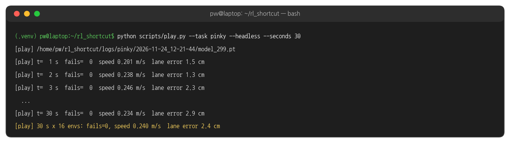{width=1000}

- `fails` = 도로를 벗어난 횟수 · `speed` = 도로 방향 속도 · `lane error` = 차로 가운데에서 벗어난 거리
- 16대가 30초 동안 한 번도 벗어나지 않음 · 평균 0.240 m/s · 차로 오차 2.4 cm

### 터미널: 카메라 + YOLO 로

```bash
cd ~/rl_shortcut
source scripts/env.sh
python scripts/play.py --task pinky --num_envs 1 --perception yolo --enable_cameras
```

- 벽 · 건물이 있는 도시 전체를 불러오고 로봇 카메라를 그림 → YOLO → 도로 시야 → 정책
- 정책(`logs/pinky/` 또는 `checkpoints/pinky.pt`)은 그대로 · 바뀐 것은 도로 시야를 만드는 방법뿐
- 영상으로 저장: `--headless --seconds 38 --video outputs/pinky_yolo.mp4` 추가

### 실행 결과: 화면

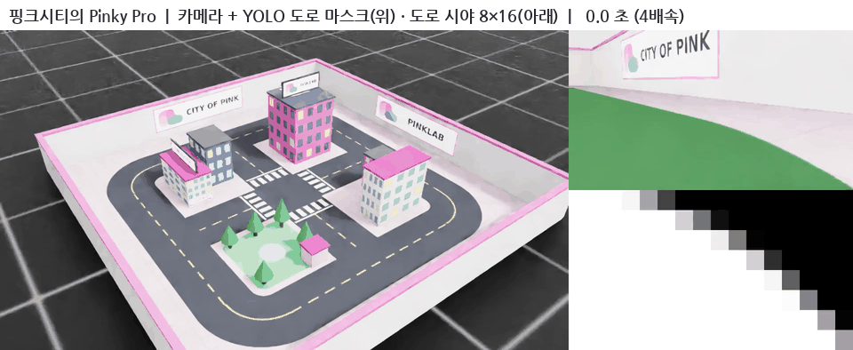{width=1000}

### 실행 결과: 장면들

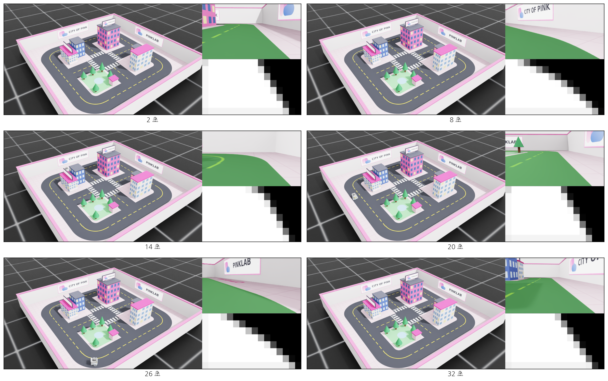{width=1000}

### 실행 결과: 터미널

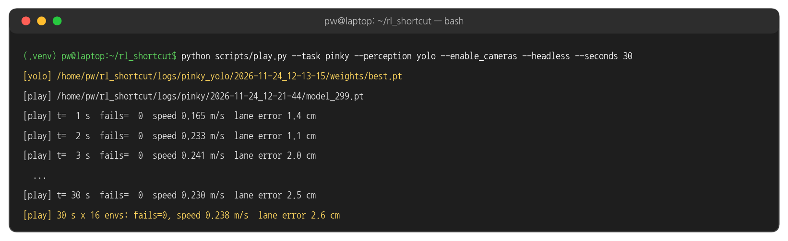{width=1000}

- 16대 · 30초: 도로 이탈 0 · 평균 0.238 m/s · 차로 오차 2.6 cm
- 지도로 만든 도로 시야(0.240 m/s · 2.4 cm)와 거의 같은 성능
- 학습 때 한 번도 보지 않은 카메라 영상으로 달렸지만 정책에게는 같은 관측

### 학습을 짧게 하면

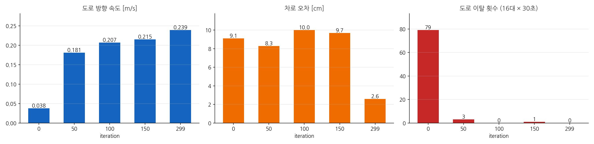{width=1000}

- iteration 0 (학습 전): 30초 동안 79번 도로 이탈
- 50 ~ 150: 벗어나지는 않지만 차로 오차 약 10 cm = 중앙선 위로 달림
- 299: 차로 오차 2.6 cm = 오른쪽 차로 유지

## 6. 학습을 못 했다면

- 저장소의 `checkpoints/pinky.pt` = 이 페이지의 학습 결과
- `logs/pinky/` 가 없으면 `play.py` 가 자동으로 이 파일 사용

## 7. 해 볼 것

- `RewardsCfg` 의 `in_lane` 가중치를 0 으로 바꿔 학습 → 로봇이 도로의 어디로 달리는지 `play.py` 로 확인
- `ObservationsCfg` 의 `flip` 을 0.0 으로 바꿔 학습 → `--perception yolo` 평가의 차로 오차 비교
- `pink_city.py` 의 `LANE` 을 -0.10 으로 바꾸면 안쪽 차로 · 삼거리 입구가 있는 쪽이라 더 어려운지 확인
